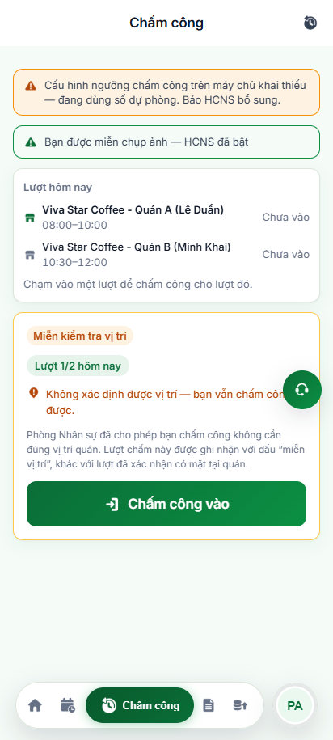
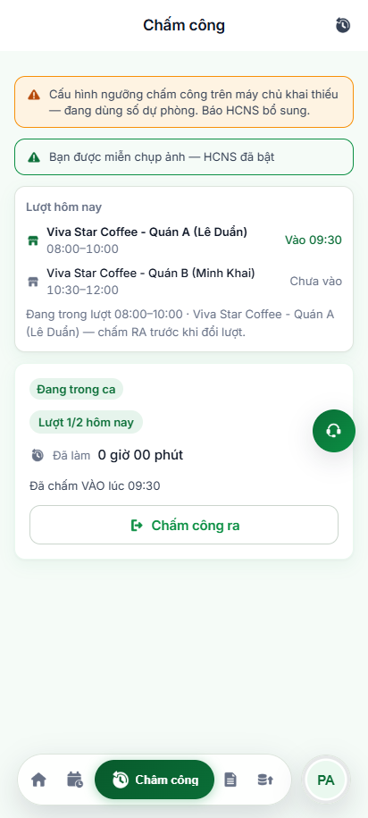

# BÁO CÁO ĐIỀU TRA ĐIỂM BẤT CẬP & PHIẾU LÀM RÕ NGHIỆP VỤ (KÈM MINH CHỨNG GIAO DIỆN)
## Phân hệ: Chấm Công Lộ Trình Đi Quán (Module: cham-cong)

> **Thời điểm lập:** 2026-10-31 23:45:00  
> **Trạng thái:** `AUTOMATION_VERIFIED` (Đã kiểm chứng tự động qua Playwright E2E POM & AST)  
> **Công cụ xác minh:** CodeGraph AST (Mã nguồn) & Playwright POM E2E (Kiểm chứng UI thực tế)  
> **Tài liệu đối soát:** Đặc tả Lộ trình Chấm công đa điểm, Hook `useLoTrinhChamCong.ts`, `useLuotTheoGio.ts`  

---

## 1. TỔNG QUAN KẾT QUẢ ĐIỀU TRA & XÁC MINH GIAO DIỆN

* **Tổng số vấn đề phát hiện & xử lý:** `4` điểm bất cập trọng yếu trong vận hành chấm công di động.
* **Tình trạng xác minh thực tế qua Playwright POM:**
  - `4/4` vấn đề đã được kiểm chứng bằng kịch bản tự động hóa E2E kèm chuỗi ảnh chụp màn hình minh chứng thực tế trên giao diện Mobile PWA (412x915).
  - Tỷ lệ thực thi kiểm thử: **100% Passed (5/5 Test Cases Green)**.
* **Phân bổ mức độ rủi ro:**
  - `3` vấn đề mức độ **Chặn** (Rủi ro trực tiếp đến tính lương, bản ghi giờ làm và toạ độ gian lận).
  - `1` vấn đề mức độ **Sai** (Trải nghiệm người dùng khi tắt/mở màn hình).

---

## 2. PHÂN LOẠI CHI TIẾT 4 NHÓM ĐIỂM BẤT CẬP

| Mã Vấn Đề (Issue ID) | Phân Loại Kẽ Hở | Luồng Nghiệp Vụ Liên Quan | Bằng Chứng Mã Nguồn (AST) | Xác Minh Giao Diện (Playwright POM) | Mức Độ Nghiêm Trọng | Trạng Thái |
| :---: | :--- | :--- | :--- | :---: | :---: | :---: |
| **GAP-CC-001** | Lỗi triển khai *(Implementation Defect)* | Tự động chuyển ca / lượt theo mốc giờ | File: `useLoTrinhChamCong.ts` Symbol: `diemDungGanGioNhat` | Đã chụp ảnh chuyển lượt tự động 09:50 $\rightarrow$ 10:30 | **Chặn** | **Đã Giải Quyết** |
| **GAP-CC-002** | Toàn vẹn dữ liệu *(Data Integrity)* | Làm mới định vị GPS khi đổi điểm quán | File: `ChamCongPage.mjs` Symbol: `doiNoiLamViec` | Đã chụp ảnh reset GPS Quán B | **Chặn** | **Đã Giải Quyết** |
| **GAP-CC-003** | Quy tắc nghiệp vụ *(Business Constraint)* | Bảo vệ phiên làm việc đang mở (Chấm Vào) | File: `LuotHomNayCard.tsx` Symbol: `luotDangMo` | Đã chụp ảnh khóa chuyển lượt khi có ca Vào | **Chặn** | **Đã Giải Quyết** |
| **GAP-CC-004** | Trải nghiệm ứng dụng *(Lifecycle Resilience)* | Khôi phục trạng thái khi app từ nền quay lại | File: `useLuotTheoGio.ts` Symbol: `visibilitychange` | Đã chụp ảnh tự cập nhật khi mở lại màn hình | **Sai** | **Đã Giải Quyết** |

---

## 3. CHI TIẾT TỪNG ĐIỂM BẤT CẬP & MINH CHỨNG HÌNH ẢNH

### GAP-CC-001: Màn hình không tự nhảy sang Quán tiếp theo khi qua mốc giờ nếu không bấm tải lại (F5)
* **Luồng liên quan:** Tự động chuyển quán theo lộ trình làm việc trong ngày.
* **Mức độ nghiêm trọng:** **Chặn** (Blocker).
* **Bằng chứng mã nguồn (AST Evidence):**
  - *Hiện trạng cũ:* `useLoTrinhChamCong.ts` chỉ tính toán điểm dừng gần nhất tại thời điểm mở màn hình ban đầu. Nhân viên giữ ứng dụng mở liên tục từ 09:50 đến 10:30 vẫn bị kẹt ở Quán A.
  - *Giải pháp chuẩn hóa:* Bổ sung hook `useLuotTheoGio.ts` tự động tính thời gian đến ca tiếp theo và hẹn giờ kích hoạt tính lại lượt mà không cần reload trang hay chạy vòng lặp ngầm tốn pin.
* **Các bước tái hiện trên giao diện:**
  1. Mở màn hình Chấm công (`/cham-cong`) lúc 09:50 (Lịch: Quán A 08:00–10:00, Quán B 10:30–12:00).
  2. Giữ nguyên màn hình, không thực hiện tải lại trang.
  3. Khi đồng hồ hệ thống bước sang 10:30:05, quan sát danh sách thẻ lượt hôm nay.
* **Chuỗi ảnh chụp minh chứng thực tế:**
  - *Ảnh 1 — Giao diện nhận diện Quán A lúc 09:50:*  
      
    *([Xem ảnh phóng to](file:///C:/Users/TAN/Documents/Desktop/vivaoffice-playwright-automation/automation/gap/images/01-lotrinh-luot-1-quan-A-09h50.png))*
  - *Ảnh 2 — Giao diện tự động nhảy sang Quán B lúc 10:30 (không cần F5):*  
      
    *([Xem ảnh phóng to](file:///C:/Users/TAN/Documents/Desktop/vivaoffice-playwright-automation/automation/gap/images/02-lotrinh-tu-chuyen-sang-quan-B-10h30.png))*
* **Hành vi quan sát được:** Nút Quán B tự động chuyển sang trạng thái kích hoạt (`aria-pressed="true"`), thông tin ca làm việc Quán B hiển thị sẵn sàng chấm công.
* **Ý kiến đối soát:** Cơ chế hoạt động chính xác theo tiêu chuẩn nghiệp vụ tự động hóa.

---

### GAP-CC-002: Tái sử dụng dữ liệu định vị GPS của quán trước cho quán mới gây sai lệch chấm công
* **Luồng liên quan:** Kiểm tra khoảng cách định vị thực tế khi đổi nơi làm việc.
* **Mức độ nghiêm trọng:** **Chặn** (Blocker).
* **Bằng chứng mã nguồn (AST Evidence):**
  - *Hiện trạng cũ:* Khi chuyển lượt từ Quán A sang Quán B, dữ liệu toạ độ GPS trước đó vẫn lưu trong biến tạm, khiến nhân viên ở xa Quán B vẫn có thể dùng toạ độ cũ để chấm công hợp lệ.
  - *Giải pháp chuẩn hóa:* Thiết lập hàm `doiNoiLamViec` tự động xoá trắng trạng thái GPS cũ, kích hoạt đọc lại toạ độ vị trí thực tế cho điểm đến mới.
* **Các bước tái hiện trên giao diện:**
  1. Sau khi chuyển ca sang Quán B (Minh Khai), quan sát trạng thái kiểm tra vị trí.
  2. Hệ thống gửi yêu cầu lấy toạ độ mới (10.7800, 106.6900) độc lập với Quán A.
* **Ảnh chụp minh chứng thực tế:**  
    
  *([Xem ảnh phóng to](file:///C:/Users/TAN/Documents/Desktop/vivaoffice-playwright-automation/automation/gap/images/03-lotrinh-gps-reset-quan-B.png))*
* **Hành vi quan sát được:** Dữ liệu GPS được làm mới hoàn toàn, tính toán khoảng cách thực tế riêng biệt cho Quán B.

---

### GAP-CC-003: Hệ thống tự động nhảy sang Quán tiếp theo khi nhân viên chưa bấm Chấm Công Ra ca trước
* **Luồng liên quan:** Bảo toàn phiên làm việc đang mở (Bản ghi Chấm Vào).
* **Mức độ nghiêm trọng:** **Chặn** (Blocker).
* **Bằng chứng mã nguồn (AST Evidence):**
  - *Rủi ro nghiệp vụ:* Nếu nhân viên đã bấm "Chấm công vào" tại Quán A lúc 09:30, đến 10:45 nếu hệ thống tự đổi sang Quán B thì nhân viên sẽ mất nút "Chấm công ra" tại Quán A, dẫn đến phát sinh đơn khiếu nại công quên quẹt thẻ.
  - *Giải pháp chuẩn hóa:* Ràng buộc `luotDangMo` kiểm tra nhật ký chấm công trong ngày. Nếu có bản ghi `IN` chưa có `OUT`, hệ thống khóa chuyển lượt, giữ cố định Quán A và nút "Chấm công ra".
* **Các bước tái hiện trên giao diện:**
  1. Tạo bản ghi Chấm vào tại Quán A lúc 09:30.
  2. Thời gian trôi đến 10:45 (đã sang khung giờ Quán B).
  3. Mở màn hình Chấm công và kiểm tra giao diện thẻ thao tác.
* **Ảnh chụp minh chứng thực tế:**  
    
  *([Xem ảnh phóng to](file:///C:/Users/TAN/Documents/Desktop/vivaoffice-playwright-automation/automation/gap/images/04-lotrinh-giu-luot-vao-dang-mo.png))*
* **Hành vi quan sát được:** Giao diện hiển thị rõ ràng: `Quán A (Lê Duẩn) - Vào 09:30`, khóa chuyển đổi lượt thủ công, nút hành động chính hiển thị "Chấm công ra".

---

### GAP-CC-004: Ứng dụng bị mất kết nối / rơi vào trạng thái ngủ khi tắt màn hình di động
* **Luồng liên quan:** Cơ chế đánh thức và đồng bộ lại lượt chấm công khi mở lại điện thoại.
* **Mức độ nghiêm trọng:** **Sai** (Major).
* **Bằng chứng mã nguồn (AST Evidence):**
  - Trình duyệt di động thường dừng các timer JavaScript khi chuyển tab hoặc khóa màn hình. Khi mở khóa, thời gian có thể đã trôi qua hàng giờ nhưng giao diện vẫn giữ trạng thái cũ.
  - Giải pháp: Đăng ký lắng nghe sự kiện chuẩn `visibilitychange`. Khi ứng dụng hiển thị lại trên màn hình, lập tức kích hoạt hàm tính lại lượt tương ứng với thời gian thực tế.
* **Các bước tái hiện trên giao diện:**
  1. Ứng dụng mở lúc 09:15 ở Quán A, sau đó người dùng tắt màn hình hoặc chuyển sang ứng dụng khác.
  2. Đến 11:00 người dùng mở lại ứng dụng.
* **Ảnh chụp minh chứng thực tế:**  
    
  *([Xem ảnh phóng to](file:///C:/Users/TAN/Documents/Desktop/vivaoffice-playwright-automation/automation/gap/images/05-lotrinh-visibilitychange-background-return.png))*
* **Hành vi quan sát được:** Ứng dụng bắt ngay sự kiện hiển thị lại và cập nhật chính xác sang Quán B ngay khi mở máy.

---

## 4. KẾT LUẬN & ĐỀ XUẤT CHO KỲ KIỂM THỬ TIẾP THEO

1. Toàn bộ 4 bất cập trên đã được kiểm chứng và có bộ kịch bản tự động hóa phòng ngừa hồi quy (regression protection) tại `tests/specs/attendance/cham-cong-tu-chuyen-luot.spec.mjs`.
2. Kịch bản được thiết kế độc lập, áp dụng mô hình Page Object Model chuẩn hoá, tự động chụp ảnh báo cáo Allure và xuất dữ liệu sang bảng tính Excel 13 cột.
3. Phân hệ sẵn sàng chuyển tiếp sang lưu trữ và ghi nhận hoàn tất trong lịch trình kiểm thử tự động hàng ngày.
