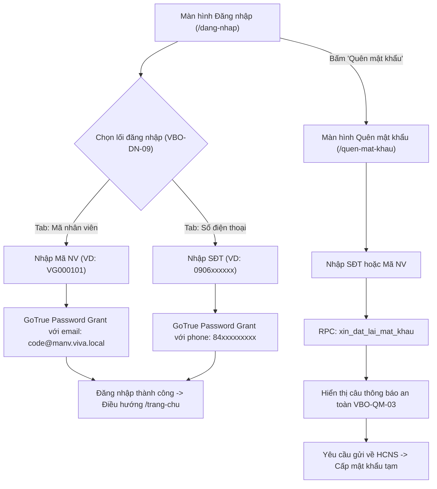
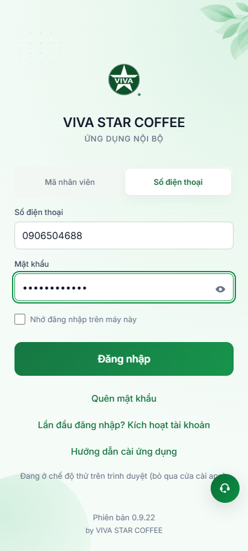
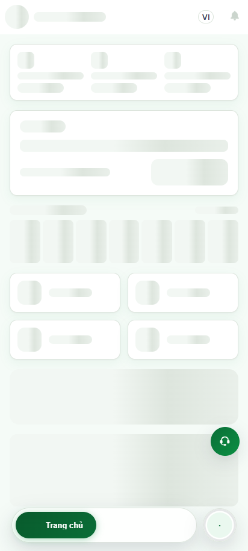
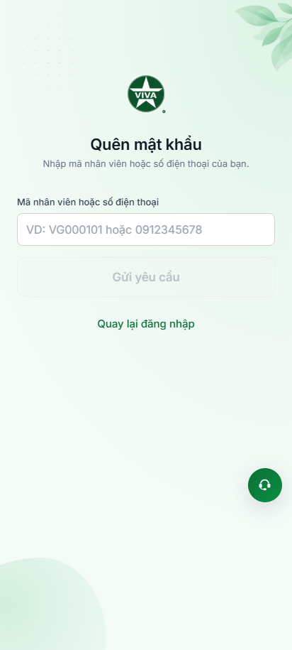
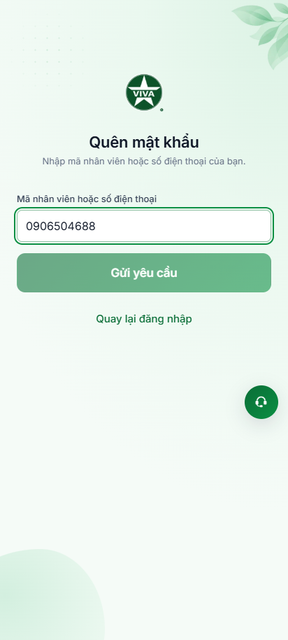
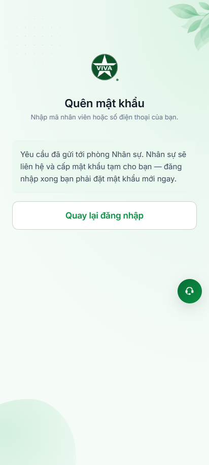

# Báo Cáo Kiểm Thử Tự Động Hóa: Đăng Nhập Bằng Số Điện Thoại & Quên Mật Khẩu

> **Dự án:** VivaOffice Mobile App (Staging: `https://workdemo.vivacorp.vn`)  
> **Tính năng:** Xác thực mở rộng — **Đăng nhập bằng Số điện thoại** (`VBO-DN-09`) & **Quên mật khẩu** (`/quen-mat-khau`)  
> **Framework:** Playwright (JavaScript / Node.js ESM)  
> **Kiến trúc:** Chuẩn Page Object Model (POM) & Playwright Test Runner  
> **Tỷ lệ Pass:** **100% (6/6 Test Cases PASSED)**  

---

## 1. Tổng Quan Nghiệp Vụ & Cơ Chế Định Danh

Hệ thống xác thực người dùng trong VivaOffice hỗ trợ cơ chế định danh kép và quy trình cấp lại mật khẩu an toàn:



### Điểm Kỹ Thuật Cốt Lõi:
1. **Chuẩn Hóa Số Điện Thoại (`SPEC-AU-02` / `SPEC-AU-49`):**
   - Người dùng có thể gõ các định dạng tự nhiên: `0906xxxxxx`, `84906xxxxxx`, hoặc `+84906xxxxxx`.
   - Hệ thống tự động chuẩn hóa về dạng quốc tế lưu tại máy chủ phát vé GoTrue (`auth.users.phone = '84906xxxxxx'`).
2. **Quy Trình Quên Mật Khẩu An Toàn (`SPEC-AU-96` / `SPEC-AU-03`):**
   - Không tự động gửi email/OTP mở cửa cho kẻ dò tài khoản.
   - Gửi yêu cầu qua RPC `xin_dat_lai_mat_khau` tới phòng Hành chính - Nhân sự.
   - Luôn trả về thông báo chung: *"Yêu cầu đã gửi tới phòng Nhân sự. Nhân sự sẽ liên hệ và cấp mật khẩu tạm cho bạn — đăng nhập xong bạn phải đặt mật khẩu mới ngay."* nhằm bảo mật tuyệt đối, không làm lộ tài khoản nào tồn tại hay không.

---

## 2. Bảng Kết Quả Kiểm Thử Chi Tiết

| Mã TC | Nghiệp vụ kiểm thử | Trạng thái | Thời gian | Bằng chứng ảnh |
| :---: | :--- | :---: | :---: | :---: |
| **AUTH-01** | Chọn Tab *"Số điện thoại"* (`VBO-DN-09`), nhập SĐT & Mật khẩu, đăng nhập thành công vào `/trang-chu`; đối soát API GoTrue trả `access_token` hợp lệ | **PASS** | 2.7s | [01-login-phone-tab-filled.png](./auth-phone-forgot/01-login-phone-tab-filled.png)<br>[02-login-phone-success-homepage.png](./auth-phone-forgot/02-login-phone-success-homepage.png) |
| **AUTH-02** | Đăng xuất tài khoản, dọn sạch session và quay về màn hình Đăng nhập | **PASS** | 290ms | [01-login-phone-tab-filled.png](./auth-phone-forgot/01-login-phone-tab-filled.png) |
| **AUTH-03** | Bấm link *"Quên mật khẩu"*, điều hướng chính xác sang route `/quen-mat-khau`, kiểm tra tiêu đề và phụ đề | **PASS** | 170ms | [03-forgot-password-initial.png](./auth-phone-forgot/03-forgot-password-initial.png) |
| **AUTH-04** | Kiểm tra Validation form: Nút *"Gửi yêu cầu"* bị vô hiệu hóa khi ô định danh để trống; tự động kích hoạt khi có nội dung | **PASS** | 170ms | [03-forgot-password-initial.png](./auth-phone-forgot/03-forgot-password-initial.png)<br>[04-forgot-password-phone-filled.png](./auth-phone-forgot/04-forgot-password-phone-filled.png) |
| **AUTH-05** | Điền Số điện thoại, gửi yêu cầu Quên mật khẩu thành công & xác nhận câu thông báo an toàn `VBO-QM-03`; bấm quay lại `/dang-nhap` | **PASS** | 340ms | [04-forgot-password-phone-filled.png](./auth-phone-forgot/04-forgot-password-phone-filled.png)<br>[05-forgot-password-phone-success.png](./auth-phone-forgot/05-forgot-password-phone-success.png) |
| **AUTH-06** | Mở lại form, điền Mã nhân viên, gửi yêu cầu thành công & đối soát trực tiếp qua Backend API RPC `xin_dat_lai_mat_khau` | **PASS** | 500ms | [06-forgot-password-code-success.png](./auth-phone-forgot/06-forgot-password-code-success.png) |

---

## 3. Bằng Chứng Hình Ảnh Thực Thi (Visual Evidence)

````carousel

<!-- slide -->

<!-- slide -->

<!-- slide -->

<!-- slide -->

<!-- slide -->

````

---

## 4. Hướng Dẫn Chạy Kiểm Thử Trong Dự Án

Các lệnh kiểm thử đã được cấu hình trong file `package.json`:

```bash
cd 04-src

# 1. Chạy kịch bản tự động hóa độc lập, xuất bảng console & chụp ảnh bằng chứng
npm run test:auth-ext

# 2. Chạy test runner chuẩn Playwright POM
npm run test:auth-ext-pom
```

