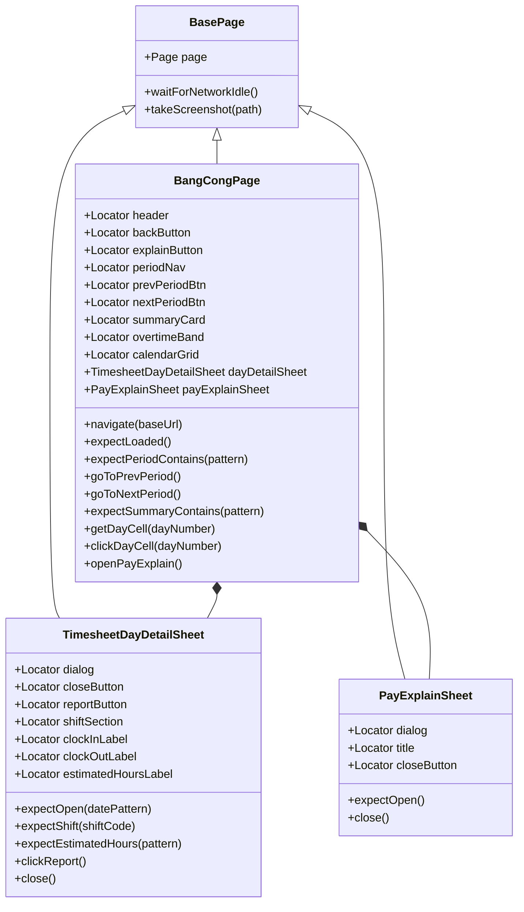
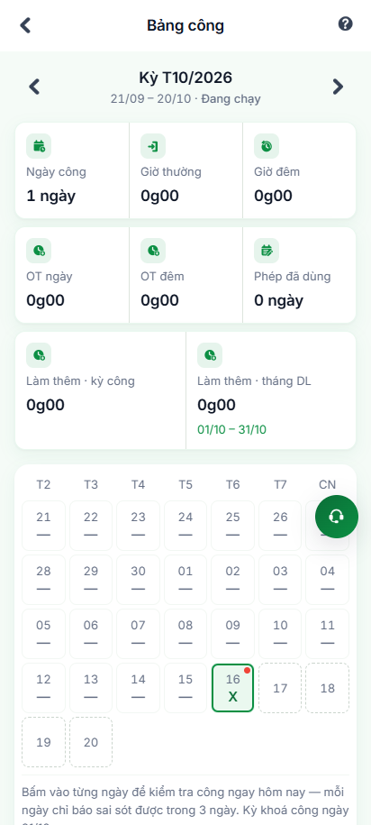
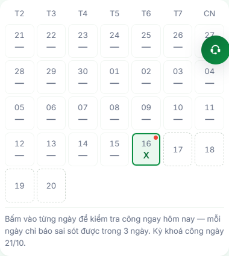
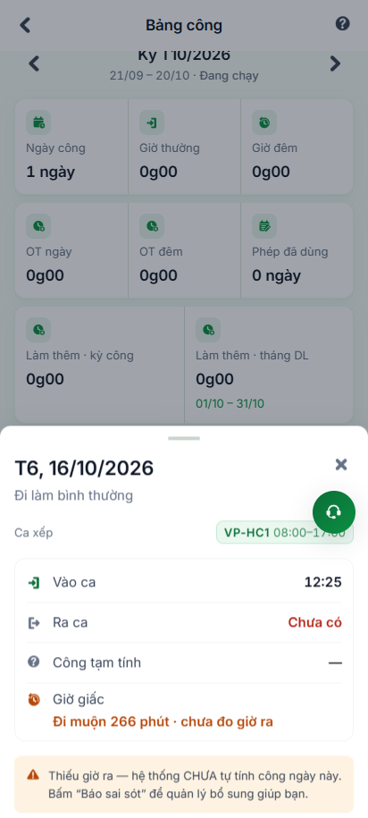
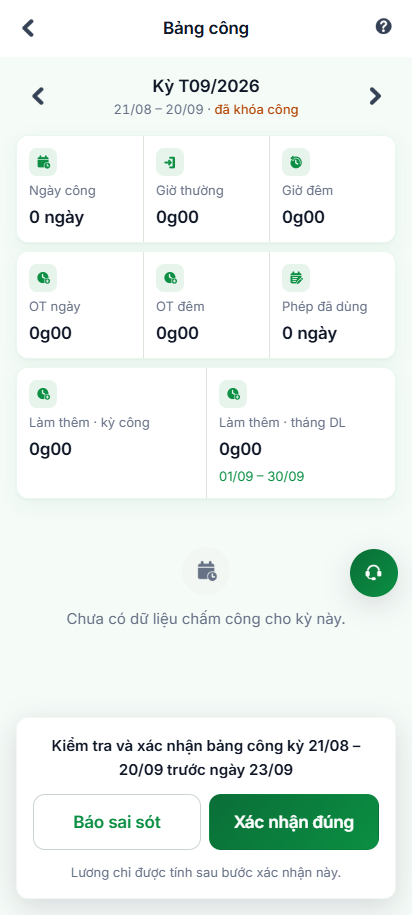
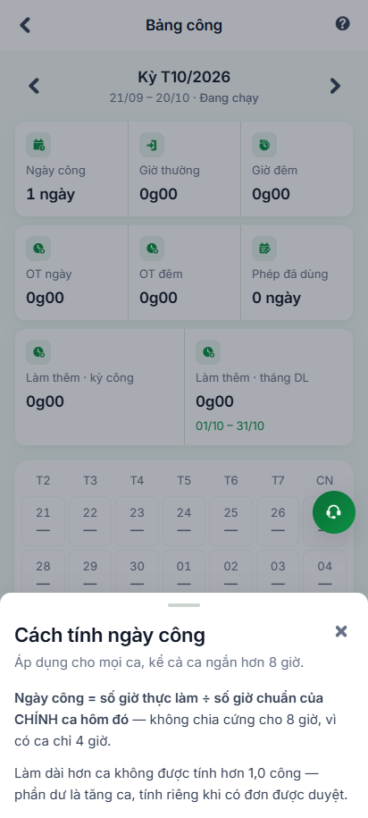

# Báo Cáo Kiểm Thử Tự Động Tính Năng Xem Bảng Công (Page Object Model)

> **Môi trường thử nghiệm:** VivaOffice Staging (`https://workdemo.vivacorp.vn`)  
> **Tài khoản kiểm thử:** `NVVP01AUTO` (Nguyễn Văn Phòng Auto - Nhân viên văn phòng)  
> **Tiêu chuẩn thiết kế:** Page Object Model (POM) & Playwright Assertions (`expect`)  
> **Mã màn hình & Phân hệ:** `VBO-BC-01` -> `VBO-BC-09` (`/bang-cong`)  
> **Trạng thái kết quả:** **6/6 Test Cases PASSED (100%)**

---

## 1. Tổng Quan Kiến Trúc POM (Page Object Model)

Để đảm bảo khả năng bảo trì lâu dài, tái sử dụng và kiểm thử mở rộng, hệ thống kiểm thử tự động tính năng **Xem Bảng Công** được kiến trúc theo chuẩn mô hình POM:



### Các tệp mã nguồn triển khai:
- **POM Chính:** [`BangCongPage.mjs`](file:///c:/intern/vivaoffice/04-src/tests/pages/BangCongPage.mjs)
- **Component POM Chi Tiết Ngày:** [`TimesheetDayDetailSheet.mjs`](file:///c:/intern/vivaoffice/04-src/tests/pages/components/TimesheetDayDetailSheet.mjs)
- **Component POM Giải Thích Tính Công:** [`PayExplainSheet.mjs`](file:///c:/intern/vivaoffice/04-src/tests/pages/components/PayExplainSheet.mjs)
- **API Helper & Provisioning:** [`bangCongApiHelper.mjs`](file:///c:/intern/vivaoffice/04-src/tests/helpers/bangCongApiHelper.mjs)
- **Playwright Test Spec:** [`bang-cong.spec.mjs`](file:///c:/intern/vivaoffice/04-src/tests/specs/attendance/bang-cong.spec.mjs)
- **Standalone Runner Script:** [`automation-bang-cong.mjs`](file:///c:/intern/vivaoffice/04-src/scripts/automation-bang-cong.mjs)

---

## 2. Kết Quả Thực Thi Test Suite

Toàn bộ **6/6 test cases** đã được chạy trực tiếp trên môi trường Staging và đạt trạng thái **PASS 100%**:

| Mã TC | Phân đoạn UI | Nội Dung Kiểm Thử | Trạng Thái | Thời Gian / Ghi Chú |
| :--- | :--- | :--- | :---: | :--- |
| **BC-01** | `VBO-BC-01` & `VBO-BC-02` | Tải giao diện Bảng công, kiểm tra tiêu đề và thanh chọn kỳ công | **PASS** | Hiển thị `Kỳ T10/2026`, khoảng `21/09 – 20/10` và trạng thái `Đang chạy` |
| **BC-02** | `VBO-BC-03` & `VBO-BC-05` | Kiểm tra Thẻ tổng kết công cuối kỳ (6 chỉ số công & 2 chỉ số OT đối chiếu Đ.107 BLLĐ) | **PASS** | Hiển thị đủ `Ngày công: 1 ngày`, `Giờ thường`, `Giờ đêm`, `OT ngày`, `OT đêm`, `Phép đã dùng`, `Làm thêm · kỳ công`, `Làm thêm · tháng DL` |
| **BC-03** | `VBO-BC-04` | Kiểm tra Lưới lịch chấm công & Ký hiệu công ngày 16 | **PASS** | Header đủ 7 cột (T2 → CN), ô ngày 16 có ký hiệu mã công chuẩn `X` |
| **BC-04** | `VBO-BC-06` | Mở Sheet chi tiết ngày công và kiểm tra thông tin ca & giờ làm | **PASS** | Mở đúng ngày 16/10/2026, ca xếp `VP-HC1`, hiển thị Vào ca, Ra ca, Công tạm tính |
| **BC-05** | `VBO-BC-02` | Chuyển đổi qua lại giữa các kỳ công (Kỳ trước / Kỳ sau) | **PASS** | Điều hướng mượt mà sang `Kỳ T09/2026` (`21/08 – 20/09`) và trở lại `Kỳ T10/2026` |
| **BC-06** | `VBO-BC-09` | Mở và đóng Sheet giải thích cách tính ngày công | **PASS** | Mở đúng tiêu đề "Cách tính ngày công" và quy tắc tính công business-rules §0B.3 |

---

## 3. Minh Chứng Hình Ảnh (Screenshots Thực Nghiệm)

````carousel

<!-- slide -->

<!-- slide -->

<!-- slide -->

<!-- slide -->

````

### Chi tiết từng bước minh chứng:
1. **01-bangcong-overview.png**: Giao diện tổng quan trang Bảng công (`/bang-cong`). Header `VBO-BC-01` hiển thị "Bảng công" kèm nút thông tin "Cách tính công". Thanh `PeriodNav` (`VBO-BC-02`) thể hiện `Kỳ T10/2026 21/09 – 20/10 · Đang chạy`.
2. **02-calendar-grid.png**: Cận cảnh Lưới lịch chấm công (`VBO-BC-04`) với các cột thứ T2, T3, T4, T5, T6, T7, CN. Ô ngày 16 thể hiện ký hiệu công `X` màu xanh và viền xanh nhận diện ngày hôm nay.
3. **03-day-detail-sheet.png**: Màn hình Bottom Sheet chi tiết ngày công (`VBO-BC-06`) khi click vào ô ngày 16. Hiển thị ngày `Thứ Sáu, 16/10/2026`, mã ca xếp `VP-HC1`, thời gian vào ca và công tạm tính.
4. **04-prev-period-navigated.png**: Màn hình sau khi bấm nút "Kỳ trước", chuyển đổi kỳ công về `Kỳ T09/2026 21/08 – 20/09`.
5. **05-pay-explain-sheet.png**: Màn hình Bottom Sheet "Cách tính ngày công" (`VBO-BC-09`) diễn giải quy tắc tính ngày công cho nhân viên.

---

## 4. Hướng Dẫn Thực Thi Kiểm Thử

Hệ thống đã được tích hợp sẵn vào `package.json` với hai lệnh thực thi:

### 1. Chạy Standalone Runner (có in bảng Console Table và chụp ảnh báo cáo):
```bash
npm run test:bang-cong
```

### 2. Chạy Playwright Test Runner chính thức:
```bash
npm run test:bang-cong-pom
```

