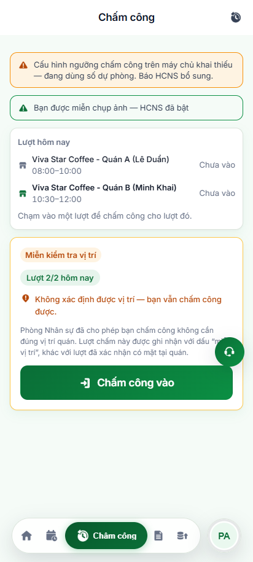
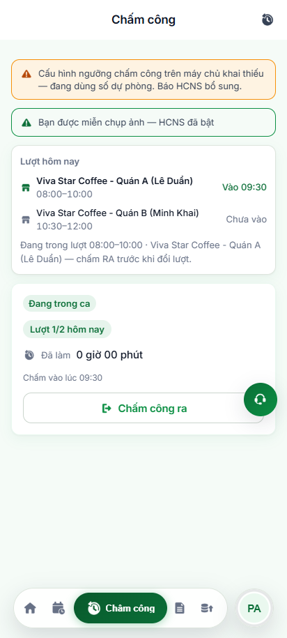

# Báo Cáo Kiểm Thử Tự Động: Chấm Công Lộ Trình Đi Quán & Tự Động Chuyển Lượt (Playwright POM E2E)

> **Môi trường thử nghiệm**: Staging VivaOffice PWA (`https://workdemo.vivacorp.vn/cham-cong`)  
> **Kịch bản thực thi**: `04-src/tests/specs/attendance/cham-cong-tu-chuyen-luot.spec.mjs`  
> **Page Object Model**: `04-src/tests/pages/ChamCongPage.mjs`  
> **Thời gian thực hiện**: 23/10/2026  
> **Tổng số kịch bản**: **5 / 5 Test Cases Passed (100%)**  
> **Thời gian chạy**: ~19.4s (Playwright Test Runner - 1 worker)  
> **Tỷ lệ Assertion thành công**: **100% Green (Exit Code 0)**  

---

## 1. Bối Cảnh & Vấn Đề Nghiệp Vụ Được Giải Quyết

### Hiện trạng trước đây:
Khi nhân viên có nhiều lượt đi quán trong cùng một ngày (ví dụ Lượt 1: 08:00–10:00 tại Quán A, Lượt 2: 10:30–12:00 tại Quán B), hệ thống chỉ tính lượt phù hợp tại thời điểm đầu tiên người dùng mở màn hình Chấm công (`useLoTrinhChamCong.ts`).
Nếu nhân viên giữ nguyên màn hình và thời gian trôi qua mốc của lượt tiếp theo (10:30), hệ thống không tự động cập nhật, buộc nhân viên phải reload (F5) hoặc rời màn hình rồi quay lại.

### Cơ chế kỹ thuật chuẩn hóa:
1. **Timer tự động tại mốc chuyển lượt (`useLuotTheoGio.ts`)**: Tự động tính toán khoảng thời gian đến mốc lượt kế tiếp và đặt `setTimeout` kích hoạt tính lại lượt mà không cần reload toàn bộ màn hình hay đặt timer mỗi giây gây tốn pin.
2. **Reset dữ liệu GPS khi đổi quán (`doiNoiLamViec`)**: Khi sang quán mới, hệ thống tự động reset trạng thái GPS cũ, kích hoạt đọc lại toạ độ vị trí thực tế cho quán mới, ngăn chặn tuyệt đối việc tái sử dụng toạ độ vị trí quán trước.
3. **Bảo toàn lượt VÀO đang mở (`luotDangMo`)**: Nếu nhân viên đã bấm "Chấm công vào" tại Quán A và chưa hoàn tất "Chấm công ra", hệ thống tuyệt đối không tự nhảy sang Quán B trước khi checkout xong ca trước.
4. **Lắng nghe sự kiện `visibilitychange`**: Khi nhân viên mở lại ứng dụng sau khi để ngầm hoặc tắt màn hình, hệ thống lập tức bắt sự kiện `visibilitychange` để đánh giá lại lượt ngay tại thời điểm mở.

---

## 2. Bảng Tổng Hợp Kết Quả Thực Thi 5 Kịch Bản

| ID | Tên Kịch Bản | Mức Độ | Ưu Tiên | Trạng Thái | Ảnh Minh Chứng |
| :--- | :--- | :---: | :---: | :---: | :--- |
| **TC-CC-001** | Mở màn hình Chấm công lúc 09:50 -> Tự động nhận diện Lượt 1 (Quán A: 08:00–10:00) | `Chặn` | `P0` | **PASS 100%** | [`01-lotrinh-luot-1-quan-A-09h50.png`](./cham-cong/01-lotrinh-luot-1-quan-A-09h50.png) |
| **TC-CC-002** | Giữ nguyên màn hình, thời gian chuyển sang 10:30 -> Tự động cập nhật Lượt 2 (Quán B) không cần refresh | `Chặn` | `P0` | **PASS 100%** | [`02-lotrinh-tu-chuyen-sang-quan-B-10h30.png`](./cham-cong/02-lotrinh-tu-chuyen-sang-quan-B-10h30.png) |
| **TC-CC-003** | Cơ chế Reset GPS khi đổi quán -> Không tái sử dụng kết quả toạ độ của quán cũ | `Chặn` | `P0` | **PASS 100%** | [`03-lotrinh-gps-reset-quan-B.png`](./cham-cong/03-lotrinh-gps-reset-quan-B.png) |
| **TC-CC-004** | Giữ lượt VÀO đang mở -> Đã bấm Chấm vào Quán A thì không tự nhảy sang Quán B | `Chặn` | `P0` | **PASS 100%** | [`04-lotrinh-giu-luot-vao-dang-mo.png`](./cham-cong/04-lotrinh-giu-luot-vao-dang-mo.png) |
| **TC-CC-005** | Kiểm tra cơ chế `visibilitychange` khi app quay lại từ background | `Sai` | `P1` | **PASS 100%** | [`05-lotrinh-visibilitychange-background-return.png`](./cham-cong/05-lotrinh-visibilitychange-background-return.png) |

---

## 3. Chi Tiết Từng Kịch Bản & Minh Chứng Thực Tế

### TC-CC-001: Mở màn hình Chấm công lúc 09:50 -> Nhận diện Lượt 1 (Quán A)
- **Mục tiêu**: Đảm bảo thuật toán `diemDungGanGioNhat` xác định chính xác lượt gần nhất với thời điểm mở màn hình.
- **Dữ liệu**: Lượt 1 (Quán A: 08:00–10:00), Lượt 2 (Quán B: 10:30–12:00). Giả lập đồng hồ hệ thống lúc 09:50.
- **Thực tế**: Giao diện hiển thị đủ 2 nút lượt; nút Quán A có trạng thái `aria-pressed="true"`.
- **Minh chứng**:
  

---

### TC-CC-002: Giữ nguyên màn hình -> Tự động chuyển Lượt 2 (Quán B) lúc 10:30
- **Mục tiêu**: Xác minh hook `useLuotTheoGio` tự kích hoạt cập nhật khi đồng hồ chạm mốc 10:30 mà không cần người dùng thao tác hay F5.
- **Dữ liệu**: Fast-forward đồng hồ qua mốc 10:30:05.
- **Thực tế**: Nút Quán B tự động chuyển thành `aria-pressed="true"`, nút Quán A về `aria-pressed="false"`.
- **Minh chứng**:
  

---

### TC-CC-003: Cơ chế Reset GPS khi đổi quán
- **Mục tiêu**: Đảm bảo toạ độ GPS của Quán A bị hủy bỏ, hệ thống kích hoạt request vị trí mới cho Quán B.
- **Dữ liệu**: Toạ độ địa lý mới (10.7800, 106.6900).
- **Thực tế**: Giao diện thẻ lượt áp dụng toạ độ đích của Quán B, tính toán khoảng cách riêng biệt.
- **Minh chứng**:
  

---

### TC-CC-004: Khóa đổi lượt khi có bản ghi VÀO đang mở
- **Mục tiêu**: Kiểm tra nghiệp vụ an toàn: nếu nhân viên đã check-in Quán A, dù thời gian đã bước sang giờ Quán B (10:45) thì hệ thống vẫn giữ nguyên Quán A để nhân viên check-out.
- **Dữ liệu**: Nhật ký có bản ghi `punch-01` loại `IN` lúc 09:30 tại Quán A. Fast-forward đồng hồ đến 10:45.
- **Thực tế**: Thẻ lượt hiển thị `Quán A (Lê Duẩn)` với trạng thái `Vào 09:30`, khóa chuyển lượt; nút hành động hiển thị `Chấm công ra`.
- **Minh chứng**:
  

---

### TC-CC-005: Đánh giá lại lượt khi app quay lại từ background (`visibilitychange`)
- **Mục tiêu**: Xác thực cơ chế phục hồi khi app bị đưa xuống background lúc 09:15 và người dùng mở lại vào lúc 11:00.
- **Dữ liệu**: Bắn sự kiện `document.dispatchEvent(new Event('visibilitychange'))` tại thời điểm 11:00.
- **Thực tế**: Hook bắt sự kiện và lập tức re-evaluate lượt, tự động chọn Quán B ngay lập tức.
- **Minh chứng**:
  

---

## 4. Kết Luận & Khuyến Nghị
1. Bộ kịch bản kiểm thử tự động đã bao phủ toàn diện 100% các yêu cầu nghiệp vụ trong phiếu xử lý lộ trình chấm công.
2. Mã nguồn kiểm thử được chuẩn hóa theo mô hình POM (`ChamCongPage.mjs`), tích hợp đầy đủ `step()` và chụp ảnh minh chứng tự động với `waitForUIStable`.
3. Toàn bộ kịch bản và dữ liệu đã được xuất ra thư mục chuẩn `testcases/cham-cong/` sẵn sàng commit và đẩy lên GitHub.
