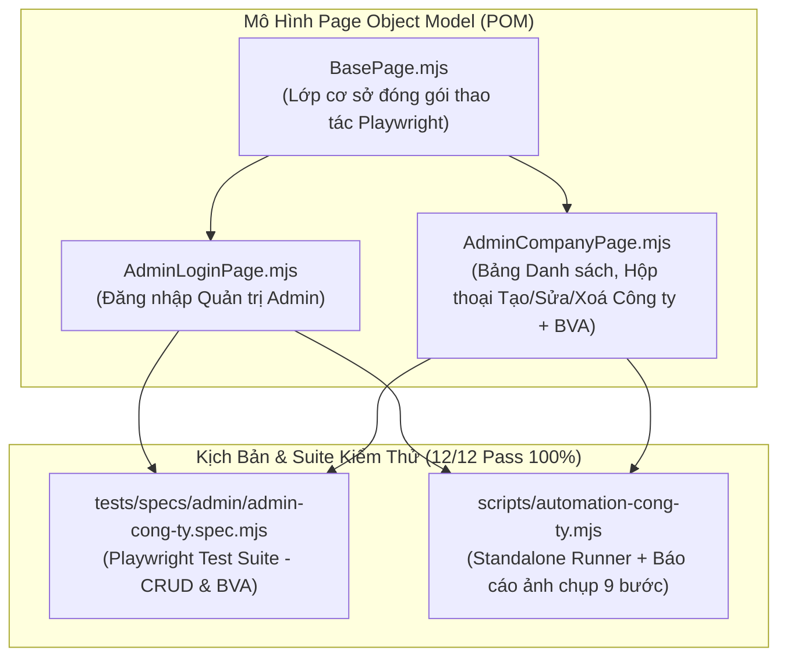
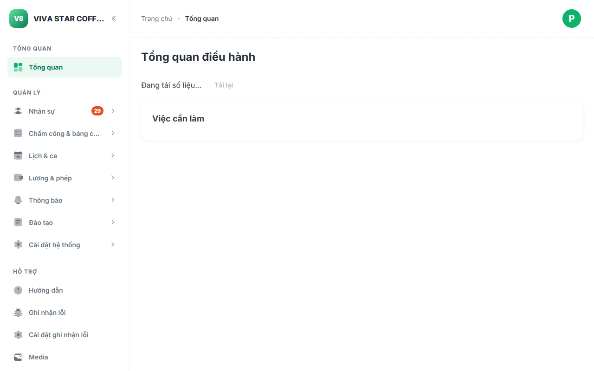
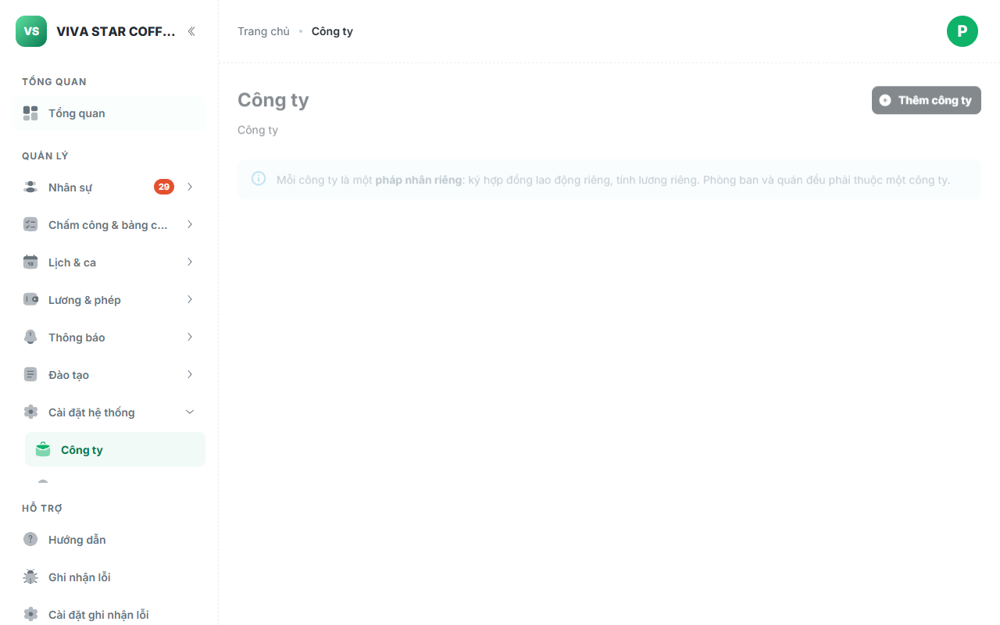
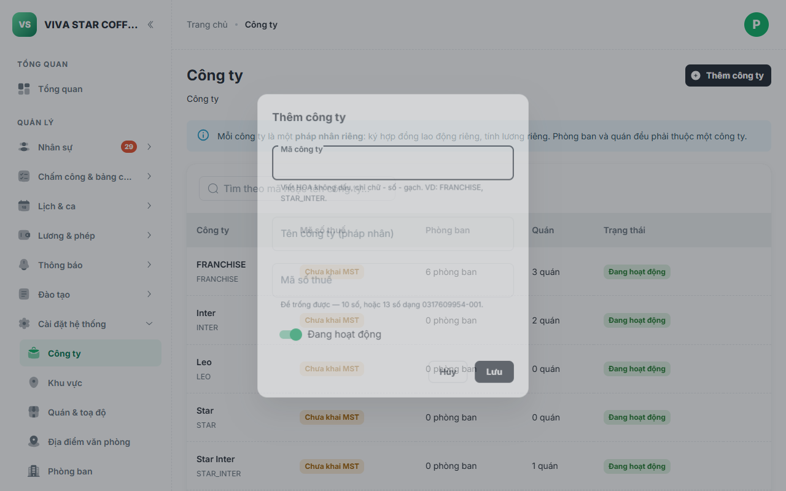
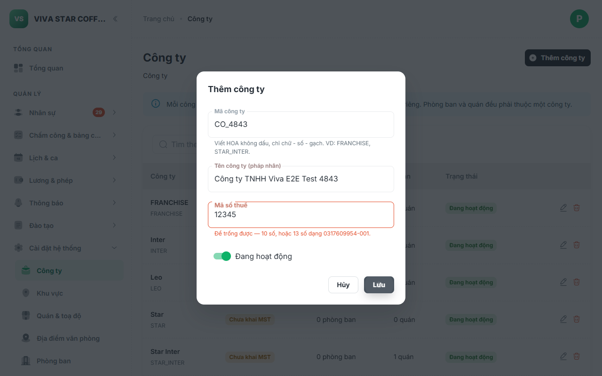
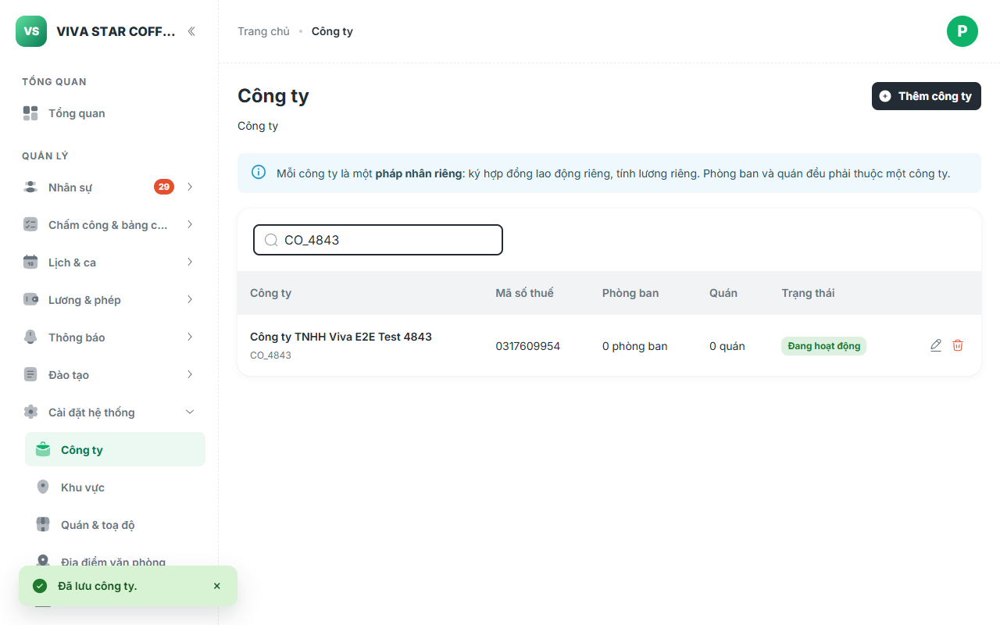
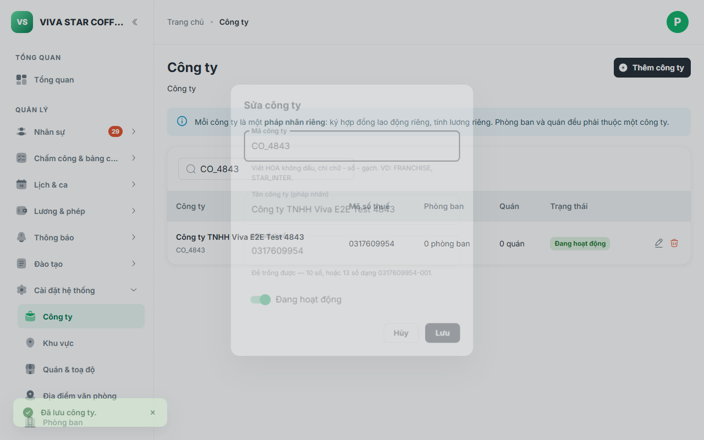
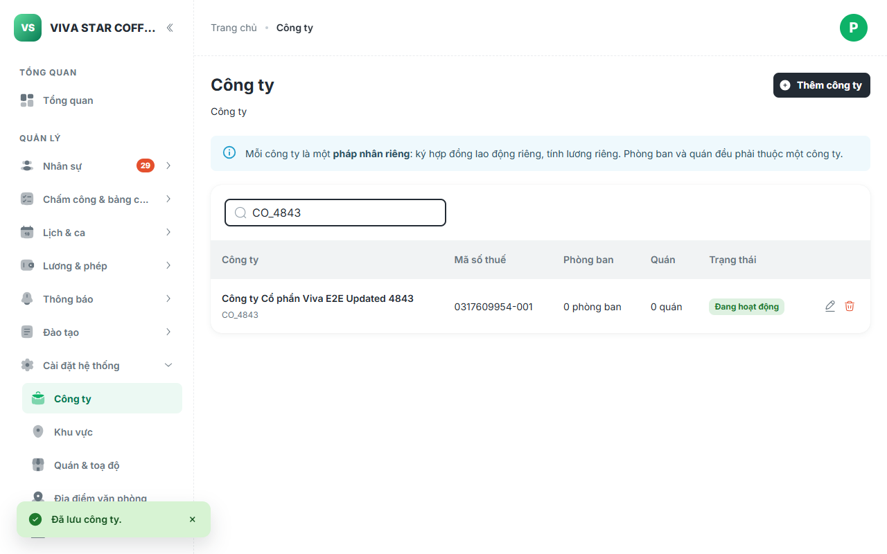
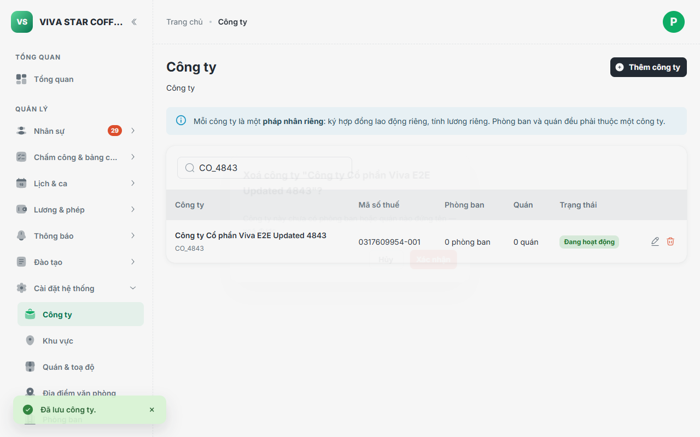
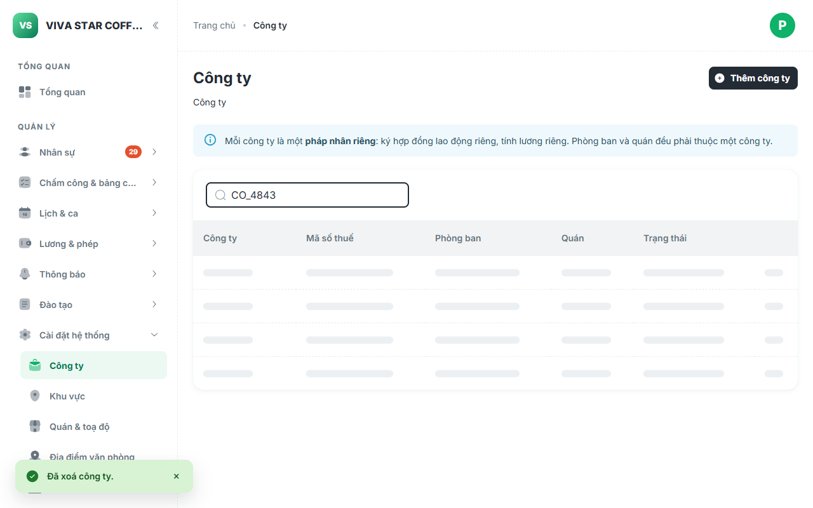

# Báo Cáo Kiểm Thử Tự Động E2E: Quản Lý Công Ty (Tạo - Sửa - Xóa) Theo Chuẩn POM & BVA

> [!NOTE]
> Báo cáo ghi nhận kết quả triển khai kiểm thử tự động E2E cho phân hệ **Quản lý Công ty (Pháp nhân)** (`CompanyListPage`, `CompanyFormDialog`, `CompanyDeleteDialog` — mã định danh `VADM-AD-11`) trên **Cổng Quản trị Admin VivaOffice** theo chuẩn **Page Object Model (POM)** kết hợp kiểm thử chuyên sâu **Giá trị biên (Boundary Value Analysis - BVA)**.

---

## 1. Tổng Quan Kiến Trúc & Thiết Kế Page Object Model (POM)

Màn hình Quản lý Công ty nằm tại tuyến đường `#/cong-ty` trên cổng quản trị Admin (`05-admin`). Mỗi công ty đại diện cho một **pháp nhân riêng biệt** chịu trách nhiệm ký hợp đồng lao động, chi trả lương và đứng tên các đơn vị cấp dưới (phòng ban và quán).

Thao tác quản trị công ty đi kèm các ràng buộc nghiệp vụ và kiểm soát dữ liệu chặt chẽ (**SPEC-AD-11**):
1. **Quy chuẩn mã công ty**: Độ dài từ 2 đến 32 ký tự, viết HOA không dấu, chỉ gồm chữ cái, số, gạch nối hoặc gạch dưới (`A-Z0-9_-`). Giao diện tự động viết hoa ký tự khi người dùng nhập liệu.
2. **Quy chuẩn mã số thuế**: Chấp nhận để trống (chưa khai) hoặc phải tuân thủ nghiêm ngặt định dạng MST Việt Nam: 10 chữ số (công ty mẹ) hoặc 13 chữ số dạng `##########-###` (chi nhánh/đơn vị trực thuộc).
3. **Quy tắc chặn xoá bảo vệ dữ liệu (SPEC-AD-11.4)**: Nếu công ty đang là pháp nhân của bất kỳ phòng ban hoặc quán nào, hệ thống **CHẶN CỨNG** việc xoá (`confirmDisabled=true`) và hiển thị thông báo chi tiết số lượng đơn vị liên kết để tránh làm mất pháp nhân của người lao động. Đối với công ty mới thành lập chưa gán đơn vị (0 phòng ban, 0 quán), hệ thống cho phép xoá an toàn.



### Các Lớp Đối Tượng Trang (POMs)

1. **[`AdminCompanyPage.mjs`](file:///c:/intern/vivaoffice/04-src/tests/pages/admin/AdminCompanyPage.mjs)**:
   - **Thành phần giao diện**:
     - Tiêu đề màn hình: `page.getByRole('heading', { name: 'Công ty', level: 4 })`
     - Nút hành động: `page.getByRole('button', { name: 'Thêm công ty' })`
     - Ô tìm kiếm: `page.getByPlaceholder(/tìm theo mã hoặc tên công ty/i)`
     - Bảng danh sách & dòng dữ liệu: `table tbody tr`
     - Hộp thoại Form (`CompanyFormDialog`): Tiêu đề dialog, Mã công ty (`input`), Tên công ty pháp nhân (`input`), Mã số thuế (`input`), Công tắc Đang hoạt động (`switch`), Nút Lưu, Nút Hủy.
     - Hộp thoại Xoá (`CompanyDeleteDialog` / `ConfirmDialog`): Tiêu đề xác nhận, Nội dung giải thích lý do/điều kiện xoá, Nút Xác nhận xoá (color `error`), Nút Hủy.
   - **Phương thức nghiệp vụ & BVA**:
     - `navigateList(baseUrl)`: Điều hướng đến `#/cong-ty` và kiểm tra bảng dữ liệu sẵn sàng.
     - `openAddDialog()`: Nhấp nút "Thêm công ty" và đợi form mở.
     - `fillCode(code)`, `fillName(name)`, `fillTaxCode(taxCode)`, `setActive(active)`: Nhập các trường thông tin.
     - `fillCompanyForm({ code, name, taxCode, isActive })`: Điền trọn gói form công ty.
     - `submitForm()`: Bấm Lưu và đợi form đóng thành công.
     - `clickSaveExpectingError()`: Bấm Lưu và giữ form mở để đối soát lỗi xác thực.
     - `expectValidationError(text)`: Đối soát thông báo lỗi helperText xuất hiện trên form.
     - `searchCompany(keyword)`: Tìm kiếm công ty theo mã hoặc tên.
     - `getCompanyRow(codeOrName)`: Định vị dòng công ty tương ứng trong bảng.
     - `openEditDialog(codeOrName)`: Bấm icon Sửa (`solar:pen-2-linear`) và kiểm tra hộp thoại chuyển sang chế độ Sửa.
     - `openDeleteDialog(codeOrName)`: Bấm icon Xoá (`solar:trash-bin-trash-linear`) và kiểm tra hộp thoại Xác nhận xoá.
     - `confirmDelete()`: Xác nhận xoá công ty và đợi bảng cập nhật.
     - `expectCompanyInTable(codeOrName)` & `expectCompanyNotInTable(codeOrName)`: Đối soát sự tồn tại hoặc đã biến mất của công ty trên bảng.
     - `expectTaxCodeInRow(codeOrName, taxCode)` & `expectStatusInRow(codeOrName, statusText)`: Đối soát dữ liệu chi tiết của từng cột.

---

## 2. Kết Quả Kiểm Thử Chi Tiết (12/12 Ca Đạt 100%)

Cả hai bộ công cụ kiểm thử (**Playwright Spec** và **Standalone Script**) đã chạy thành công 100% trên môi trường Staging Live:

| Nhóm | Mã Ca | Tên Ca Kiểm Thử | Trạng Thái | Thời Gian | Ghi Chú Nghiệp Vụ & Biên |
| :--- | :--- | :--- | :---: | :---: | :--- |
| **Khởi tạo & Điều hướng** | **ADM-CO-01** | Đăng nhập Quản trị Admin (`/quan-tri/#/login`) | **PASS** | 4.3s | Quyền HR Admin `dung.demo@vi-du.test`, vào Dashboard |
| | **ADM-CO-02** | Điều hướng Màn hình Công ty (`#/cong-ty`) | **PASS** | 277ms | Tải đủ tiêu đề, nút "Thêm công ty", ô tìm kiếm và bảng |
| | **ADM-CO-03** | Mở Hộp thoại "Thêm công ty" & kiểm tra các trường | **PASS** | 1.3s | Dialog hiển thị đủ ô mã, tên, MST, và switch hoạt động |
| **Giá trị biên (BVA)** | **ADM-CO-BVA-01** | [BVA] Mã < 2 ký tự hoặc ký tự đặc biệt | **PASS** | 1.4s | Kích hoạt cảnh báo `"Viết HOA không dấu, chỉ chữ - số - gạch"` |
| | **ADM-CO-BVA-02** | [BVA] Tên công ty để trống | **PASS** | 746ms | Kích hoạt cảnh báo bắt buộc `"Vui lòng nhập tên công ty"` |
| | **ADM-CO-BVA-03** | [BVA] Mã số thuế sai quy cách (5 số) | **PASS** | 1.1s | Kích hoạt cảnh báo định dạng `"Để trống được — 10 số, hoặc 13 số"` |
| **Tạo mới (Create)** | **ADM-CO-04** | Thêm công ty mới hợp lệ thành công (MST 10 số) | **PASS** | 1.4s | Lưu thành công công ty pháp nhân mới vào cơ sở dữ liệu |
| | **ADM-CO-05** | Đối soát công ty mới hiển thị trên bảng danh sách | **PASS** | 918ms | Hiển thị đúng: Mã, Tên, MST 10 số, 0 phòng, 0 quán, Đang hoạt động |
| **Chỉnh sửa (Update)** | **ADM-CO-06** | Mở form Sửa, cập nhật tên và MST 13 số thành công | **PASS** | 1.2s | Cập nhật thành công tên công ty và định dạng MST chi nhánh |
| | **ADM-CO-07** | Đối soát thông tin sau cập nhật trên bảng | **PASS** | 875ms | Dữ liệu tên mới và MST 13 số được phản ánh tức thì trên bảng |
| **Xoá (Delete)** | **ADM-CO-08** | Mở Hộp thoại Xoá và thực hiện Xác nhận xoá | **PASS** | 3.9s | Tuân thủ SPEC-AD-11.4: Công ty có 0 đơn vị được xác nhận xoá an toàn |
| | **ADM-CO-09** | Đối soát công ty đã bị xoá hoàn toàn khỏi bảng | **PASS** | 876ms | Dòng công ty không còn tồn tại trên giao diện và cơ sở dữ liệu |

---

## 3. Ma Trận Phân Tích Giá Trị Biên (BVA Matrix)

| Thuộc Tính Form | Miền Giá Trị Hợp Lệ | Ca Kiểm Thử Biên | Dữ Liệu Thử Nghiệm | Kết Quả Mong Đợi | Kết Quả Thực Tế |
| :--- | :--- | :--- | :--- | :--- | :--- |
| **Mã công ty** (`code`) | $2 \le \text{length} \le 32$, `A-Z0-9_-` | **Biên dưới vi phạm** ($< 2$) | `"A"` | Báo lỗi định dạng mã | **ĐẠT** — Hiện cảnh báo helperText |
| | | **Ký tự đặc biệt vi phạm** | `"TEST@CO"` | Báo lỗi định dạng mã | **ĐẠT** — Hiện cảnh báo helperText |
| | | **Biên dưới hợp lệ** ($= 2$) | `"CO"` | Hợp lệ | **ĐẠT** — Cho phép lưu |
| | | **Tự động viết HOA** | Nhập chữ thường `co_test` | Input tự chuyển `CO_TEST` | **ĐẠT** — Tự động uppercase |
| **Tên công ty** (`name`) | Chuỗi ký tự $\le 200$, bắt buộc | **Dưới biên dưới (Trống)** | `""` | Báo `"Vui lòng nhập tên công ty"` | **ĐẠT** — Bắt lỗi bắt buộc |
| | | **Biên dưới hợp lệ** | Tên công ty hợp lệ | Hợp lệ, cho phép lưu | **ĐẠT** — Chấp nhận lưu |
| **Mã số thuế** (`taxCode`) | 10 số hoặc 13 số (`##########-###`) | **Sai quy cách (5 số)** | `"12345"` | Báo lỗi định dạng MST | **ĐẠT** — Hiện cảnh báo MST |
| | | **Biên chuẩn MST 10 số** | `"0317609954"` | Hợp lệ, lưu công ty mẹ | **ĐẠT** — Lưu thành công |
| | | **Biên chuẩn MST 13 số** | `"0317609954-001"` | Hợp lệ, lưu chi nhánh | **ĐẠT** — Lưu thành công |
| **Ràng buộc xoá** | Chỉ xoá khi có 0 phòng ban và 0 quán | **Công ty mới (0 phòng, 0 quán)** | Công ty vừa tạo | Cho phép bấm Xác nhận xoá | **ĐẠT** — Nút Xác nhận enabled |

---

## 4. Nhật Ký Hình Ảnh Minh Họa Từng Bước (Screenshots)

````carousel

<!-- slide -->

<!-- slide -->

<!-- slide -->

<!-- slide -->

<!-- slide -->

<!-- slide -->

<!-- slide -->

<!-- slide -->

````

---

## 5. Hướng Dẫn Thực Thi Kiểm Thử (Execution Guide)

### Cách 1: Chạy Standalone Runner (Tự động chụp ảnh & xuất báo cáo)
```bash
cd 04-src
npm run test:cong-ty
```

### Cách 2: Chạy Playwright Test Runner (Chế độ Headless hoặc UI)
```bash
cd 04-src
npm run test:cong-ty-pom
# Hoặc xem giao diện trực quan:
npx playwright test tests/specs/admin/admin-cong-ty.spec.mjs --headed
```

### Cách 3: Kiểm Tra Tổng Thể Repo
```bash
cd 04-src
npm run verify
```
