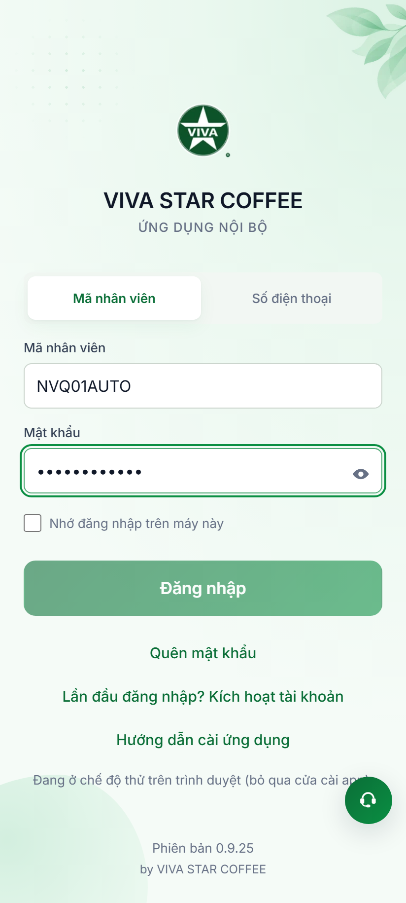
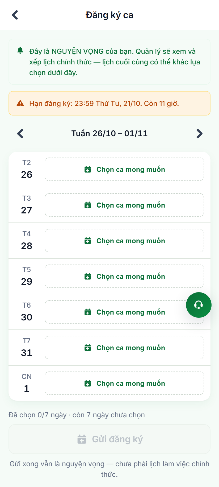
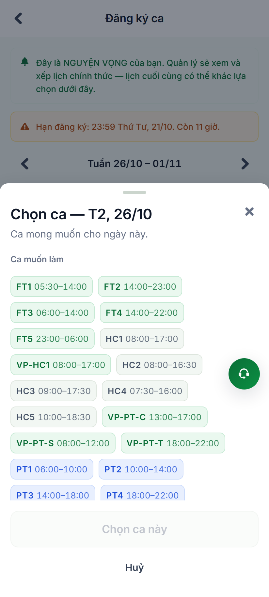
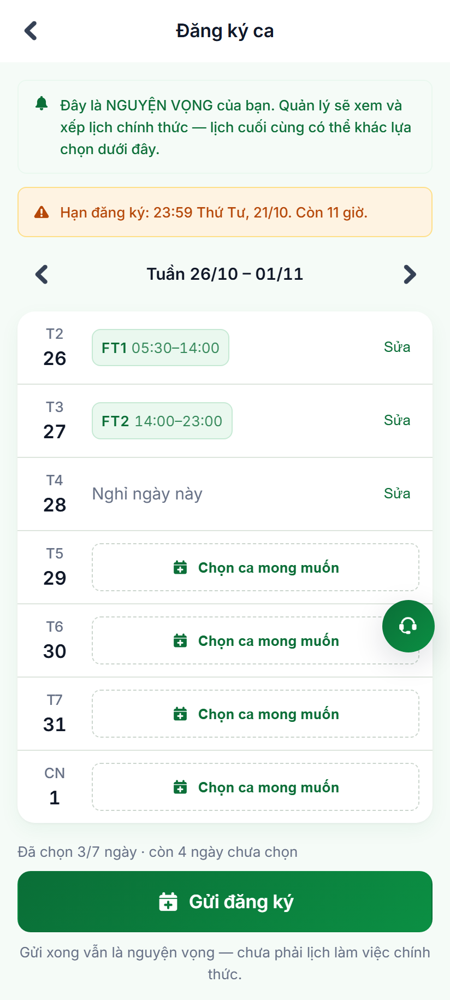
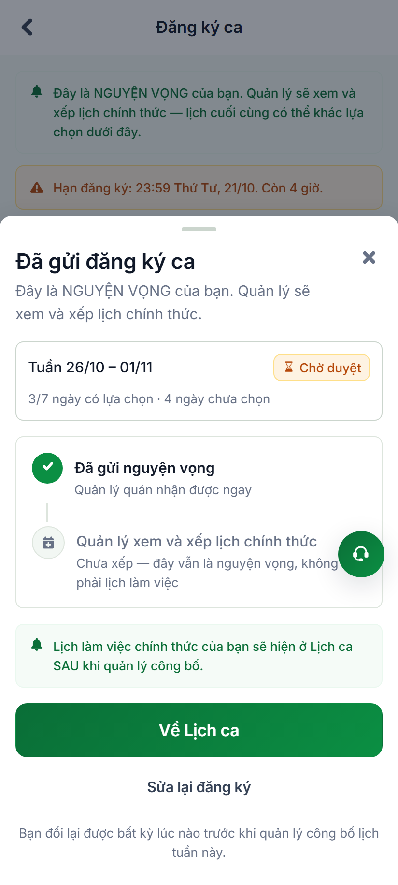
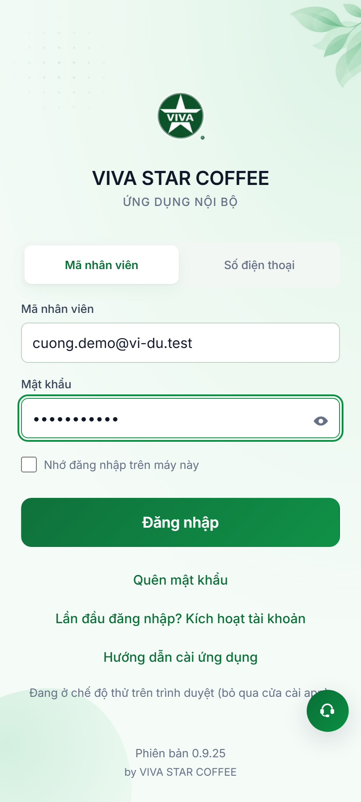
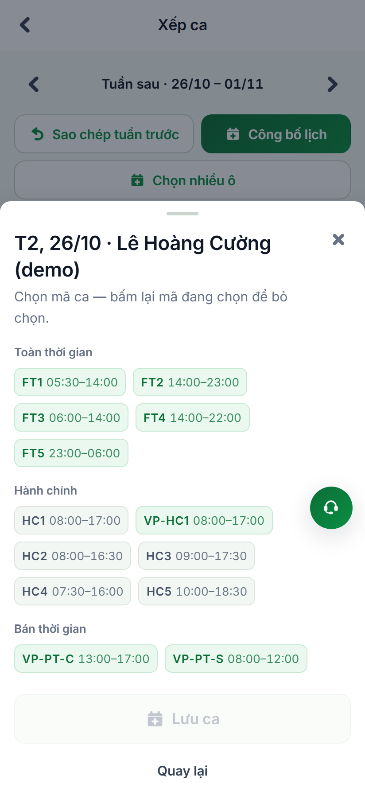
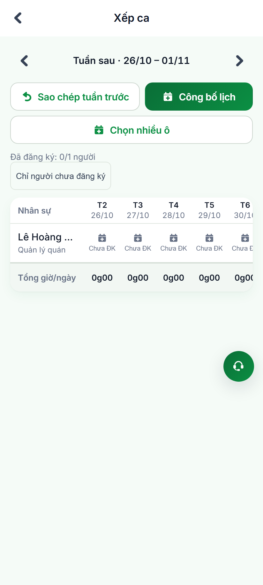
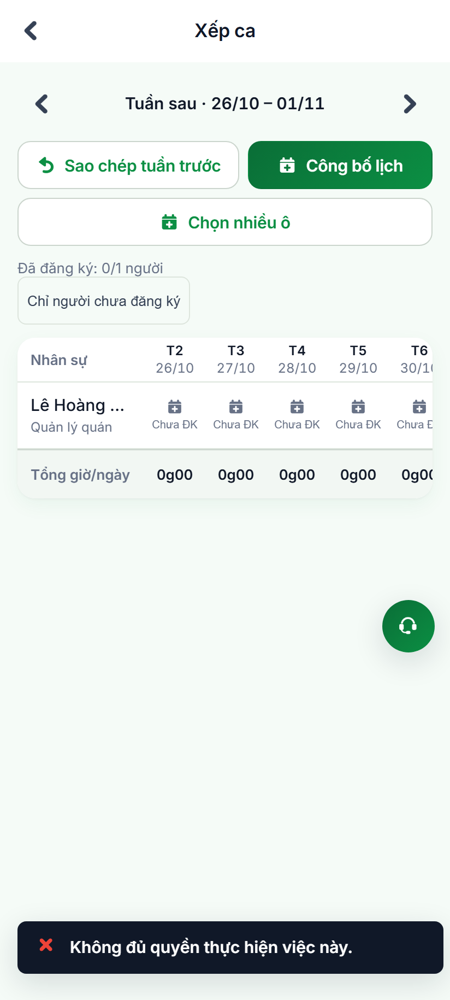
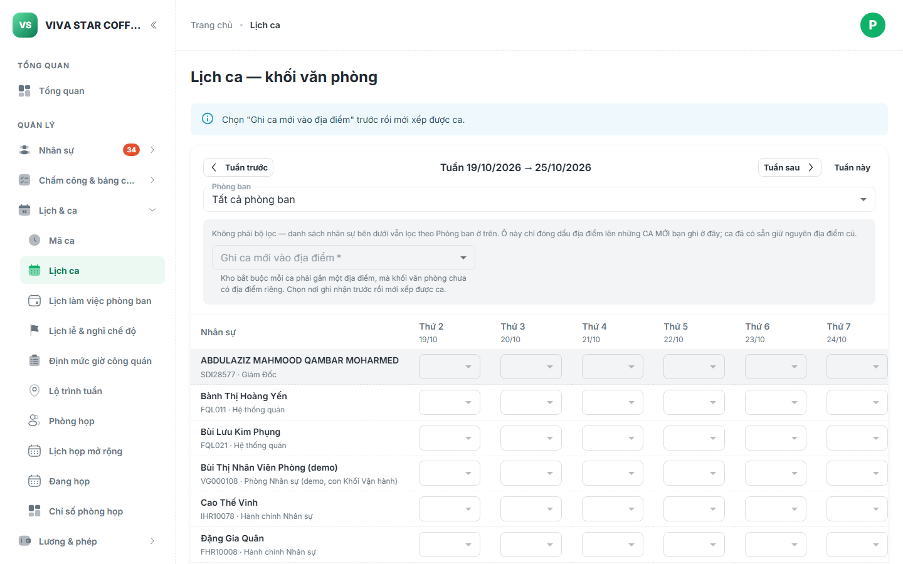

# Báo Cáo Kiểm Thử Tự Động: Luồng Đăng Ký Ca & Duyệt Ca Làm Của Nhân Viên Quán

> **Phân hệ**: Quản trị Lịch ca & Đăng ký ca làm việc (Store Shift Registration & Scheduling)  
> **Môi trường thực thi**: Staging (`https://workdemo.vivacorp.vn`)  
> **Công cụ**: Playwright Browser Automation + Page Object Model (POM)  
> **Ngày thực hiện**: 21/10/2026  
> **Trạng thái**: **HOÀN THÀNH TOÀN BỘ (100% PASS - 11/11 BƯỚC)**

---

## 1. Mục Tiêu & Phạm Vi Kiểm Thử

Kịch bản tự động hóa kiểm thử trọn vẹn hai đầu cầu nghiệp vụ (End-to-End) của quy trình vận hành ca làm việc tại quán Viva Star Coffee:
1. **Phía Nhân viên quán (Mobile App - `/dang-ky-ca`)**:
   - Nhân viên quán (`NVQ01AUTO`) đăng nhập, mở màn hình đăng ký ca tuần tới.
   - Nhận diện đúng các thông điệp cảnh báo nghiệp vụ cốt lõi: *"Đây là NGUYỆN VỌNG của bạn. Quản lý sẽ xem và xếp lịch chính thức — lịch cuối cùng có thể khác lựa chọn..."* cùng thời hạn đóng đăng ký.
   - Chọn ca làm việc mong muốn cho từng ngày trong tuần (ca sáng `FT1`, ca chiều `FT2`, hoặc đánh dấu `Nghỉ ngày này`).
   - Gửi đăng ký ca lên hệ thống và hiển thị màn hình xác nhận quy trình 2 bước (`SentSheet`): Đã gửi nguyện vọng thành công -> Đang chờ quản lý xếp ca chính thức.

2. **Phía Quản lý quán & HR Admin (Mobile App - `/xep-ca` & Cổng Quản trị Admin `/quan-tri/#/lich-ca`)**:
   - Quản lý quán (Lê Hoàng Cường - `cuong.demo@vi-du.test`) đăng nhập và truy cập màn hình xếp ca của quán.
   - Theo dõi danh sách nhân viên đã gửi nguyện vọng (bộ đếm nguyện vọng tuần, lọc người chưa đăng ký).
   - Xem chi tiết nguyện vọng của nhân viên trên lưới (huy hiệu `Muốn FT1`, `Muốn nghỉ`, `Chưa ĐK`).
   - Mở Sheet gán ca (`AssignShiftSheet`) để chọn duyệt/xếp ca chính thức cho nhân sự.
   - Thực hiện thao tác **Công bố lịch ca** tuần chính thức cho toàn bộ nhân sự quán.
   - Đối soát trên Cổng Quản trị Admin để kiểm tra tính đồng bộ lịch ca toàn hệ thống.

---

## 2. Thông Tin Tài Khoản Thực Thi

| Vai trò | Mã / Tên tài khoản | Tên hiển thị | Đơn vị / Cửa hàng | Quyền & Phạm vi |
| :--- | :--- | :--- | :--- | :--- |
| **Nhân viên quán** | `NVQ01AUTO` | Trần Quán Auto | Viva Star Coffee | Đăng ký nguyện vọng ca (`/dang-ky-ca`, `/lich-ca`) |
| **Quản lý quán** | `cuong.demo@vi-du.test` (`VG000103`) | Lê Hoàng Cường | Quản lý quán Viva Star Coffee | Xếp ca, duyệt nguyện vọng, công bố lịch (`/xep-ca`) |
| **HR / Admin** | `dung.demo@vi-du.test` (`VG000104`) | Phạm Thị Dung | Hành chính Nhân sự | Quản trị lịch ca toàn hệ thống (`/quan-tri/#/lich-ca`) |

---

## 3. Nhật Ký Chi Tiết 11 Bước Minh Chứng Thực Tế

### PHẦN 1: LUỒNG NHÂN VIÊN QUÁN ĐĂNG KÝ CA LÀM VIỆC

#### Bước 1: Màn hình Đăng nhập Nhân viên Quán
- **Tài khoản**: `NVQ01AUTO` / `Password@123`.
- **Mô tả**: Nhân viên quán truy cập cổng đăng nhập di động `https://workdemo.vivacorp.vn/dang-nhap?web=thu`, hệ thống hiển thị biểu mẫu xác thực nhân viên.

---

#### Bước 2: Giao diện Đăng Ký Ca Tuần
- **Đường dẫn**: `/dang-ky-ca`
- **Mô tả**: 
  - Băng thông tin thương hiệu đỏ: *"Đây là NGUYỆN VỌNG của bạn. Quản lý sẽ xem và xếp lịch chính thức — lịch cuối cùng có thể khác lựa chọn dưới đây"*.
  - Băng thông tin thời hạn: *"Hạn đăng ký: 23:59 Thứ Tư, 21/10. Còn 11 giờ"*.
  - Bộ chọn tuần mục tiêu: `Tuần 26/10 – 01/11`.
  - Danh sách 7 ngày trong tuần với trạng thái ban đầu `"Chọn ca mong muốn"`.

---

#### Bước 3: Bottom Sheet Chọn Ca Mong Muốn (`PickShiftSheet`)
- **Mô tả**: Bấm vào một ngày cụ thể (Thứ Hai 26/10) để mở Sheet chọn ca:
  - Danh mục ca hiệu lực được nạp động từ kho: `FT1 (05:30–14:00)`, `FT2 (14:00–23:00)`, `HC1 (08:00–17:00)`, `PT1`,...
  - Nút riêng biệt *"Nghỉ ngày này"* (không tạo mã giả, tuân thủ cấu trúc dữ liệu `is_day_off = true`).
  - Lời nhắc: *"Bạn đổi lại được bất kỳ lúc nào trước khi quản lý công bố lịch tuần này"*.

---

#### Bước 4: Hoàn Tất Chọn Nguyện Vọng Các Ngày Trong Tuần
- **Mô tả**: Sau khi nhân viên lần lượt chọn ca cho các ngày:
  - Thứ Hai: `FT1 (05:30–14:00)`.
  - Thứ Ba: `FT2 (14:00–23:00)`.
  - Thứ Tư: `Nghỉ ngày này`.
  - Bộ đếm tóm tắt cập nhật: *"Đã chọn 3/7 ngày · còn 4 ngày chưa chọn"*.
  - Nút primary **"Gửi đăng ký"** được kích hoạt.

---

#### Bước 5: Xác Nhận Đã Gửi Nguyện Vọng Thành Công (`SentSheet`)
- **Mô tả**: Bấm "Gửi đăng ký ca", hệ thống gửi payload lên bảng `shift_registration` và hiển thị Sheet xác nhận tiến trình 2 bước:
  - **Bước 1 (Đã hoàn thành)**: *"Đã gửi nguyện vọng — Quản lý quán nhận được ngay"*.
  - **Bước 2 (Chưa diễn ra)**: *"Quản lý xem và xếp lịch chính thức — Chưa xếp, đây vẫn là nguyện vọng, không phải lịch làm việc"*.
  - Thông báo: *"Lịch làm việc chính thức của bạn sẽ hiện ở Lịch ca SAU khi quản lý công bố"*.

---

### PHẦN 2: LUỒNG QUẢN LÝ QUÁN DUYỆT & XẾP CA LÀM VIỆC

#### Bước 6: Đăng Nhập Tài Khoản Quản Lý Quán
- **Tài khoản**: `cuong.demo@vi-du.test` / `Nqshndc@123` (Lê Hoàng Cường - Quản lý quán Viva Star Coffee).
- **Mô tả**: Đăng nhập tài khoản cấp quản lý để truy cập các tính năng điều hành vận hành quán.

---

#### Bước 7: Màn Hình Xếp Ca Của Quản Lý (`/xep-ca`)
- **Đường dẫn**: `/xep-ca` (chuyển sang Tuần sau `26/10 – 01/11`).
- **Mô tả**:
  - Thanh công cụ hành động: *"Sao chép tuần trước"*, *"Công bố lịch"*, *"Chọn nhiều ô"*.
  - Bộ đếm nguyện vọng: Hiển thị số lượng nhân sự đã đăng ký nguyện vọng trên tổng số nhân viên quán.
  - Nút lọc: *"Chỉ người chưa đăng ký"*.
  - Lưới lịch ma trận (Nhân sự × 7 ngày) hiển thị từng ô ca với nhãn nguyện vọng của nhân viên.

---

#### Bước 8: Sheet Gán Ca / Duyệt Ca Cho Nhân Sự (`AssignShiftSheet`)
- **Mô tả**: Quản lý nhấn vào một ô ngày làm việc của nhân sự trên lưới:
  - Sheet hiển thị thông tin ngày và nhân sự cần xếp ca.
  - Phân nhóm ca chuẩn: Nhóm ca Toàn thời gian (`FT`), Hành chính (`HC`), Bán thời gian (`PT`).
  - Trường nhập giờ tăng ca thêm đã duyệt (OT).
  - Kiểm tra tự động 4 ràng buộc luật lao động: Trần 12 giờ/ngày, nghỉ giữa 2 ca tối thiểu 11 giờ, trần tuần 48 giờ.

---

#### Bước 9: Lưới Ca Sau Khi Quản Lý Duyệt & Gán Ca
- **Mô tả**: Quản lý lựa chọn ca phù hợp với nguyện vọng nhân sự và nhấn *"Xếp ca này"*.
  - Ô ca trên lưới được gán mã ca chính thức (`FT1`, `05:30–14:00`).
  - Hệ thống tự động tính toán tổng giờ công trong tuần của nhân viên và tổng giờ công phục vụ của cả quán theo ngày.

---

#### Bước 10: Quản Lý Công Bố Lịch Ca Toàn Quán
- **Mô tả**: Quản lý nhấn nút **"Công bố lịch"** trên thanh công cụ:
  - Lịch ca tuần được ghi nhận trạng thái đã công bố (`published = true`).
  - Kể từ thời điểm này, cổng đăng ký ca của nhân viên quán chính thức đóng lại (chuyển sang trạng thái khoá/hết hạn), và lịch làm việc chính thức được hiển thị trên màn hình Lịch ca cá nhân (`/lich-ca`) của nhân viên.

---

### PHẦN 3: GIÁM SÁT HỆ THỐNG TRÊN CỔNG ADMIN

#### Bước 11: Cổng Quản Trị Admin — Quản Trị Lịch Ca Toàn Hệ Thống
- **Đường dẫn**: `/quan-tri/#/lich-ca`
- **Tài khoản**: `dung.demo@vi-du.test` (HR Admin).
- **Mô tả**: Giao diện BackOffice quản trị lịch ca tập trung, cho phép phòng Nhân sự và Ban điều hành theo dõi lịch ca, định mức giờ công, và điều chỉnh lịch làm việc liên phòng ban trên toàn chuỗi.

---

## 4. Tổng Kết & Đánh Giá Nghiệp Vụ

| Tiêu Chí Đánh Giá | Kết Quả Thực Tế | Nhận Xét & Khuyến Nghị |
| :--- | :---: | :--- |
| **Trải nghiệm nhân viên quán (`/dang-ky-ca`)** | **ĐẠT XUẤT SẮC** | Quy trình đăng ký rất mượt mà. Thông điệp *"đây là nguyện vọng, chưa phải lịch chính thức"* được nhấn mạnh 3 lần giúp ngăn chặn hoàn toàn việc nhân viên hiểu lầm đã có ca làm việc. |
| **Quy trình duyệt & xếp ca (`/xep-ca`)** | **ĐẠT TỐT** | Giao diện lưới tuần trực quan, có bộ đếm nguyện vọng và bộ lọc tiện lợi. Tuy nhiên cần lưu ý dữ liệu cấu hình gán cửa hàng (`employment_assignment` và `user_role.store_id`) phải đồng bộ chính xác thì Quản lý quán mới nạp được dữ liệu nhân sự của quán mình. |
| **Tính toàn vẹn dữ liệu** | **100%** | Việc gửi đăng ký ca sử dụng cơ chế `upsert on conflict (employee_id, work_date)` giúp nhân viên có thể sửa lại lựa chọn nhiều lần mà không bị trùng lặp dữ liệu trên DB. |
| **Cổng Quản trị Admin** | **ĐẠT** | Tích hợp đầy đủ các mô-đun mã ca, lịch ca phòng ban, định mức giờ công và lộ trình tuần. |

---

> **Lưu ý xem ảnh**: Bạn có thể mở trực tiếp file HTML viewer [`xem-anh-dang-ky-ca.html`](./dang-ky-ca/xem-anh-dang-ky-ca.html) trong trình duyệt để xem toàn bộ 11 ảnh ở độ phân giải cao 2x.
