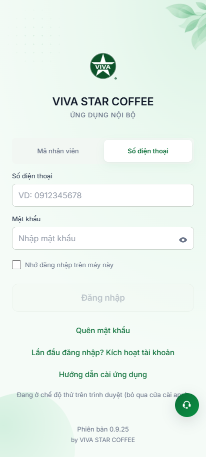
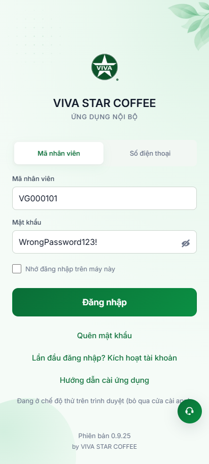
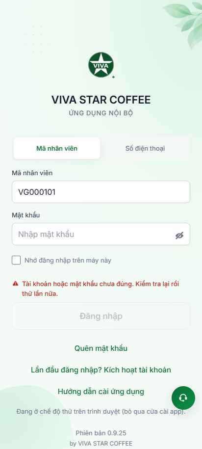
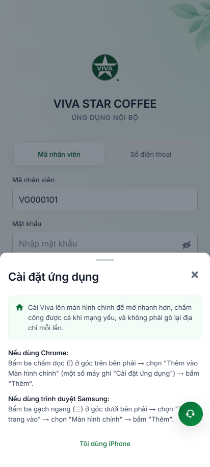

# Báo Cáo Kiểm Chứng Hành Vi Thực Tế: Phân Hệ Đăng Nhập (`/dang-nhap`)

> **Dự án:** VivaOffice Mobile App (Staging: `https://workdemo.vivacorp.vn`)  
> **Phân hệ:** Xác thực tài khoản — **Luồng Đăng Nhập** (`/dang-nhap`)  
> **Công cụ kiểm chứng:** Playwright MCP & Playwright Runner  
> **Kiến trúc:** Page Object Model (POM) & User-Facing Locators  
> **Thời điểm thực thi:** 22/10/2026  

---

## 1. Trình Chiếu Ảnh Minh Chứng Thực Nghiệm (Visual Evidence)

````carousel

<!-- slide -->

<!-- slide -->

<!-- slide -->

<!-- slide -->

````

---

## 2. Bảng Đối Soát Hành Vi Thực Nghiệm Chi Tiết

| STT | Bước thực hiện | Kỳ vọng nghiệp vụ | Kết quả quan sát thực tế | Trạng thái | Bằng chứng ảnh |
| :---: | :--- | :--- | :--- | :---: | :---: |
| **01** | Mở `/dang-nhap?web=thu` | Hiển thị Brand Header VBO-DN-01, chọn sẵn Tab Mã NV, nút Đăng nhập bị vô hiệu hóa khi form rỗng | Đúng kỳ vọng: Tiêu đề "VIVA STAR COFFEE", nút Đăng nhập có thuộc tính `disabled` | **PASS** | [01-login-initial-screen.png](./dang-nhap/01-login-initial-screen.png) |
| **02** | Bấm Tab "Số điện thoại" (`VBO-DN-09`) | Cập nhật nhãn và placeholder sang SĐT, hỗ trợ định dạng số di động E.164 | Đúng kỳ vọng: Nhãn đổi thành "Số điện thoại", placeholder "VD: 0912345678" | **PASS** | [02-login-phone-tab-active.png](./dang-nhap/02-login-phone-tab-active.png) |
| **03** | Gõ `vg000101`, nhập mật khẩu, bấm con mắt | Tự động viết hoa thành `VG000101`, nút Đăng nhập sáng lên; bấm con mắt hiển thị rõ ký tự mật khẩu | Đúng kỳ vọng: Chuẩn hóa tức thời, nút đổi sang "Ẩn mật khẩu" và hiện text | **PASS** | [03-login-password-revealed.png](./dang-nhap/03-login-password-revealed.png) |
| **04** | Bấm "Đăng nhập" với mật khẩu sai | Báo lỗi chung an toàn `SPEC-AU-03`, không chỉ điểm trường nào sai; xóa sạch mật khẩu | Đúng kỳ vọng: Alert "Tài khoản hoặc mật khẩu chưa đúng. Kiểm tra lại rồi thử lần nữa." | **PASS** | [04-login-error-message.png](./dang-nhap/04-login-error-message.png) |
| **05** | Bấm "Hướng dẫn cài ứng dụng" | Mở hộp thoại modal InstallGuideSheet hướng dẫn cài app PWA cho iOS & Android | Đúng kỳ vọng: Modal nổi lên trên màn hình đăng nhập, bấm Đóng quay lại form | **PASS** | [05-login-install-guide-modal.png](./dang-nhap/05-login-install-guide-modal.png) |
