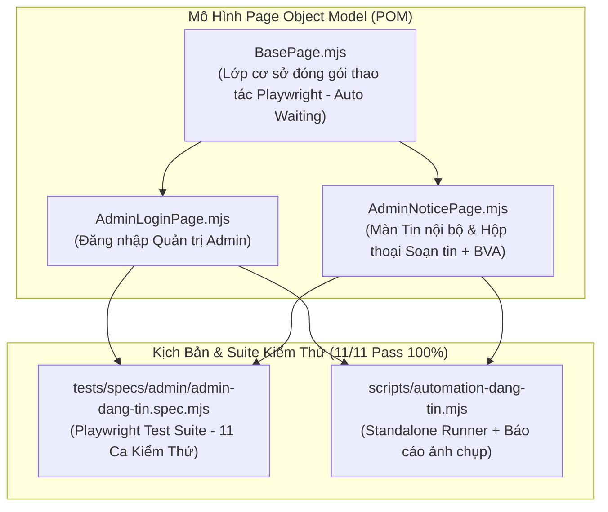
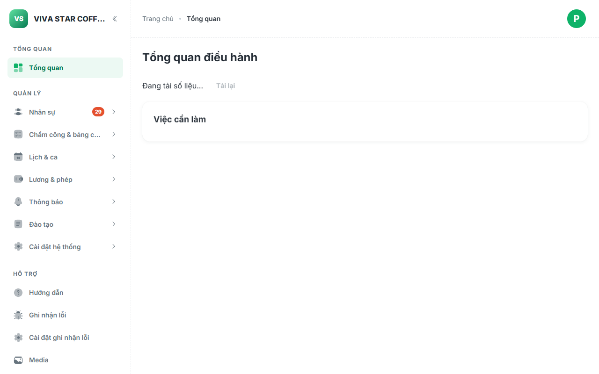
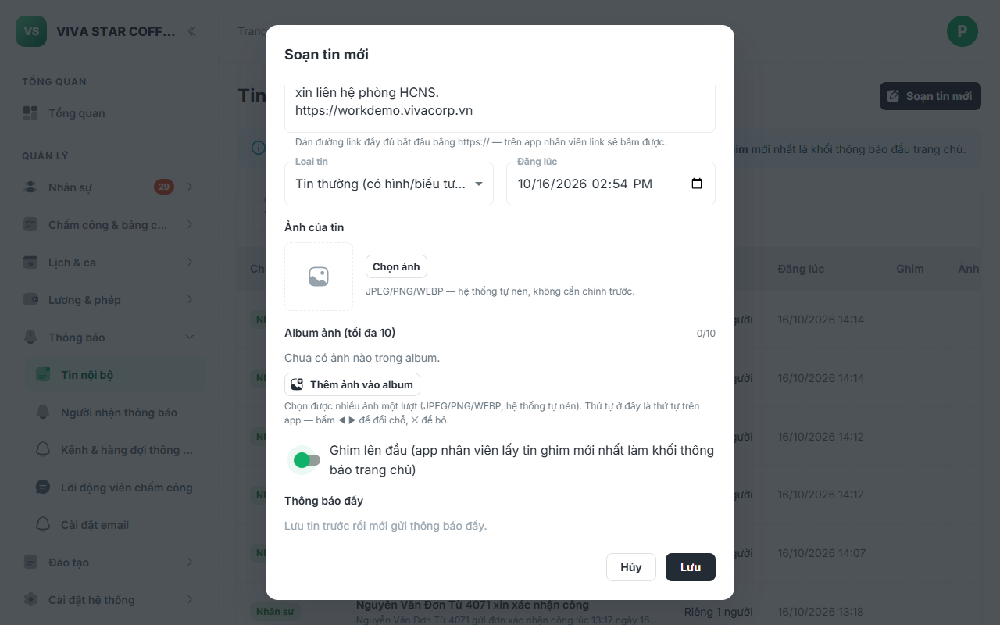
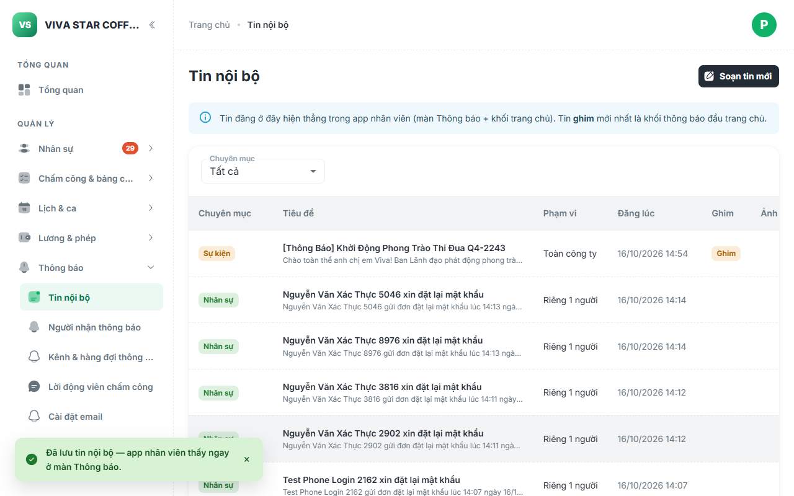
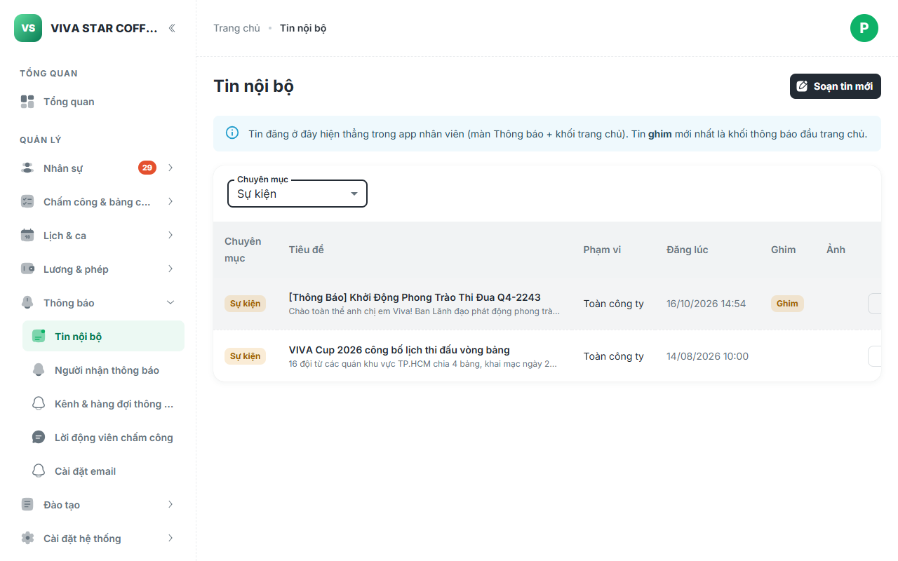

# Báo Cáo Kiểm Thử Tự Động E2E: Tính Năng Đăng Tin Nội Bộ (Admin Portal & BVA)

> [!NOTE]
> Báo cáo ghi nhận kết quả triển khai kiểm thử tự động E2E cho phân hệ **Tin nội bộ** (`company_notice` — thực thể `VADM-AD-17`) trên **Cổng Quản trị Admin VivaOffice** theo chuẩn **Page Object Model (POM)**, phương pháp phân tích **Giá trị biên (Boundary Value Analysis - BVA)** và thư viện **Playwright**.

---

## 1. Tổng Quan Kiến Trúc & Thiết Kế Page Object Model (POM)

Màn hình Quản lý & Đăng tin nội bộ nằm tại tuyến đường `#/tin-noi-bo` trên cổng quản trị Admin (`05-admin`), thuộc quyền quản trị của Ban Nhân sự (**HR Admin** — `is_hr_admin()`). Tin được đăng tải tại đây sẽ lập tức đồng bộ hiển thị sang ứng dụng nhân viên (`04-src`) tại màn hình Thông báo (`#/thong-bao`) và khối tiêu điểm trang chủ (`#/bang-tin`).



### Các Lớp Đối Tượng Trang (POMs)

1. **[`AdminNoticePage.mjs`](file:///c:/intern/vivaoffice/04-src/tests/pages/admin/AdminNoticePage.mjs)**:
   - **Thành phần giao diện**:
     - Tiêu đề màn hình: `page.getByRole('heading', { name: 'Tin nội bộ', level: 4 })`
     - Nút soạn tin: `page.getByRole('button', { name: 'Soạn tin mới' })`
     - Bảng danh sách & dòng dữ liệu: `table tbody tr`
     - Bộ lọc Chuyên mục: `[data-section="VADM-AD-17-01"] .MuiSelect-select`
     - Hộp thoại Soạn tin (`VADM-AD-17-02`): Dropdown chuyên mục, Tiêu đề, Nội dung, Công tắc Ghim (`Switch`), Nút Lưu/Hủy.
   - **Phương thức nghiệp vụ & BVA**:
     - `navigateList(baseUrl)`: Điều hướng trực tiếp đến `#/tin-noi-bo` và kiểm tra sẵn sàng giao diện.
     - `openCreateDialog()`: Mở hộp thoại "Soạn tin mới".
     - `fillNoticeForm({ category, title, body, isPinned })`: Điền đầy đủ thông tin bài tin.
     - `fillTitle(title)` & `fillBody(body)`: Nhập tiêu đề và nội dung phục vụ kiểm thử biên.
     - `expectSubmitDisabled()` & `expectSubmitEnabled()`: Kiểm tra trạng thái nút Lưu theo quy tắc validation.
     - `submitDialog()`: Bấm Lưu và xác nhận hộp thoại đóng lại thành công.
     - `filterCategory(categoryLabel)`: Thao tác lọc chuyên mục trên bảng danh sách.
     - `expectNoticeInTable(title)`: Đối soát sự tồn tại của tin đăng trên bảng.
     - `expectNoticeDetails(title, { category, isPinned })`: Kiểm tra tính toàn vẹn của huy hiệu Ghim và Chuyên mục.

---

## 2. Kết Quả Kiểm Thử Chi Tiết (11/11 Ca Đạt 100%)

Cả hai bộ công cụ kiểm thử (**Playwright Spec** và **Standalone Script**) đã chạy thành công 100% trên môi trường Staging Live:

| Mã Ca | Phân Loại | Tên Ca Kiểm Thử | Trạng Thái | Thời Gian | Ghi Chú Nghiệp Vụ & Biên |
| :--- | :--- | :--- | :---: | :---: | :--- |
| **ADM-TN-01** | Khởi tạo | Đăng nhập Quản trị Admin (`/quan-tri/#/login`) | **PASS** | 3.9s | Tài khoản HR Admin `dung.demo@vi-du.test`, vào thẳng Dashboard |
| **ADM-TN-02** | Điều hướng | Điều hướng Màn hình Tin nội bộ (`#/tin-noi-bo`) | **PASS** | 400ms | Hiển thị đầy đủ tiêu đề, nút "Soạn tin mới", bảng danh sách và dropdown lọc |
| **ADM-TN-03** | Giao diện | Mở Hộp thoại "Soạn tin mới" | **PASS** | 1.4s | Kiểm tra các trường: Chuyên mục, Tiêu đề, Nội dung, Công tắc Ghim, Nút Lưu |
| **ADM-TN-04** | Nghiệp vụ | Điền thông tin, Bật Ghim & Lưu tin mới | **PASS** | 1.5s | Chuyên mục: `Sự kiện`, Bật ghim trang chủ, lưu thành công vào cơ sở dữ liệu |
| **ADM-TN-05** | Đối soát | Đối soát hiển thị bài tin trên Bảng | **PASS** | 1.4s | Bài tin xuất hiện ở dòng đầu tiên, mang đầy đủ nhãn "Sự kiện" và huy hiệu "Ghim" |
| **ADM-TN-06** | Bộ lọc | Lọc danh sách theo Chuyên mục | **PASS** | 1.8s | Lọc `Sự kiện` -> hiển thị; Lọc `Văn hoá` -> ẩn bài tin; Lọc `Tất cả` -> phục hồi |
| **ADM-TN-BVA-01** | BVA | [Biên dưới] Tiêu đề rỗng hoặc chỉ chứa khoảng trắng | **PASS** | 1.4s | Nút Lưu bị vô hiệu hóa (`disabled`), ngăn chặn lưu tin không có tiêu đề |
| **ADM-TN-BVA-02** | BVA | [Biên dưới hợp lệ] Tiêu đề đúng 1 ký tự | **PASS** | 1.5s | Nút Lưu lập tức chuyển sang trạng thái sẵn sàng (`enabled`) |
| **ADM-TN-BVA-03** | BVA | [Biên trên tối đa] Tiêu đề đạt ngưỡng 200 ký tự | **PASS** | 1.4s | Hạn mức 200 ký tự được tôn trọng, tự động cắt tỉa chống tràn chuỗi |
| **ADM-TN-BVA-04** | BVA | [Trường tùy chọn] Đăng tin với Nội dung rỗng (Empty Body) | **PASS** | 2.7s | Nội dung là trường không bắt buộc, cho phép đăng tin chỉ gồm tiêu đề |
| **ADM-TN-BVA-05** | BVA | [Ký tự đặc biệt & Unicode] HTML, tiếng Việt có dấu, emoji, URL | **PASS** | 3.3s | Xử lý an toàn chuỗi XSS/HTML `<script>`, ký tự tiếng Việt UTF-8 và Emoji |

---

## 3. Ma Trận Phân Tích Giá Trị Biên (BVA Matrix)

| Thuộc Tính Form | Miền Giá Trị Hợp Lệ | Ca Kiểm Thử Biên | Dữ Liệu Thử Nghiệm | Kết Quả Mong Đợi | Kết Quả Thực Tế |
| :--- | :--- | :--- | :--- | :--- | :--- |
| **Tiêu đề bài tin** (`title`) | $1 \le \text{length} \le 200$, bắt buộc | **Dưới biên dưới (Trống)** | `""` hoặc `"   "` | Nút Lưu bị khóa (`disabled`) | **ĐẠT** — Nút bị disabled |
| | | **Biên dưới hợp lệ** | `"A"` (1 ký tự) | Nút Lưu kích hoạt (`enabled`) | **ĐẠT** — Nút sáng enabled |
| | | **Biên trên tối đa** | 200 ký tự | Chấp nhận đầy đủ 200 ký tự | **ĐẠT** — Lưu đủ 200 ký tự |
| | | **Ký tự đặc biệt & Unicode** | `🎉 Tiêu đề <bảo mật> & [link]` | Hiển thị nguyên vẹn, chống lỗi mã hóa | **ĐẠT** — Hiển thị chuẩn xác |
| **Nội dung bài tin** (`body`) | Tùy chọn (không bắt buộc) | **Nội dung rỗng** | `""` | Cho phép Lưu bài tin | **ĐẠT** — Đăng tin thành công |

---

## 4. Nhật Ký Hình Ảnh Minh Họa Từng Bước (Screenshots)

````carousel

<!-- slide -->

<!-- slide -->

<!-- slide -->

````

1. **`01-admin-login-dashboard.png`**: Giao diện Dashboard quản trị sau khi đăng nhập thành công với tài khoản HR Admin.
2. **`02-notice-dialog-filled.png`**: Hộp thoại Soạn tin mới với các trường Chuyên mục ("Sự kiện"), Tiêu đề, Nội dung và công tắc Ghim được kích hoạt.
3. **`03-notice-created-verified.png`**: Bảng tin nội bộ hiển thị bài tin vừa tạo ở vị trí đầu với nhãn Chuyên mục "Sự kiện" và huy hiệu "Ghim" màu cam nổi bật.
4. **`04-notice-filtered-category.png`**: Bộ lọc chuyên mục hoạt động chính xác khi lọc theo chuyên mục Sự kiện.

---

## 5. Hướng Dẫn Vận Hành & Khởi Chạy

Các lệnh npm tương ứng đã được khai báo sẵn sàng trong [`04-src/package.json`](file:///c:/intern/vivaoffice/04-src/package.json):

```bash
# 1. Chạy kịch bản Automation độc lập kèm chụp ảnh màn hình và in bảng kết quả
npm run test:dang-tin

# 2. Chạy Playwright Test Suite theo chuẩn POM & BVA
npm run test:dang-tin-pom

# 3. Chạy kiểm tra quy chuẩn toàn bộ repository (ESLint, Build, Repository Guards)
npm run verify
```
