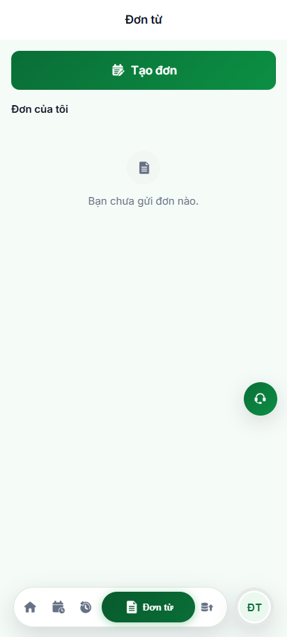
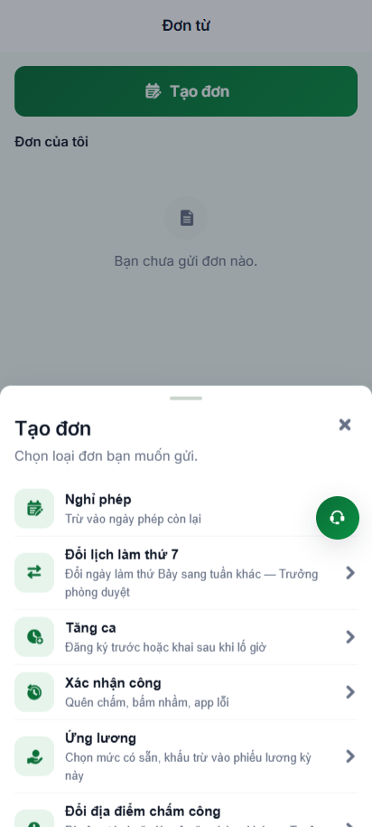
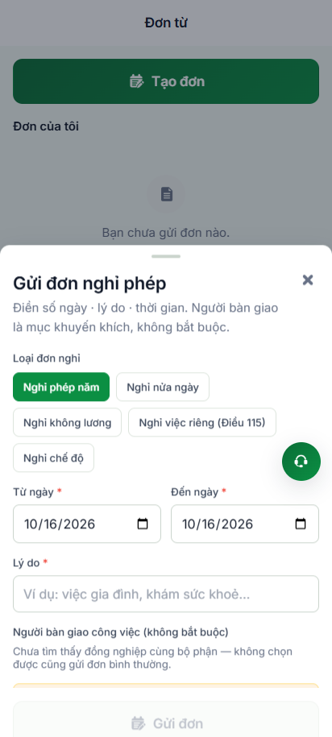
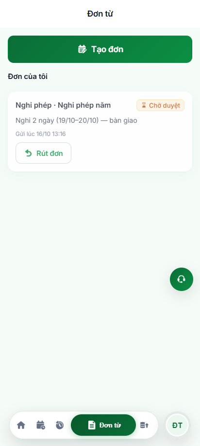
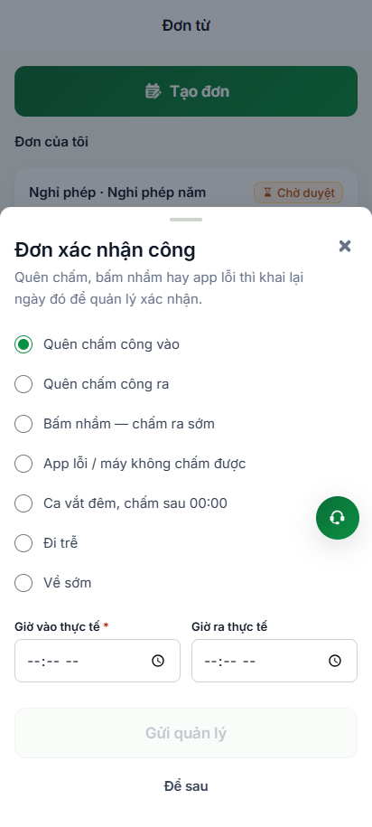
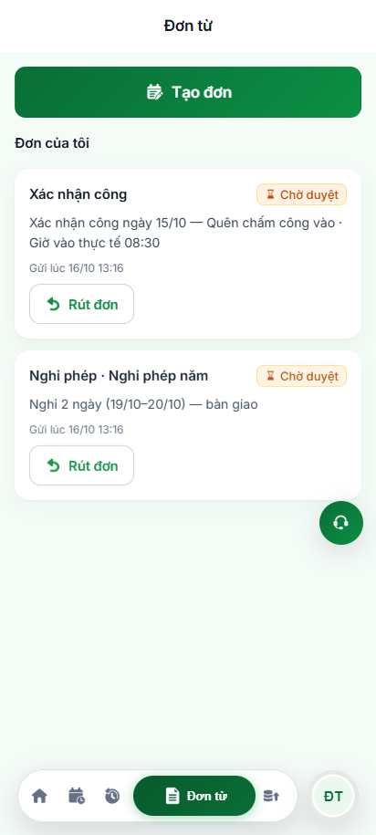
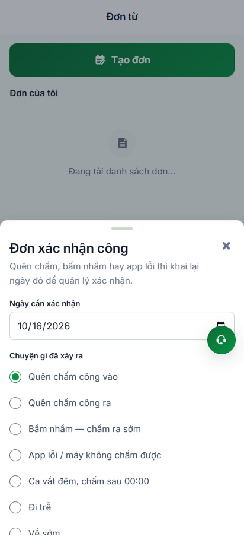
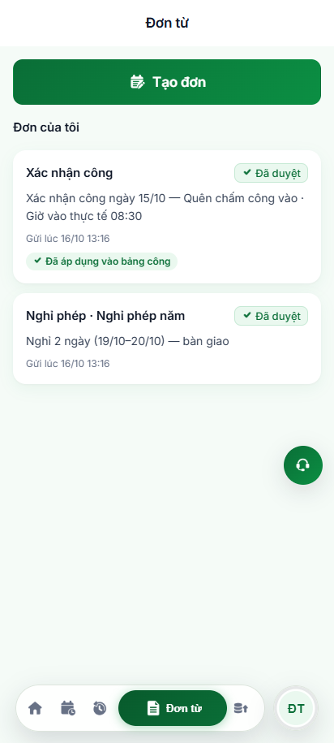
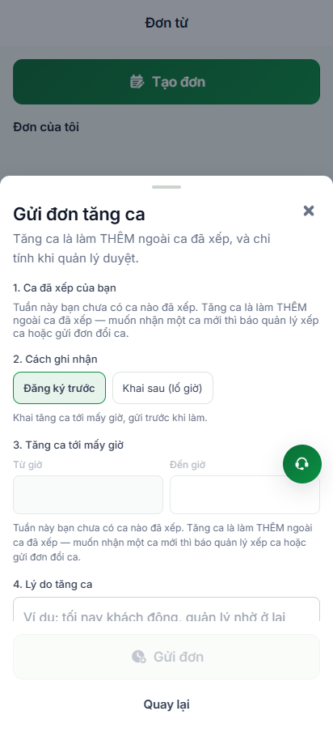

# Báo Cáo Kiểm Thử Tự Động Hoá: Đơn Từ & Đơn Xác Nhận Công (POM)

> **Môi trường:** Staging (`https://workdemo.vivacorp.vn`)  
> **Nền tảng:** VivaOffice Mobile App (Google Pixel 7 — 412 × 915)  
> **Công nghệ:** Playwright JS · Page Object Model (POM) · PostgREST API  
> **Chuẩn hóa Locator:** `getByRole`, `getByText`, `getByLabel`, `getByPlaceholder` (No `waitForTimeout`)  
> **Kết quả thực thi:** **9/9 Test Cases Spec PASSED (100%)**

---

## 1. Mục Tiêu & Phạm Vi Kiểm Thử

Hệ thống kiểm thử tự động được thiết kế nhằm chuẩn hoá toàn diện luồng quản lý và tạo đơn từ của nhân viên:
1. **Mô hình Page Object Model (POM):** Phân tách tách bạch giữa cấu trúc UI/Locators, hành động người dùng và logic kiểm thử (`expect`), sử dụng Web-First Assertions và Auto-Waiting.
2. **Kiểm thử Đơn xin nghỉ phép (`leave_request`):**
   - Mở Sheet "Tạo đơn" (`VBO-DT-11`), chọn loại đơn "Nghỉ phép".
   - Kiểm tra Validation: Chặn gửi (nút vô hiệu hoá) khi chưa nhập lý do.
   - Gửi đơn nghỉ phép hợp lệ (loại phép năm, khoảng ngày, lý do) và xác nhận đơn xuất hiện ở danh sách "Đơn của tôi" với trạng thái "Chờ duyệt".
3. **Kiểm thử Đơn xác nhận công / Bổ sung công (`attendance_confirm_request`):**
   - Mở Sheet "Đơn xác nhận công" (`VBO-DT-10`) cho các trường hợp quên chấm công, app lỗi, đi trễ, về sớm.
   - Kiểm tra Validation mốc giờ: Chọn lý do "Quên chấm công vào" mà chưa điền giờ vào thực tế thì hệ thống cảnh báo bắt buộc điền và khoá nút gửi.
   - Gửi đơn xác nhận công bổ sung cho ngày công hợp lệ với giờ vào thực tế và mô tả chi tiết.
   - Kiểm tra khả năng mở trực tiếp biểu mẫu qua liên kết nhanh Deep-link (`/don-tu?don=xac-nhan-cong`).
4. **Đối soát Database API & Phê duyệt:**
   - Đối soát trực tiếp các bản ghi lưu trong bảng `leave_request` và `attendance_confirm_request`.
   - Giả lập Quản lý / HR duyệt đơn qua API -> Màn hình nhân viên tự động cập nhật sang trạng thái "Đã duyệt" và hiển thị nhãn "Đã áp dụng vào bảng công".

---

## 2. Kiến Trúc Page Object Model (POM)

Mô hình POM được tổ chức bài bản tại thư mục `tests/`:

```
tests/
├── pages/
│   ├── BasePage.mjs                          # Lớp cơ sở chứa tiện ích Playwright (No waitForTimeout)
│   ├── LoginPage.mjs                         # POM Màn hình Đăng nhập (/dang-nhap)
│   ├── DonTuPage.mjs                         # POM Màn hình Đơn từ (/don-tu)
│   └── components/
│       ├── CreateRequestSheet.mjs            # Sheet danh mục loại đơn (VBO-DT-11)
│       ├── LeaveRequestSheet.mjs             # Sheet gửi đơn nghỉ phép (VBO-DT-05) - getByRole('textbox', { name: /lý do/i })
│       ├── AttendanceConfirmSheet.mjs        # Sheet đơn xác nhận công (VBO-DT-10)
│       └── OvertimeRequestSheet.mjs          # Sheet gửi đơn tăng ca (VBO-DT-09, VBO-DT-17.1)
├── helpers/
│   ├── profileApiHelper.mjs                  # Cấp tài khoản nhân viên & HR Admin Token (Cache & Backoff)
│   └── donTuApiHelper.mjs                    # Đối soát DB & API phê duyệt đơn từ
└── specs/
    ├── don-tu.spec.mjs                       # Spec kiểm thử Đơn từ & Xác nhận công (8 Test Cases)
    └── don-tu-overtime.spec.mjs              # Spec kiểm thử UX Đơn tăng ca trên Redmi 13 (TC-09)
scripts/
└── automation-don-tu.mjs                     # Script chạy độc lập xuất log & hình ảnh
```

---

## 3. Kết Quả Thực Thi Chi Tiết (8/8 Test Cases Spec PASS 100%)

| Mã Ca | Tên Ca Kiểm Thử | Thao Tác Nghiệp Vụ | Kỳ Vọng (Expect) | Trạng Thái | Thời Gian |
| :---: | :--- | :--- | :--- | :---: | :---: |
| **TC-01** | Đăng nhập App & Mở Đơn từ | Đăng nhập mã nhân viên mới, vào `/don-tu` | Hiển thị thông báo rỗng "Bạn chưa gửi đơn nào." | **PASS** | 3.4s |
| **TC-02** | Validation Đơn xin nghỉ phép | Mở Sheet Nghỉ phép, để trống ô Lý do | Nút "Gửi đơn" bị vô hiệu hoá (`disabled`) | **PASS** | 883ms |
| **TC-03** | Gửi Đơn xin nghỉ phép hợp lệ | Chọn loại phép năm, nhập khoảng ngày & lý do | Sheet tự đóng; thẻ Nghỉ phép xuất hiện "Chờ duyệt" | **PASS** | 1.8s |
| **TC-04** | Validation Đơn xác nhận công | Chọn "Quên chấm công vào", chưa nhập giờ | Cảnh báo mốc giờ hiển thị; nút "Gửi quản lý" bị khóa | **PASS** | 1.0s |
| **TC-05** | Gửi Đơn xác nhận công hợp lệ | Điền ngày công kết thúc, giờ vào & lý do | Sheet đóng; thẻ Xác nhận công xuất hiện "Chờ duyệt" | **PASS** | 2.3s |
| **TC-06** | Deep-link `?don=xac-nhan-cong` | Điều hướng thẳng URL có tham số query | Sheet Xác nhận công tự động mở sẵn trực tiếp | **PASS** | 713ms |
| **TC-07** | Đối soát Database API | Truy vấn bảng `leave_request` & `attendance_confirm_request` | Dữ liệu đơn lưu chính xác trong DB kho thật PostgREST | **PASS** | 1.2s |
| **TC-08** | Quản lý / HR duyệt đơn | HR duyệt 2 đơn qua API -> Reload trang | Cả 2 đơn chuyển "Đã duyệt", gắn chip "Đã áp dụng" | **PASS** | 1.6s |
| **TC-09** | UX Khóa giờ Đơn tăng ca (Redmi 13) | Mở Sheet Tăng ca khi chưa có ca xếp | Ô giờ disabled, placeholder `--:--`, hiển thị lý do & hướng dẫn liên hệ QL | **PASS** | 9.8s |

---

## 4. Phát Hiện Nghiệp Vụ Quan Trọng (Business Rules)

> [!IMPORTANT]
> **Quy tắc kết thúc ngày công (`XNC_NGAY_CHUA_KET_THUC` - Mã lỗi 23514):**  
> Cơ sở dữ liệu backend cài đặt ràng buộc nghiệp vụ: Không cho phép Quản lý duyệt Đơn xác nhận công cho ngày công **hôm nay** nếu ca làm việc chưa kết thúc. Đơn chỉ được duyệt khi ngày công đã kết thúc (ngày hôm qua hoặc các ngày trước đó), bảo đảm bảng công đã nhận đủ các lượt chấm công thực tế trước khi áp giờ bổ sung.

> [!TIP]
> **Tự động liên kết Bảng công (`applied_at`):**  
> Khi Đơn xác nhận công được duyệt, hệ thống kho tự động đối soát và gắn dấu hiệu `applied_at`, thẻ đơn của nhân viên lập tức xuất hiện nhãn màu xanh lá **"Đã áp dụng vào bảng công"**, đồng thời ẩn nút "Rút đơn" để ngăn ngừa can thiệp dữ liệu đã chốt.

---

## 5. Hình Ảnh Minh Chứng Thực Tế (Screenshots)

````carousel

<!-- slide -->

<!-- slide -->

<!-- slide -->

<!-- slide -->

<!-- slide -->

<!-- slide -->

<!-- slide -->

<!-- slide -->

````

---

## 6. Lệnh Chạy Kiểm Thử

Người dùng hoặc hệ thống CI/CD có thể thực thi dễ dàng qua 2 lệnh:

```bash
# 1. Chạy script automation xuất hình ảnh bằng chứng & console trực quan:
npm run test:don-tu

# 2. Chạy bộ kiểm thử qua Playwright Test Runner chuẩn POM:
npm run test:don-tu-pom
```
