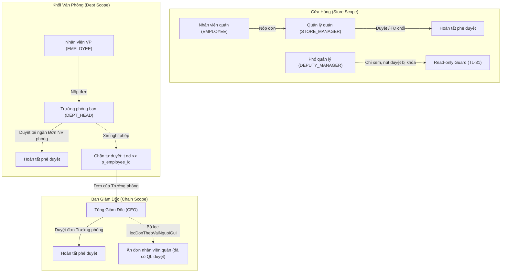

# Báo Cáo Kiểm Thử Tự Động: Luồng Duyệt Đơn Phân Cấp (Multi-Level Approval Hierarchy)

> **Phân hệ**: Duyệt Đơn & Phân Cấp Phê Duyệt (`/duyet-don`)  
> **Môi trường**: Staging VivaOffice (`https://workdemo.vivacorp.vn/duyet-don`)  
> **Framework**: Playwright POM (Page Object Model), User-facing Locators (`getByRole`, `getByText`)  
> **Test Spec**: [`tests/specs/requests/duyet-don-phan-cap.spec.mjs`](file:///c:/intern/vivaoffice/04-src/tests/specs/requests/duyet-don-phan-cap.spec.mjs)  
> **Page Object**: [`tests/pages/DuyetDonPage.mjs`](file:///c:/intern/vivaoffice/04-src/tests/pages/DuyetDonPage.mjs)  
> **Kết quả thực thi**: **6/6 Test Cases Passed (100%)** | Thời gian: 1.1m | Exit code: 0  

---

## 1. Tóm Tắt Nghiệp Vụ & Phân Tích Kiến Trúc Phê Duyệt (`[CODE-CONFIRMED]`)

Dựa trên việc phân tích mã nguồn tầng cơ sở dữ liệu (`05-admin/db/duyet-14b.sql`) và tầng giao diện (`04-src/src/features/duyet-don/` & `04-src/src/constants/duyetDon.ts`), hệ thống VivaOffice đã thiết lập mô hình phê duyệt phân cấp chặt chẽ:



### Chi Tiết Các Quy Tắc Nghiệp Vụ Cốt Lõi:
1. **Nhân viên quán (`EMPLOYEE` có `store_id`)**:
   - Được phê duyệt bởi Quản lý quán (`STORE_MANAGER`) hoặc Giám sát khu vực (`AREA_SUPERVISOR`).
2. **Phó quản lý quán (`DEPUTY_MANAGER`)**:
   - Theo đặc tả `TL-31 câu 9` & `SPEC-NS-09`: Có quyền mở `/duyet-don` để xem danh sách đơn của quán, nhưng các nút Duyệt/Từ chối bị vô hiệu hóa (`canApprove = false`).
3. **Nhân viên văn phòng (`EMPLOYEE` thuộc phòng ban, không gắn quán)**:
   - Được phê duyệt bởi Trưởng phòng (`DEPT_HEAD`).
   - Màn hình duyệt đơn của Trưởng phòng tách thành 2 ngăn chuyên biệt (`SPEC-DD-04` / `VBO-DD-08`):
     - **"Đơn nhân viên phòng"**: Danh sách đơn của cấp dưới trong bộ phận để duyệt.
     - **"Đơn của tôi"**: Đơn cá nhân do chính Trưởng phòng nộp.
4. **Quy tắc chặn tự phê duyệt (Self-Approval Guard)**:
   - Tầng DB (`duyet-14b.sql:53`): Ràng buộc cứng `and t.nd <> p_employee_id`.
   - Tầng Ứng dụng (`duyetDonRepo.ts:107` & `laDonCuaToi`): Đơn của chính mình bị loại bỏ hoàn toàn khỏi hàng chờ duyệt ở ngăn "Đơn nhân viên phòng".
   - Tại ngăn "Đơn của tôi": Ẩn hoàn toàn 2 nút Duyệt/Từ chối (`hideDecisionButtons = true`), hiển thị thông báo: *"Đây là đơn của chính bạn. Bạn không thể tự duyệt đơn của mình."*
5. **Tổng Giám Đốc (`CEO`)**:
   - Theo `SPEC-DD-07` & `BUG-000038`: Hàng việc của CEO được thu hẹp tự động qua hàm `locDonTheoVaiNguoiGui()`.
   - CEO chỉ thấy đơn của các cấp Trưởng phòng ban (`VAI_NGUOI_GUI_CEO_THAY: ["DEPT_HEAD", "HR_MANAGER"]`).
   - Đơn của nhân viên thường được tự động lọc ẩn kèm banner thông báo nghiệp vụ (`VBO-DD-09`): *"Màn này chỉ hiện đơn của các trưởng phòng ban. Đơn của nhân viên đã có quản lý quán hoặc trưởng bộ phận của họ duyệt nên không hiện ở đây."*

---

## 2. Kết Quả Kiểm Thử Tự Động Playwright E2E (POM)

| STT | Mã Test Case | Vai Trò Thực Hiện | Kịch Bản & Trọng Tâm Kiểm Chứng | Kết Quả | Thời Gian |
| :---: | :--- | :--- | :--- | :---: | :---: |
| 1 | **TC-DD-01** | `STORE_MANAGER` | Quản lý quán duyệt đơn xin nghỉ phép của nhân viên quán thành công | **PASS** | 12.8s |
| 2 | **TC-DD-02** | `DEPUTY_MANAGER` | Phó quản lý quán xem được đơn, nút Duyệt bị khóa kèm lý do chỉ xem | **PASS** | 11.4s |
| 3 | **TC-DD-03** | `DEPT_HEAD` | Trưởng phòng duyệt đơn của nhân viên văn phòng tại tab "Đơn nhân viên phòng" | **PASS** | 10.3s |
| 4 | **TC-DD-04** | `DEPT_HEAD` | Trưởng phòng nộp đơn: Hệ thống chặn tự duyệt (tab "Đơn của tôi" không có nút Duyệt) | **PASS** | 9.2s |
| 5 | **TC-DD-05** | `CEO` | CEO đăng nhập: Banner thu hẹp hiển thị, ẩn đơn nhân viên quán, hiện đơn Trưởng phòng | **PASS** | 9.4s |
| 6 | **TC-DD-06** | `CEO` | CEO thực hiện phê duyệt đơn xin nghỉ phép của Trưởng phòng thành công | **PASS** | 9.9s |

---

## 3. Nhật Ký Thực Thi CLI & Bằng Chứng Khách Quan

```bash
Running 6 tests using 1 worker

  ok 1 tests/specs/requests/duyet-don-phan-cap.spec.mjs:35:3 › TC-DD-01: Quản lý quán duyệt đơn thành công (12.8s)
  ok 2 tests/specs/requests/duyet-don-phan-cap.spec.mjs:78:3 › TC-DD-02: Phó quản lý quán (DEPUTY_MANAGER) có quyền xem nhưng KHÔNG được duyệt (11.4s)
  ok 3 tests/specs/requests/duyet-don-phan-cap.spec.mjs:124:3 › TC-DD-03: Nhân viên văn phòng gửi đơn -> Trưởng phòng (DEPT_HEAD) duyệt đơn (10.3s)
  ok 4 tests/specs/requests/duyet-don-phan-cap.spec.mjs:171:3 › TC-DD-04: Trưởng phòng xin nghỉ phép -> Hệ thống chặn tự duyệt (9.2s)
  ok 5 tests/specs/requests/duyet-don-phan-cap.spec.mjs:218:3 › TC-DD-05: CEO đăng nhập -> Hệ thống thu hẹp bộ lọc, chỉ hiện đơn Trưởng phòng (9.4s)
  ok 6 tests/specs/requests/duyet-don-phan-cap.spec.mjs:282:3 › TC-DD-06: CEO phê duyệt đơn xin nghỉ phép của Trưởng phòng thành công (9.9s)

  6 passed (1.1m)
```

Kết hợp chạy song song kiểm tra hồi quy cùng bộ đơn từ cơ bản: **14/14 test cases Passed 100%** (1.3m).

---

## 4. Tài Liệu Kiểm Thử & Tích Hợp Đã Hoàn Thành
- **File Test Case Excel**: [`testcases/duyet-don/duyet-don-testcases.xlsx`](file:///c:/intern/vivaoffice/testcases/duyet-don/duyet-don-testcases.xlsx)
- **File Test Case JSON (CI/CD)**: [`testcases/duyet-don/duyet-don-testcases.json`](file:///c:/intern/vivaoffice/testcases/duyet-don/duyet-don-testcases.json)
- **Thư mục kịch bản độc lập (PR Review)**: [`testcases/duyet-don/cases/`](file:///c:/intern/vivaoffice/testcases/duyet-don/cases/)
- **Mã nguồn POM**: [`04-src/tests/pages/DuyetDonPage.mjs`](file:///c:/intern/vivaoffice/04-src/tests/pages/DuyetDonPage.mjs)
- **Mã nguồn Test Spec**: [`04-src/tests/specs/requests/duyet-don-phan-cap.spec.mjs`](file:///c:/intern/vivaoffice/04-src/tests/specs/requests/duyet-don-phan-cap.spec.mjs)
