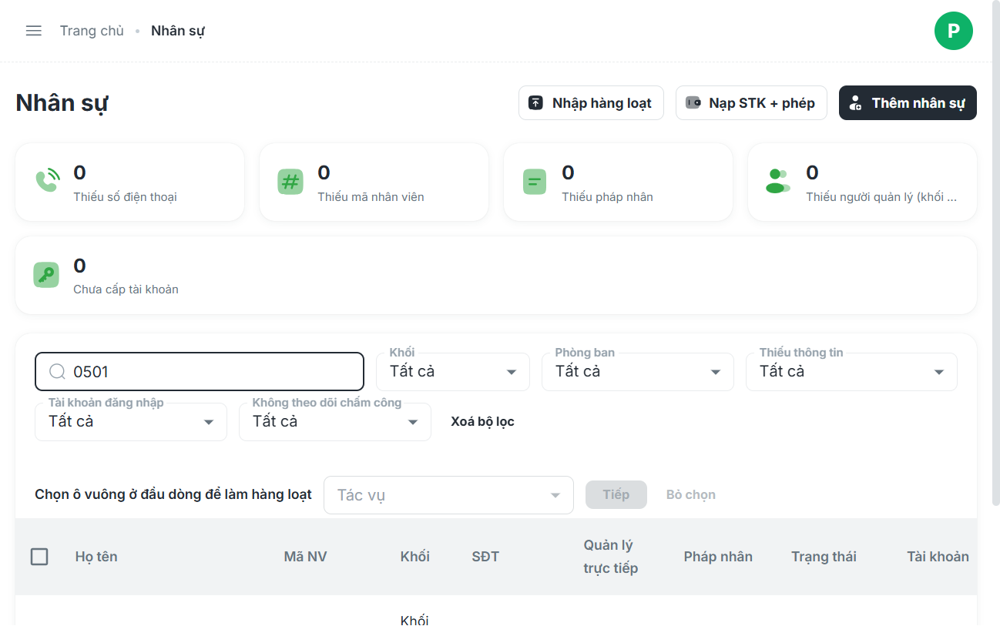
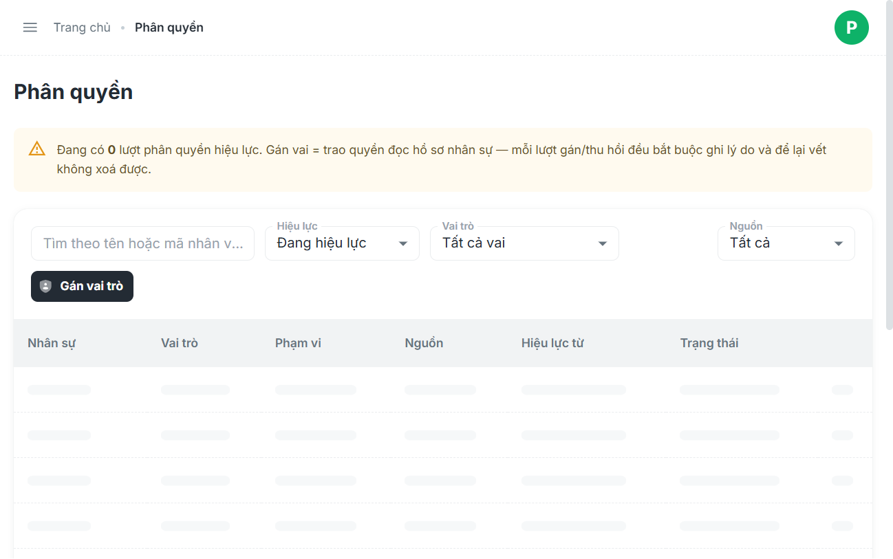
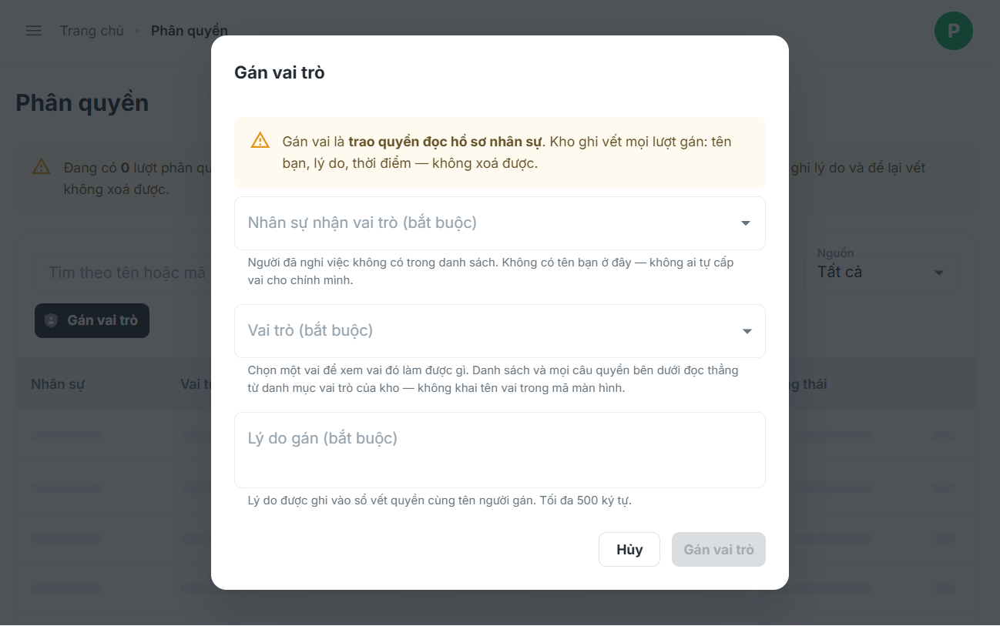
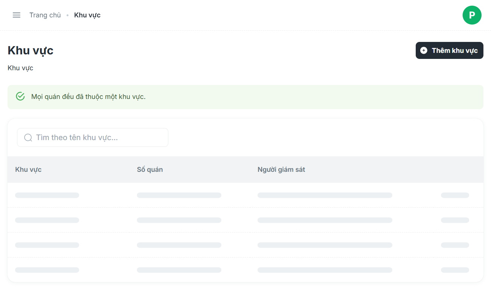
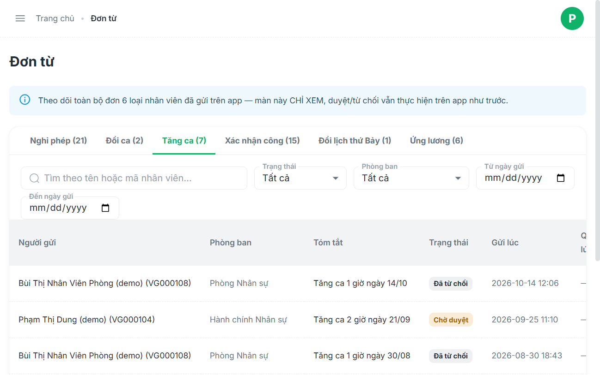

# Danh Sách Phiếu Báo Lỗi (GitHub Issue Templates)

Tập hợp 5 phiếu báo lỗi chuẩn hóa theo mẫu GitHub Issue, kèm mã nguồn đối soát và đường dẫn ảnh minh chứng thực tế trên Staging (`https://workdemo.vivacorp.vn`).

---

## 📌 PHIẾU BÁO LỖI 1: NHÂN SỰ ĐÃ NGHỈ VIỆC KHÔNG TỰ ĐỘNG THU HỒI VAI TRÒ

### Tiêu đề GitHub Issue:
`[BUG] Nhân sự đã nghỉ việc nhưng không tự động thu hồi vai trò trong user_role gây nghẽn gán Quản lý quán mới`

### Labels:
`bug`, `backend`, `database`, `lifecycle`, `p1-high`

### Mô tả (Description):
Khi bộ phận nhân sự thực hiện chức năng "Cho nghỉ việc" đối với một nhân viên (`employee.status = 'resigned'`), hệ thống chỉ thực hiện khóa tài khoản đăng nhập (`auth_login.is_active = false`), nhưng **KHÔNG hề cập nhật thu hồi các vai trò trong bảng `user_role`**. Các dòng vai trò này vẫn tồn tại ở trạng thái "Đang hiệu lực" (`valid_to IS NULL`).

### Tác động nghiêm trọng (Impact):
Do bảng `user_role` có ràng buộc duy nhất `ux_user_role_one_store_manager` (1 quán chỉ có tối đa 1 Quản lý quán còn hiệu lực), khi một Quản lý quán nghỉ việc, vai trò cũ của họ vẫn chiếm giữ vị trí. Khi HR bổ nhiệm Quản lý mới cho quán đó, hệ thống sẽ **báo lỗi vi phạm Unique Constraint và chặn cứng thao tác gán Quản lý mới**.

### Các bước tái hiện (Steps to Reproduce):
1. Vào `Quản trị > Nhân sự` (`#/nhan-su`).
2. Tìm kiếm nhân sự `NV_OFF_0501` hoặc `NV_OFF_1692` -> Xác nhận trạng thái là **"Đã nghỉ việc"** và tài khoản **"⚠ Đã khoá"**.
3. Chuyển sang màn hình `Quản trị > Phân quyền` (`#/phan-quyen`).
4. Tìm kiếm mã nhân sự trên -> Thấy vai trò vẫn hiển thị với trạng thái **"Đang hiệu lực"** kèm nút **"Thu hồi"**.

### Hành vi kỳ vọng (Expected Behavior):
Khi nhân viên chuyển sang trạng thái `resigned`, hệ thống phải tự động cập nhật `valid_to = NOW()` cho toàn bộ các vai trò mà nhân sự đó đang nắm giữ trong bảng `user_role`.

### Hành vi thực tế (Actual Behavior):
Tài khoản bị khóa đăng nhập nhưng vai trò trong `user_role` vẫn "Đang hiệu lực".

### Vị trí mã nguồn liên quan:
- Database trigger: `trg_employee_status_to_login` trên bảng `employee`.
- Bảng liên quan: `employee`, `auth_login`, `user_role`.

### Ảnh minh chứng (Screenshots):
- Nhân sự đã nghỉ việc và bị khóa tài khoản:
  
- Vai trò vẫn tồn tại "Đang hiệu lực" trên màn Phân quyền:
  

### Hướng khắc phục đề xuất (Proposed Solution):
Bổ sung trigger hoặc mở rộng `trg_employee_status_to_login`:
```sql
CREATE OR REPLACE FUNCTION trg_revoke_roles_on_resign()
RETURNS TRIGGER AS $$
BEGIN
  IF NEW.status = 'resigned' AND OLD.status <> 'resigned' THEN
    UPDATE user_role 
    SET valid_to = NOW() 
    WHERE user_id = NEW.id AND valid_to IS NULL;
  END IF;
  RETURN NEW;
END;
$$ LANGUAGE plpgsql;
```

---

## 📌 PHIẾU BÁO LỖI 2: ĐỔI KHỐI MỘT CHIỀU KHI GÁN VAI TRÒ GÂY SAI KỲ CÔNG & LƯƠNG

### Tiêu đề GitHub Issue:
`[BUG] Tự động đổi khối một chiều khi gán Quản lý/Giám sát (Quán -> VP) nhưng khi thu hồi không hoàn trả gây sai lệch chu kỳ công`

### Labels:
`bug`, `payroll`, `timesheet`, `roles`, `p1-high`

### Mô tả (Description):
Khi gán vai trò Quản lý quán (`store_manager`) hoặc Giám sát (`supervisor`) cho một nhân sự khối quán (`store`), mã nguồn Frontend tự động gửi request cập nhật hồ sơ nhân sự sang khối văn phòng (`block: 'office'`) nhằm cấp quyền truy cập. Tuy nhiên, khi HR thực hiện thao tác **"Thu hồi"** vai trò, hệ thống chỉ cập nhật `valid_to` trên `user_role` mà **không hoàn trả `block` về `store`**.

### Tác động nghiêm trọng (Impact):
- Khối văn phòng (`office`) có chu kỳ chốt công theo tháng dương lịch (01 đến cuối tháng).
- Khối quán (`store`) có chu kỳ chốt công từ ngày 21 tháng này đến ngày 20 tháng sau.
- Nhân viên khối quán sau khi hết thời hạn làm Quản lý/Giám sát bị kẹt vĩnh viễn ở khối `office`, dẫn đến việc hệ thống gom công, tính OT, phạt đi muộn và tính lương sai chu kỳ hoàn toàn.

### Các bước tái hiện (Steps to Reproduce):
1. Chọn một nhân sự đang ở khối Quán (`block = 'store'`).
2. Vào `#/phan-quyen`, bấm "Gán vai trò" -> Chọn vai Quản lý quán.
3. Kiểm tra thông tin nhân sự -> Trường `Khối` đã tự chuyển thành `office`.
4. Bấm "Thu hồi" vai trò của nhân sự này.
5. Kiểm tra lại thông tin hồ sơ nhân sự -> Trường `Khối` vẫn là `office`, không tự về `store`.

### Vị trí mã nguồn liên quan:
- File `05-admin/src/pages/roles/useRolesList.ts`:
  - Hàm `handleAssignRole`:
    ```ts
    if (roleCode === 'store_manager' || roleCode === 'area_supervisor') {
      await employeesProvider.update(employeeId, { block: 'office' });
    }
    ```
  - Hàm `handleRevokeRole`:
    ```ts
    // Chỉ cập nhật validTo, không có logic hoàn trả block
    await rolesProvider.update(roleId, { validTo: new Date().toISOString() });
    ```

### Ảnh minh chứng (Screenshots):
- Modal gán vai trò Quản lý quán:
  

### Hướng khắc phục đề xuất (Proposed Solution):
- Không nên thay đổi trường `block` vật lý của hồ sơ nhân viên để phục vụ phân quyền. Quyền truy cập ứng dụng quản trị nên dựa hoàn toàn vào vai trò trong `user_role`.
- Nếu bắt buộc duy trì logic đổi khối, cần lưu lại `original_block` trong hồ sơ và tự động khôi phục trong `handleRevokeRole` hoặc bằng DB trigger.

---

## 📌 PHIẾU BÁO LỖI 3: KHÔNG CHẶN TRÙNG KHI GÁN VAI TRÒ ĐƠN LẺ

### Tiêu đề GitHub Issue:
`[BUG] Màn hình Phân quyền không chặn gán trùng cùng một vai trò cho một nhân sự`

### Labels:
`bug`, `frontend`, `database`, `roles`, `p2-medium`

### Mô tả (Description):
Màn hình Phân quyền (`#/phan-quyen`) không thực hiện kiểm tra các vai trò hiện có của nhân sự khi thực hiện thao tác gán vai mới. Ngoại trừ vai Quản lý quán có unique constraint riêng, các vai trò khác (nhân viên văn phòng, nhân viên quán, giám sát, kế toán...) có thể được gán nhiều lần cho cùng một người.

### Tác động (Impact):
- Bảng `user_role` sinh ra nhiều dòng trùng lặp dữ liệu (`duplicate records`) cho cùng một cặp `(user_id, role_code)`.
- Khi cần thu hồi quyền của nhân sự, người quản trị phải tìm và bấm nút "Thu hồi" thủ công cho từng dòng một.

### Các bước tái hiện (Steps to Reproduce):
1. Vào `#/phan-quyen`, bấm "Gán vai trò".
2. Chọn một nhân viên A và chọn vai trò "Nhân viên". Bấm Lưu.
3. Bấm "Gán vai trò" lần 2, tiếp tục chọn nhân viên A và vai trò "Nhân viên". Bấm Lưu.
4. Hệ thống không cảnh báo, tạo ra 2 dòng vai trò giống hệt nhau cho nhân viên A.

### Vị trí mã nguồn liên quan:
- Modal gán vai trong `05-admin/src/pages/roles/RoleAssignModal.tsx` và `useRolesList.ts`.
- Bảng cơ sở dữ liệu `user_role` thiếu ràng buộc Unique `(user_id, role_code)` cho các dòng đang có hiệu lực (`valid_to IS NULL`).

### Ảnh minh chứng (Screenshots):
- Modal gán vai trò không kiểm tra trùng:
  

### Hướng khắc phục đề xuất (Proposed Solution):
1. **Database**: Bổ sung Unique Index có điều kiện:
   ```sql
   CREATE UNIQUE INDEX ux_user_role_active_unique 
   ON user_role (user_id, role_code) 
   WHERE valid_to IS NULL;
   ```
2. **Frontend**: Tại dropdown chọn vai trò, vô hiệu hóa (disable) hoặc ẩn các vai trò mà nhân viên đó đang sở hữu.

---

## 📌 PHIẾU BÁO LỖI 4: LỖI XÓA KHU VỰC GỠ CỬA HÀNG TRƯỚC XÓA KHU VỰC SAU (GÂY VĂNG CỬA HÀNG)

### Tiêu đề GitHub Issue:
`[BUG] Client gỡ liên kết cửa hàng trước khi xóa Khu vực gây mất cấu trúc tổ chức khi API xóa khu vực gặp lỗi`

### Labels:
`bug`, `frontend`, `architecture`, `transaction`, `p1-high`

### Mô tả (Description):
Tại màn hình Quản lý Khu vực (`#/khu-vuc`), quy trình xóa khu vực được xử lý hoàn toàn phía Client qua 2 bước gọi API độc lập không nằm trong một Database Transaction:
1. Gỡ liên kết toàn bộ cửa hàng thuộc khu vực bằng cách gọi hàng loạt `PATCH /api/stores/:id` với `{ areaId: '' }`.
2. Sau khi tất cả cửa hàng bị gỡ, mới gọi `DELETE /api/areas/:id`.

### Tác động nghiêm trọng (Impact):
Nếu Khu vực đó đang có ràng buộc dữ liệu phía DB (ví dụ: liên kết bảng phân công giám sát khu vực chưa được dọn dẹp) khiến lệnh `DELETE` ở Bước 2 thất bại:
- **Khu vực không xóa được.**
- **Toàn bộ cửa hàng trực thuộc đã bị gỡ sạch (`areaId = ''`) và văng ra khỏi khu vực.**
- Cấu trúc cây tổ chức cửa hàng - khu vực bị phá hủy, người quản trị phải đi gán lại từng cửa hàng thủ công.

### Vị trí mã nguồn liên quan:
- File `05-admin/src/pages/areas/useAreasList.ts` (dòng 112 - 128):
  ```ts
  // Lỗi: Chạy gỡ cửa hàng trước
  await Promise.all(
    areaStores.map((s) => storesProvider.update(s.id, { areaId: '' }))
  );
  // Lỗi: Xóa khu vực sau, nếu lỗi thì cửa hàng đã bị mất areaId
  await areasProvider.delete(id);
  ```

### Ảnh minh chứng (Screenshots):
- Màn hình Quản lý khu vực và danh sách cửa hàng:
  

### Hướng khắc phục đề xuất (Proposed Solution):
- Xóa bỏ việc gọi gỡ cửa hàng lẻ tẻ từ Frontend.
- Chuyển toàn bộ quy trình sang một Stored Procedure / RPC Backend có `BEGIN ... COMMIT / ROLLBACK` hoặc xử lý bằng trigger `ON DELETE SET NULL` tại mức Database để đảm bảo tính toàn vẹn dữ liệu (Atomic Transaction).

---

## 📌 PHIẾU BÁO LỖI 5: LUỒNG DUYỆT ĐƠN KHÔNG ĐỒNG BỘ DỮ LIỆU BẢNG CÔNG (ĐƠN TĂNG CA & XÁC NHẬN CÔNG)

### Tiêu đề GitHub Issue:
`[BUG] Duyệt đơn tăng ca và xác nhận công không đồng bộ dữ liệu vào bảng công thực tế (timesheet_day)`

### Labels:
`bug`, `payroll`, `timesheet`, `requests`, `p1-high`

### Mô tả (Description):
Khi người quản lý phê duyệt đơn từ của nhân viên trên màn hình Quản lý Đơn từ (`#/don-tu`), trạng thái của đơn chuyển thành `approved`, tuy nhiên dữ liệu không được đồng bộ tự động vào bảng công thực tế (`timesheet_day`):
1. **Đơn tăng ca (Overtime)**: Không tự động cộng dồn số giờ tăng ca vào trường `ot_day_hours` hay `ot_night_hours` của ngày tương ứng. Trên môi trường Staging hiện tại, toàn bộ đơn tăng ca không sinh ra được giờ công OT nào cho nhân sự.
2. **Đơn xác nhận công**: Sau khi được duyệt, giờ check-in / check-out đã xác nhận không tự động cập nhật vào các trường giờ vào/ra thực tế của ngày công mà phụ thuộc vào việc chạy tác vụ ngầm `attendance_recompute`.
3. **Đơn nghỉ phép**: Không đồng bộ chính xác `day_value` (0.5 hay 1.0 công), dẫn đến việc màn hình chốt công nhận diện là 0 công.

### Tác động nghiêm trọng (Impact):
- Nhân viên làm tăng ca hoặc xin xác nhận công được sếp duyệt nhưng cuối tháng bảng lương vẫn không có tiền tăng ca hoặc bị tính nghỉ không lương.
- Phát sinh khiếu nại lương hàng loạt và áp lực đối soát thủ công khổng lồ cho bộ phận C&B.

### Các bước tái hiện (Steps to Reproduce):
1. Đăng nhập tài khoản Quản trị, vào `#/don-tu`.
2. Kiểm tra tab "Tăng ca" -> Thấy 7 đơn nhưng 0 đơn nào ở trạng thái "Đã duyệt" có tác động lên bảng công.
3. Kiểm tra ngày công tương ứng trên bảng công (`#/bang-cong`) -> Giờ OT và giờ làm thực tế không đổi.

### Vị trí mã nguồn & Tài liệu kiến trúc:
- Tài liệu kiến trúc: [`02-docs/49_HE-QUA-DUYET-DON.md`](file:///c:/intern/vivaoffice/02-docs/49_HE-QUA-DUYET-DON.md) (mục L1 - L19).
- Bảng cơ sở dữ liệu: `timesheet_day`, `overtime_request`, `attendance_confirmation`.

### Ảnh minh chứng (Screenshots):
- Màn hình đơn từ tăng ca (0 đơn được duyệt sinh công):
  

### Hướng khắc phục đề xuất (Proposed Solution):
Triển khai Trigger hoặc Domain Event sau khi đơn chuyển sang `status = 'approved'`:
- Tự động cập nhật `timesheet_day` của ngày tương ứng.
- Tính toán lại tổng công thực tế và số giờ làm thêm (OT) ngay lập tức.

