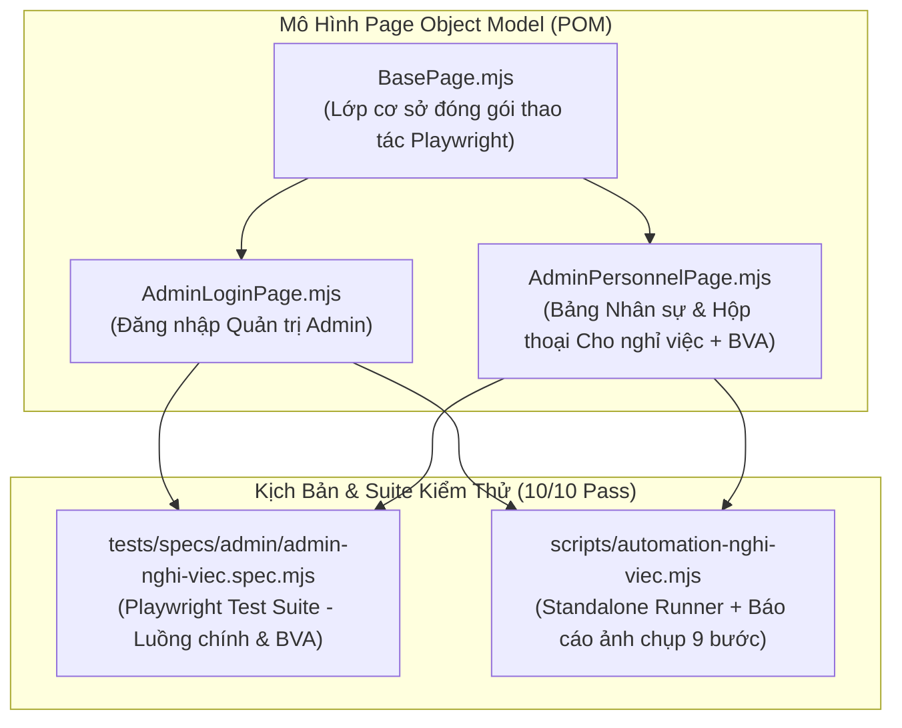
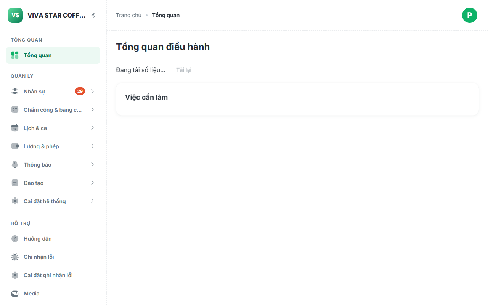
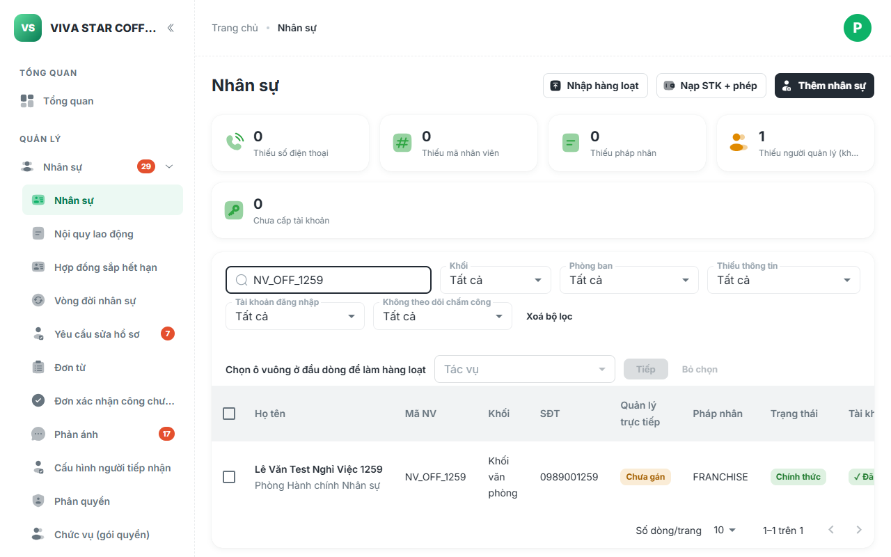
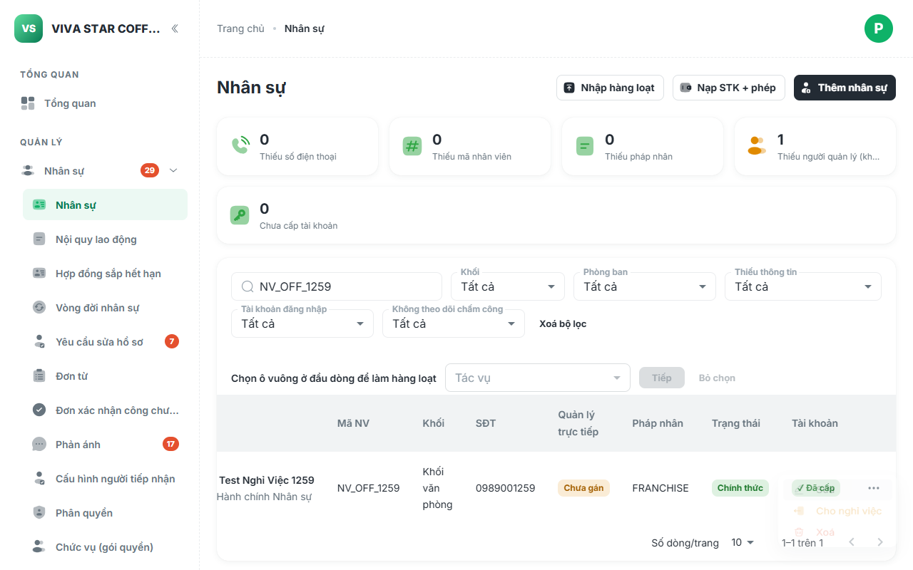
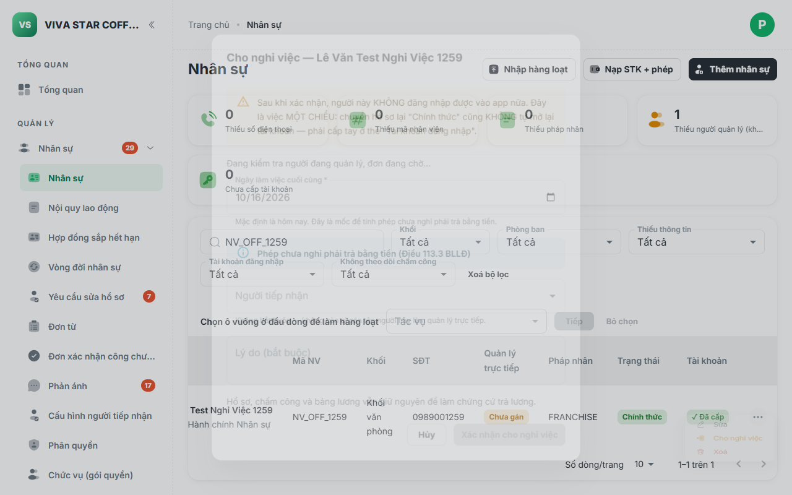
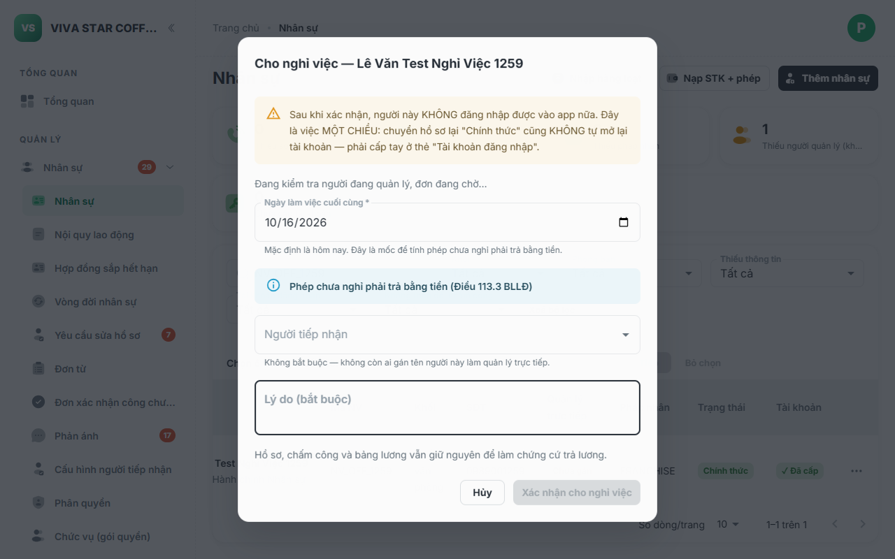
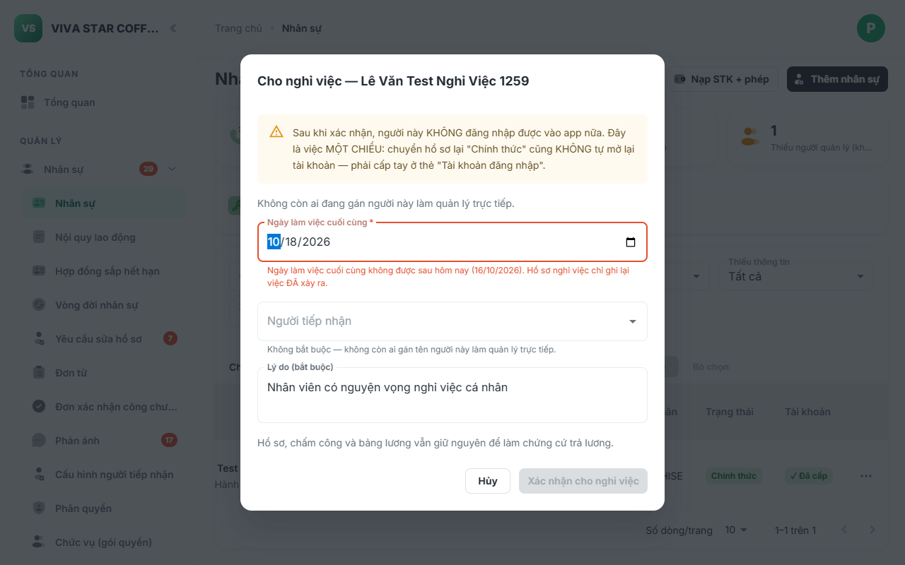
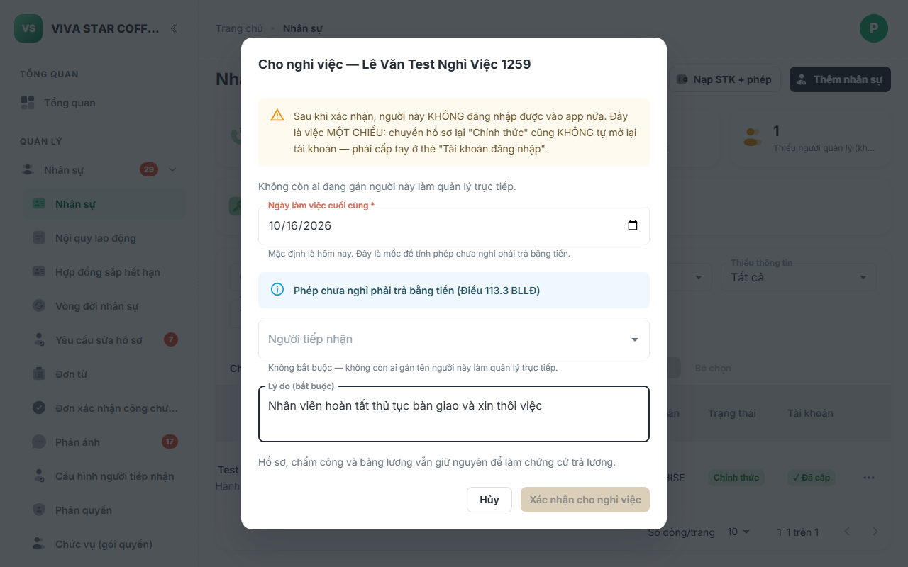
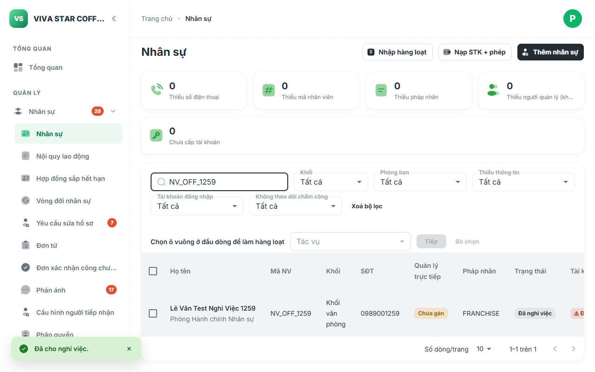
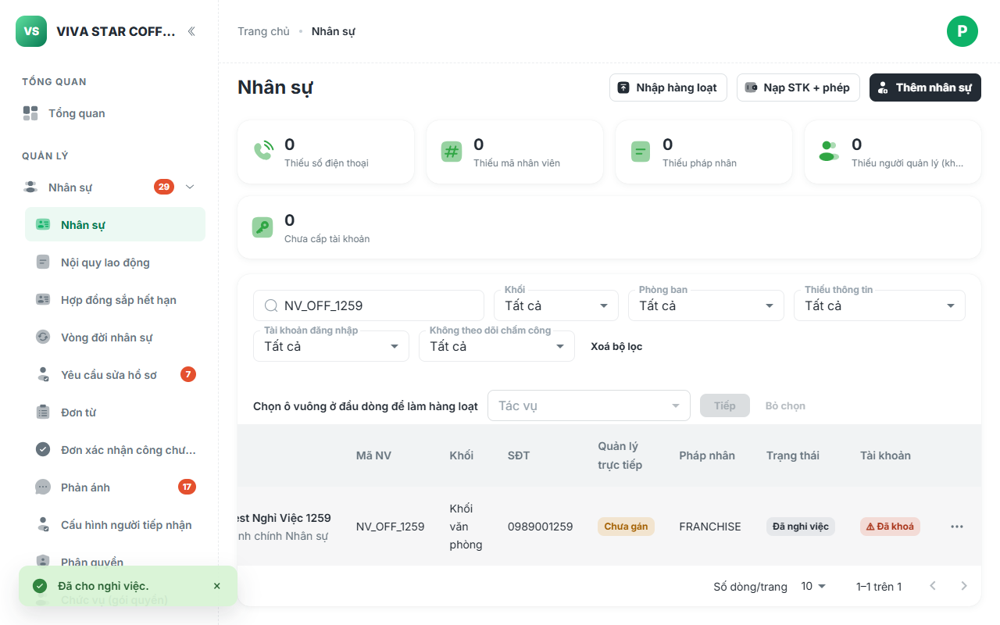

# Báo Cáo Kiểm Thử Tự Động E2E: Admin Cho Nhân Sự Nghỉ Việc (POM & BVA)

> [!NOTE]
> Báo cáo ghi nhận kết quả triển khai kiểm thử tự động E2E cho phân hệ **Cho nhân sự nghỉ việc** (`PersonnelResignDialog` — mã định danh `VADM-AD-02-25`) trên **Cổng Quản trị Admin VivaOffice** theo chuẩn **Page Object Model (POM)** kết hợp kiểm thử chuyên sâu **Giá trị biên (Boundary Value Analysis - BVA)**.

---

## 1. Tổng Quan Kiến Trúc & Thiết Kế Page Object Model (POM)

Màn hình Quản lý Nhân sự nằm tại tuyến đường `#/nhan-su` trên cổng quản trị Admin (`05-admin`). Tính năng cho nghỉ việc là một thao tác quản trị đặc biệt thuộc thẩm quyền của Ban Nhân sự (**HR Admin** — `is_hr_admin()`). 

Thao tác cho nghỉ việc đi kèm ràng buộc nghiệp vụ một chiều nghiêm ngặt (**SPEC-AD-238** & **SPEC-AD-459**):
1. **Trigger kho một chiều**: Khi nhân viên chuyển trạng thái sang `status='resigned'`, trigger `trg_employee_status_to_login` của cơ sở dữ liệu lập tức thu hồi phiên và vô hiệu hóa vé đăng nhập vào app nhân viên.
2. **Ẩn mục thao tác sau nghỉ việc**: Đối với nhân sự đã có trạng thái `resigned`, menu 3 chấm sẽ ẩn hoàn toàn mục "Cho nghỉ việc" để ngăn chặn việc ghi đè ngày nghỉ lần thứ hai.
3. **Bàn giao công việc & cấp dưới**: Hộp thoại tự động phân tích và yêu cầu chỉ định người tiếp nhận bàn giao nếu nhân sự đang giữ vai trò quản lý có cấp dưới trực tiếp.



### Các Lớp Đối Tượng Trang (POMs)

1. **[`AdminPersonnelPage.mjs`](file:///c:/intern/vivaoffice/04-src/tests/pages/admin/AdminPersonnelPage.mjs)**:
   - **Thành phần giao diện**:
     - Tiêu đề màn hình: `page.getByRole('heading', { name: 'Nhân sự', level: 4 })`
     - Ô tìm kiếm: `page.getByPlaceholder(/tìm theo tên|mã/i)`
     - Bảng danh sách & dòng dữ liệu: `table tbody tr`
     - Menu thao tác 3 chấm: `ul[role="menu"]` (`Sửa`, `Cho nghỉ việc`, `Xoá`)
     - Hộp thoại Cho nghỉ việc (`VADM-AD-02-25`): Cảnh báo một chiều, Ngày làm việc cuối cùng (`input[type="date"]`), Người tiếp nhận, Ô Lý do (`textarea`), Nút Xác nhận cho nghỉ việc, Nút Hủy.
   - **Phương thức nghiệp vụ & BVA**:
     - `navigateList(baseUrl)`: Điều hướng đến `#/nhan-su` và kiểm tra bảng dữ liệu sẵn sàng.
     - `searchEmployee(keyword)`: Tìm kiếm nhân viên theo tên hoặc mã nhân viên.
     - `openActionMenu(nameOrCode)`: Mở menu 3 chấm của dòng nhân sự tương ứng.
     - `openResignDialog(nameOrCode)`: Nhấp chọn "Cho nghỉ việc" và chờ hộp thoại xuất hiện.
     - `fillReason(reason)` & `clearReason()`: Thao tác trên ô nhập lý do.
     - `setLastDay(dateStr)`: Thiết lập mốc ngày nghỉ việc.
     - `expectConfirmDisabled()` & `expectConfirmEnabled()`: Kiểm tra tính sẵn sàng của nút Xác nhận theo luật validation.
     - `expectDateValidationError(errorText)`: Đối soát thông báo lỗi khi nhập ngày nghỉ sai quy định.
     - `submitResign()`: Xác nhận cho nghỉ việc và chờ hộp thoại đóng lại.
     - `expectEmployeeStatus(nameOrCode, statusLabel)`: Đối soát nhãn trạng thái `"Đã nghỉ việc"` trên bảng.
     - `expectResignMenuItemVisible(nameOrCode, isVisible)`: Kiểm tra ẩn/hiện mục "Cho nghỉ việc" theo quy tắc SPEC-AD-238.

---

## 2. Kết Quả Kiểm Thử Chi Tiết (10/10 Ca Đạt 100%)

Cả hai bộ công cụ kiểm thử (**Playwright Spec** và **Standalone Script**) đã chạy thành công 100% trên môi trường Staging Live:

| Nhóm | Mã Ca | Tên Ca Kiểm Thử | Trạng Thái | Thời Gian | Ghi Chú Nghiệp Vụ & Biên |
| :--- | :--- | :--- | :---: | :---: | :--- |
| **Khởi tạo & Điều hướng** | **ADM-NV-01** | Đăng nhập Quản trị Admin (`/quan-tri/#/login`) | **PASS** | 4.2s | Quyền HR Admin `dung.demo@vi-du.test`, vào Dashboard |
| | **ADM-NV-02** | Điều hướng Màn hình Nhân sự (`#/nhan-su`) | **PASS** | 695ms | Tải đủ tiêu đề, ô tìm kiếm và bảng danh sách nhân sự |
| | **ADM-NV-03** | Tìm kiếm nhân viên kiểm thử & mở Menu thao tác | **PASS** | 1.4s | Tìm thấy nhân viên và mở menu hiển thị mục "Cho nghỉ việc" |
| | **ADM-NV-04** | Mở Hộp thoại Cho nghỉ việc & kiểm tra giao diện | **PASS** | 893ms | Hiển thị cảnh báo một chiều, ô ngày làm việc và ô lý do |
| **Giá trị biên (BVA)** | **ADM-NV-BVA-01** | [Biên dưới] Lý do để trống hoặc chỉ có khoảng trắng | **PASS** | 175ms | Nút xác nhận bị vô hiệu (`disabled`), không cho lưu lý do rỗng |
| | **ADM-NV-BVA-02** | [Biên dưới hợp lệ] Điền lý do hợp lệ $\rightarrow$ Kích hoạt nút | **PASS** | 144ms | Nút xác nhận lập tức chuyển sang trạng thái sẵn sàng (`enabled`) |
| | **ADM-NV-BVA-03** | [Biên ngày nghỉ] Đặt ngày nghỉ ở tương lai | **PASS** | 254ms | Báo lỗi `không được sau hôm nay`, khóa nút xác nhận |
| **Xác nhận & Hệ quả** | **ADM-NV-05** | Điền thông tin hợp lệ & Xác nhận cho nghỉ việc | **PASS** | 410ms | Gửi lệnh thành công qua RPC `cho_nghi_viec_co_ban_giao` |
| | **ADM-NV-06** | Đối soát trạng thái nhân viên chuyển sang "Đã nghỉ việc" | **PASS** | 1.0s | Dòng nhân viên hiển thị huy hiệu xám `Đã nghỉ việc` |
| | **ADM-NV-07** | Xác nhận mục "Cho nghỉ việc" bị ẩn khỏi Menu | **PASS** | 206ms | Tuân thủ quy tắc SPEC-AD-238: người đã nghỉ ẩn nút nghỉ việc |

---

## 3. Ma Trận Phân Tích Giá Trị Biên (BVA Matrix)

| Thuộc Tính Form | Miền Giá Trị Hợp Lệ | Ca Kiểm Thử Biên | Dữ Liệu Thử Nghiệm | Kết Quả Mong Đợi | Kết Quả Thực Tế |
| :--- | :--- | :--- | :--- | :--- | :--- |
| **Lý do nghỉ việc** (`lyDo`) | Chuỗi ký tự $\ge 1$ (bắt buộc) | **Dưới biên dưới** | Chuỗi rỗng `""` hoặc toàn khoảng trắng `"     "` | Nút xác nhận bị khóa (`disabled`) | **ĐẠT** — Nút bị disabled |
| | | **Biên dưới hợp lệ** | Chuỗi ký tự hợp lệ có nghĩa | Nút xác nhận kích hoạt (`enabled`) | **ĐẠT** — Nút sáng lên enabled |
| **Ngày làm việc cuối** (`lastDay`) | Từ ngày vào làm $\le$ Hôm nay | **Vượt biên trên (Tương lai)** | Ngày tương lai ($D + 2$) | Báo lỗi `không được sau hôm nay`, khóa nút | **ĐẠT** — Báo lỗi và khóa nút |
| | | **Biên trên hợp lệ (Hôm nay)** | Ngày hiện tại (mặc định) | Hợp lệ, cho phép xác nhận | **ĐẠT** — Cho phép lưu |
| **Trạng thái Menu** | Hiện khi chưa nghỉ / Ẩn khi đã nghỉ | **Sau khi cho nghỉ việc** | Nhân viên có `status='resigned'` | Mục "Cho nghỉ việc" bị gỡ khỏi Menu | **ĐẠT** — Mục bị ẩn hoàn toàn |

---

## 4. Nhật Ký Hình Ảnh Minh Họa Từng Bước (Screenshots)

````carousel

<!-- slide -->

<!-- slide -->

<!-- slide -->

<!-- slide -->

<!-- slide -->

<!-- slide -->

<!-- slide -->

<!-- slide -->

````

1. **`01-admin-login-dashboard.png`**: Giao diện Dashboard sau khi đăng nhập thành công với tài khoản HR Admin.
2. **`02-personnel-list-search.png`**: Tìm kiếm và đối soát nhân viên kiểm thử đang ở trạng thái "Chính thức".
3. **`03-personnel-action-menu.png`**: Menu thao tác 3 chấm hiển thị mục cảnh báo màu cam "Cho nghỉ việc".
4. **`04-resign-dialog-opened.png`**: Hộp thoại Cho nghỉ việc mở ra với thông điệp cảnh báo việc một chiều.
5. **`05-bva-empty-reason-disabled.png`**: Kiểm thử biên dưới: Nút Xác nhận bị vô hiệu hóa khi ô lý do để trống.
6. **`06-bva-future-date-error.png`**: Kiểm thử biên ngày nghỉ: Báo lỗi khi người dùng chọn ngày nghỉ trong tương lai.
7. **`07-resign-form-filled.png`**: Form điền đầy đủ lý do hợp lệ và ngày làm việc hôm nay sẵn sàng xác nhận.
8. **`08-employee-resigned-status.png`**: Bảng nhân sự cập nhật trạng thái nhân viên thành công sang huy hiệu xám "Đã nghỉ việc".
9. **`09-resign-menu-item-hidden.png`**: Mở lại Menu thao tác: mục "Cho nghỉ việc" đã bị ẩn hoàn toàn theo đúng quy chuẩn SPEC-AD-238.

---

## 5. Hướng Dẫn Vận Hành

```bash
# 1. Chạy kịch bản Automation độc lập kèm chụp ảnh màn hình và in bảng kết quả
npm run test:nghi-viec

# 2. Chạy Playwright Test Suite theo chuẩn POM & BVA
npm run test:nghi-viec-pom

# 3. Chạy kiểm tra quy chuẩn toàn bộ repository (ESLint, Build, Repository Guards)
npm run verify
```

