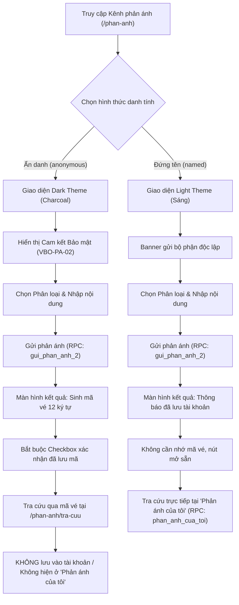
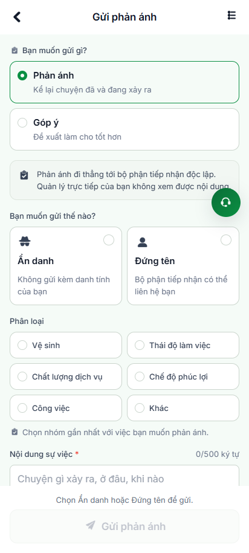
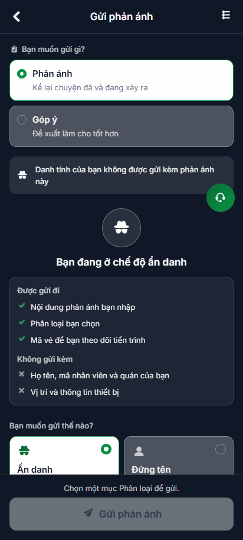
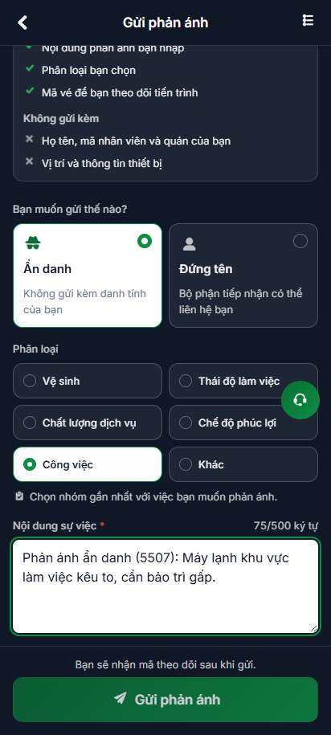
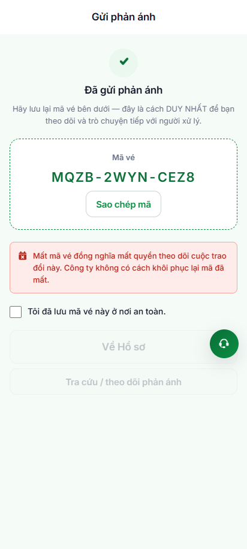
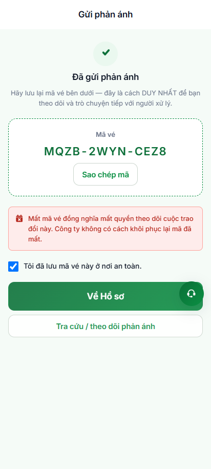
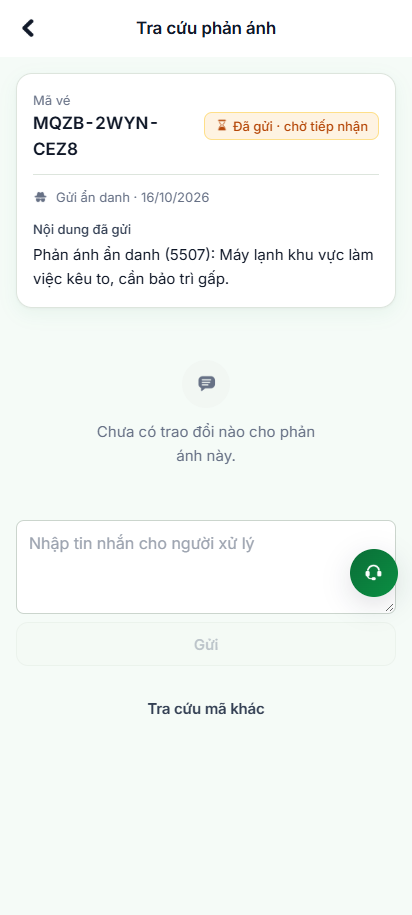
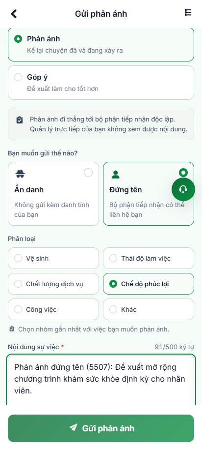
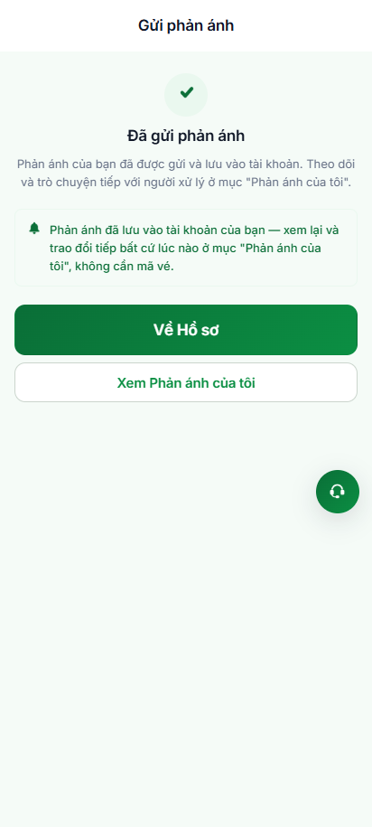
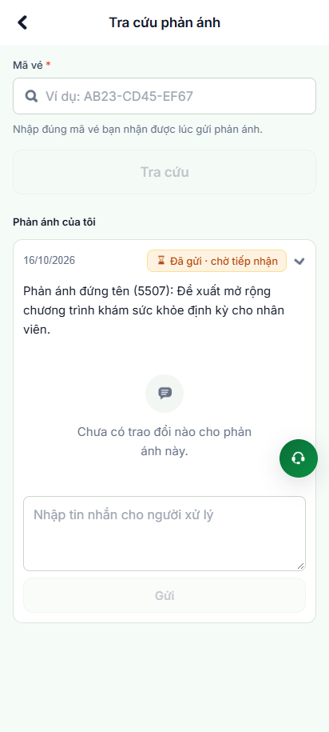

# Báo Cáo Kiểm Thử Tự Động Hóa: Phản Ánh Đứng Tên & Ẩn Danh

> **Dự án:** VivaOffice Mobile App (Staging: `https://workdemo.vivacorp.vn`)  
> **Tính năng:** Kênh Phản ánh / Góp ý — Tạo phản ánh **Đứng tên** (`named`) và **Ẩn danh** (`anonymous`)  
> **Framework:** Playwright (JavaScript / Node.js ESM)  
> **Kiến trúc:** Chuẩn Page Object Model (POM) & Playwright Test Runner  
> **Tỷ lệ Pass:** **100% (7/7 Test Cases PASSED)**  

---

## 1. Tổng Quan Kiến Trúc & Nghiệp Vụ

Hệ thống Kênh phản ánh (`/phan-anh`) và Tra cứu (`/phan-anh/tra-cuu`) được thiết kế tuân thủ nghiêm ngặt **Quy chế Phản ánh & Khiếu nại** với sự phân tách triệt để giữa hai chế độ:



---

## 2. Bảng Đối Chiếu So Sánh Ẩn Danh vs Đứng Tên

| Tiêu chí | Ẩn danh (`anonymous`) | Đứng tên (`named`) |
| :--- | :--- | :--- |
| **Giao diện người dùng** | Dark mode (nền than charcoal `rgba(255,255,255,0.06)`) | Light mode chuẩn thương hiệu Viva |
| **Cam kết bảo mật (VBO-PA-02)** | Hiển thị bảng cam kết: *Không gửi kèm Họ tên, Mã NV, Thiết bị, Vị trí* | Banner khẳng định: *Quản lý trực tiếp không xem được nội dung* |
| **Màn hình kết quả (VBO-PA-07)** | Hiển thị khối mã vé lớn `XXXX-XXXX-XXXX` + nút Sao chép | Ẩn khối mã vé, hiển thị banner xanh đã lưu vào tài khoản |
| **Ràng buộc xác nhận** | Bắt buộc đánh dấu checkbox *"Tôi đã lưu mã vé này ở nơi an toàn"* mới mở khóa nút | Không có checkbox, hai nút *"Về Hồ sơ"* & *"Xem Phản ánh của tôi"* mở sẵn |
| **Cách theo dõi tiến trình** | Nhập mã vé tại ô tra cứu `/phan-anh/tra-cuu` | Mở trực tiếp hộp *"Phản ánh của tôi"* (không cần mã vé) |
| **Bảo mật tài khoản** | **Tuyệt đối không lưu liên kết với `employee_id`**; không hiện trong *"Phản ánh của tôi"* | Lưu liên kết với tài khoản người gửi, tra cứu tiện lợi |

---

## 3. Bảng Kết Quả Kiểm Thử Chi Tiết

| Mã TC | Nghiệp vụ kiểm thử | Trạng thái | Thời gian | Bằng chứng ảnh |
| :---: | :--- | :---: | :---: | :---: |
| **PA-01** | Đăng nhập tài khoản nhân viên, mở `/phan-anh` & kiểm tra validation: Chưa chọn danh tính thì nút Gửi bị disable kèm câu nhắc | **PASS** | 2.2s | [01-phananh-initial.png](./phan-anh/01-phananh-initial.png) |
| **PA-02** | Chọn hình thức Ẩn danh, kích hoạt Dark Theme và bảng cam kết bảo mật danh tính | **PASS** | 240ms | [02-anonymous-dark-theme.png](./phan-anh/02-anonymous-dark-theme.png) |
| **PA-03** | Điền thông tin, chọn phân loại `Công việc`, gửi Ẩn danh thành công, sinh mã vé 12 ký tự & kiểm tra khóa nút chuyển tiếp cho tới khi xác nhận checkbox | **PASS** | 850ms | [03-anonymous-filled.png](./phan-anh/03-anonymous-filled.png)<br>[04-anonymous-result-locked.png](./phan-anh/04-anonymous-result-locked.png)<br>[05-anonymous-result-confirmed.png](./phan-anh/05-anonymous-result-confirmed.png) |
| **PA-04** | Chuyển sang `/phan-anh/tra-cuu`, tra cứu mã vé ẩn danh: Kiểm tra đúng nhãn `Gửi ẩn danh`, trạng thái `Đã gửi · chờ tiếp nhận`, nội dung sự việc; đối soát qua Backend RPC `tra_cuu_phan_anh` | **PASS** | 580ms | [06-anonymous-lookup-detail.png](./phan-anh/06-anonymous-lookup-detail.png) |
| **PA-05** | Quay lại gửi phản ánh ĐỨNG TÊN: Phân loại `Chế độ phúc lợi`, gửi thành công, xác nhận banner xanh đã lưu tài khoản, không bắt lưu mã vé, hai nút chuyển tiếp mở sẵn ngay | **PASS** | 760ms | [07-named-light-theme-filled.png](./phan-anh/07-named-light-theme-filled.png)<br>[08-named-result-success.png](./phan-anh/08-named-result-success.png) |
| **PA-06** | Bấm *"Xem Phản ánh của tôi"*, mở rộng xem chi tiết phản ánh đứng tên trong danh sách không cần mã vé; đối soát qua Backend RPC `phan_anh_cua_toi` | **PASS** | 270ms | [09-named-my-grievances-verified.png](./phan-anh/09-named-my-grievances-verified.png) |
| **PA-07** | **Đối soát bảo mật danh tính:** Khẳng định phản ánh Ẩn danh tuyệt đối không lộ trong danh sách *"Phản ánh của tôi"* cả trên UI lẫn Backend API | **PASS** | 60ms | [09-named-my-grievances-verified.png](./phan-anh/09-named-my-grievances-verified.png) |

---

## 4. Bằng Chứng Hình Ảnh Thực Thi (Visual Evidence)

````carousel

<!-- slide -->

<!-- slide -->

<!-- slide -->

<!-- slide -->

<!-- slide -->

<!-- slide -->

<!-- slide -->

<!-- slide -->

````

---

## 5. Hướng Dẫn Chạy Kiểm Thử Trong Dự Án

Các lệnh kiểm thử đã được cấu hình hoàn chỉnh trong file `package.json`:

```bash
cd 04-src

# 1. Chạy kịch bản tự động hóa độc lập, xuất bảng console & chụp ảnh bằng chứng
npm run test:phan-anh

# 2. Chạy test runner chuẩn Playwright POM
npm run test:phan-anh-pom
```

