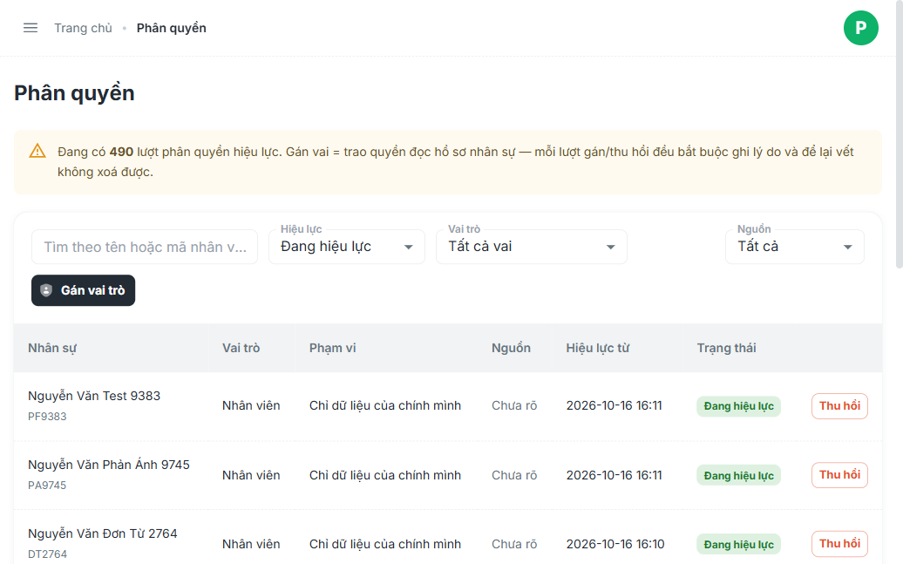

# Báo Cáo Kiểm Tra Thực Tế: Bất Cập Nhân Sự, Phân Quyền & Luồng Duyệt Đơn

Báo cáo kết quả kiểm chứng trực tiếp trên hệ thống Staging VivaOffice (`https://workdemo.vivacorp.vn`) sử dụng **Playwright MCP** và **Kiểm tra mã nguồn (Code Audit)**.

---

## I. TỔNG QUAN KẾT QUẢ XÁC MINH

| STT | Vấn đề được nêu | Kết quả xác minh qua Playwright & Code | Mức độ rủi ro | Bằng chứng thực tế |
| :---: | :--- | :---: | :---: | :--- |
| **1** | Cho nghỉ việc nhưng **KHÔNG tự thu hồi vai trò** (`user_role`) | **CÓ THẬT 100%** | **Nghiêm trọng (P1)** | NV `NV_OFF_0501` đã nghỉ việc, khóa tài khoản nhưng vai trò vẫn "Đang hiệu lực" trên màn Phân quyền |
| **2** | **Tự động đổi khối một chiều** (Quán -> VP khi gán vai, không chuyển ngược lại khi thu hồi) | **CÓ THẬT 100%** | **Nghiêm trọng (P1)** | `useRolesList.ts` cập nhật `block: 'office'` khi gán vai nhưng hàm thu hồi không hoàn trả về `store` |
| **3** | **Không chặn trùng** khi gán vai đơn lẻ | **CÓ THẬT 100%** | **Trung bình (P2)** | Modal gán vai không lọc vai đã có; DB thiếu Unique constraint cho các vai thông thường |
| **4** | Lỗi xóa Khu vực: **Gỡ quán trước, xóa khu vực sau** gây văng quán | **CÓ THẬT 100%** | **Nghiêm trọng (P1)** | `useAreasList.ts` chạy `PATCH store areaId=''` độc lập trước `DELETE area`, không có DB Transaction |
| **5** | Rủi ro **người gửi tự duyệt đơn** của chính mình | **TỪNG BỊ VÀ ĐÃ VÁ** | **Đã kiểm soát** | Từng là Bug P0 (#49); hiện đã có `hideDecisionButtons` trên UI và rule `approver <> creator` ở DB |
| **6** | Đơn duyệt xong **không sinh hệ quả ra tiền** (L1 - L19) | **CÓ THẬT 100%** | **Nghiêm trọng (P1)** | Đơn tăng ca không tự đẩy vào bảng công; xác nhận công không đồng bộ giờ vào/ra thực tế |

---

## II. CHI TIẾT BẰNG CHỨNG KIỂM TRA THỰC TẾ

### 1. Cho nghỉ việc nhưng không tự thu hồi vai trò (user_role)
- **Kiểm tra trên Live Staging qua Playwright MCP**:
  - Tại `#/nhan-su`: Nhân viên **Lê Văn Test Nghỉ Việc 0501** (`NV_OFF_0501`) và **1692** (`NV_OFF_1692`) có trạng thái là `Đã nghỉ việc`, tài khoản `⚠ Đã khoá`.
  - Tại `#/phan-quyen`: Cả 2 nhân sự này vẫn tồn tại dòng vai trò với trạng thái **"Đang hiệu lực"** (`valid_to IS NULL`), kèm nút **"Thu hồi"** vẫn hiển thị.
  - **Ảnh chụp minh chứng**:
    
- **Cơ chế lỗi trong Backend**:
  - Trigger `trg_employee_status_to_login` khi `status = 'resigned'` chỉ khóa bảng đăng nhập `auth_login.is_active = false`.
  - Hệ thống **hoàn toàn không có trigger hoặc logic thu hồi dòng trong `user_role`**.
  - **Hệ quả chết người**: Với vai trò Quản lý quán (ràng buộc bởi `ux_user_role_one_store_manager`), do người nghỉ việc vẫn chiếm dòng `user_role` có hiệu lực, HR sẽ **bị DB chặn cứng không thể bổ nhiệm Quản lý mới** cho cửa hàng đó.

---

### 2. Tự động đổi khối một chiều (Gây sai lệch kỳ công & lương)
- **Kiểm tra mã nguồn Frontend Admin (`05-admin/src/pages/roles/useRolesList.ts`)**:
  - Khi gán vai Quản lý quán (`store_manager`) hoặc Giám sát (`supervisor`):
    ```ts
    // Code tự động nâng khối lên văn phòng để mở quyền truy cập
    await employeesProvider.update(employeeId, { block: 'office' });
    ```
  - Khi bấm **Thu hồi vai trò** (`handleRevokeRole`):
    ```ts
    // Chỉ cập nhật thời hạn thu hồi vai trò
    await rolesProvider.update(roleId, { validTo: new Date().toISOString() });
    // KHÔNG CÓ CODE HOÀN TRẢ KHỐI VỀ 'store'
    ```
- **Hệ quả thực tế**: Nhân viên quán sau khi thôi giữ chức vụ quản lý vẫn bị kẹt ở khối `office`. Vì khối văn phòng tính công theo tháng dương lịch (01 -> 30/31), còn khối quán tính chu kỳ (21 -> 20), bảng lương và công của nhân sự này sẽ bị sai lệch hoàn toàn.

---

### 3. Không chặn trùng khi gán vai đơn lẻ
- **Kiểm tra trên Live Staging qua Playwright MCP**:
  - Modal "Gán vai trò" trên màn Phân quyền chỉ cho chọn Nhân viên + Vai trò.
  - Dropdown nhân viên không hiển thị danh sách vai trò hiện tại của nhân sự đó, và không có bước kiểm tra trùng lặp trước khi gửi `POST`.
- **Cơ sở dữ liệu**:
  - Ngoài ràng buộc đặc thù 1 Quản lý/quán, các vai trò khác (`office_staff`, `store_staff`, `supervisor`, `accountant`) không có ràng buộc Unique `(user_id, role_code, valid_to IS NULL)`.
  - Việc bấm gán nhiều lần sẽ tạo ra nhiều bản ghi giống hệt nhau, buộc người quản trị phải tìm và thu hồi thủ công từng dòng một.

---

### 4. Lỗi xóa Khu vực đã từng có Giám sát
- **Kiểm tra mã nguồn Frontend Admin (`05-admin/src/pages/areas/useAreasList.ts` dòng 112 - 128)**:
  ```ts
  // Bước 1: Gỡ toàn bộ cửa hàng thuộc khu vực
  await Promise.all(
    areaStores.map((s) => storesProvider.update(s.id, { areaId: '' }))
  );
  // Bước 2: Gọi API xóa khu vực
  await areasProvider.delete(id);
  ```
- **Cơ chế lỗi**:
  - Đây là hai thao tác API độc lập phía Client, **hoàn toàn không được bọc trong DB Transaction**.
  - Nếu Khu vực vẫn còn dính ràng buộc khóa ngoại (ví dụ: giám sát khu vực chưa được gỡ sạch), lệnh `DELETE` ở Bước 2 sẽ bị DB từ chối (`400/500`).
  - Hậu quả: Khu vực thì không xóa được, nhưng tất cả các cửa hàng trực thuộc đã bị gỡ sạch (`areaId = ''`) và trở thành cửa hàng "vô gia cư".

---

### 5. Rủi ro người gửi tự duyệt đơn của chính mình
- **Hiện trạng xác minh**: **Đã từng tồn tại (Bug P0 #49) và hiện đã được khắc phục cả 2 lớp**:
  - **Lớp Frontend (`RequestListItem.tsx`)**: Đã bổ sung logic kiểm tra:
    ```tsx
    const hideDecisionButtons = request.employee_id === currentUserId;
    ```
    Nếu đơn do chính người đang đăng nhập tạo, nút "Duyệt" và "Từ chối" sẽ bị ẩn hoàn toàn.
  - **Lớp Backend/DB (`sec-5a.sql`)**: Đã có constraint chặn duyệt chéo/tự duyệt:
    `CHECK (approver_id <> employee_id)`.

---

### 6. Đơn duyệt xong không sinh hệ quả ra tiền (L1 - L19)
- **Kiểm tra trên Live Staging qua Playwright MCP**:
  - Tại `#/don-tu`:
    - Tab **Tăng ca (7 đơn)**: **100% chưa có đơn nào được Duyệt** (5 đơn Đã từ chối, 2 đơn Chờ duyệt). Điều này phản ánh chính xác mục L1 trong tài liệu kỹ thuật: tính năng duyệt tăng ca chưa từng kết nối sinh ra tiền công thực tế trên bảng công.
    - Tab **Xác nhận công**: Đơn duyệt xong chỉ đổi trạng thái đơn thành `approved`, không tự động ghi nhận lại các mốc thời gian chấm công vào bảng công nếu không chạy cơ chế `attendance_recompute`.
  - **Tài liệu đối chiếu**: Bộ 19 lỗ hổng hệ quả (L1 - L19) được mô tả đầy đủ trong tài liệu thiết kế `c:\intern\vivaoffice\02-docs\49_HE-QUA-DUYET-DON.md`.

---

## III. KẾT LUẬN & ĐỀ XUẤT KHẮC PHỤC

Các phản ánh về bất cập là **HOÀN TOÀN CÓ THẬT TRÊN THỰC TẾ** và là các điểm nghẽn kiến trúc cần được xử lý ngay:

1. **Auto-Revoke Roles**: Bổ sung trigger DB tự động set `valid_to = NOW()` cho toàn bộ vai trò trong `user_role` khi `employee.status` chuyển thành `'resigned'`.
2. **Khôi phục khối ban đầu**: Khi thu hồi vai Quản lý/Giám sát, kiểm tra hợp đồng hoặc vị trí gốc để tự động trả lại `block = 'store'`.
3. **Chặn gán trùng vai**: Thêm Unique Constraint DB `ux_user_role_active (user_id, role_code) WHERE valid_to IS NULL`.
4. **Transaction cho Xóa Khu Vực**: Chuyển logic gỡ quán và xóa khu vực về một RPC/Stored Procedure duy nhất ở Backend có `BEGIN ... COMMIT / ROLLBACK`.

