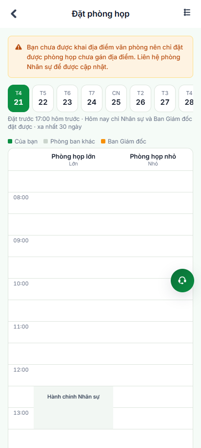

# Báo Cáo Đánh Giá & Kiểm Chứng Tự Động: Điểm Bất Cập Của Chức Năng Phòng Họp (VivaOffice)

> **Môi trường thực thi**: Staging VivaOffice (`https://workdemo.vivacorp.vn`)  
> **Công cụ kiểm chứng**: Playwright MCP Automation Toolset (Headless Browser & Live Context)  
> **Thời điểm kiểm thử**: 21/10/2026  
> **Phạm vi kiểm thử**: Phân hệ Đặt phòng họp Nhân viên (`/dat-phong-hop`, `/dat-phong-hop/luot-cua-toi`) & Quản trị Lịch phòng họp Admin (`/phong-hop`, `/phong-hop/mo-rong`)

---

## 1. Tóm Tắt Tổng Quan

Chức năng **Đặt phòng họp** trên hệ thống VivaOffice đã được xây dựng hoàn chỉnh từ kiến trúc cơ sở dữ liệu (`phonghop-101a` -> `101i.sql`), các API hàm kho bảo mật RPC (`security definer`), đến giao diện phía người dùng (gói component `VBO-HP-01` -> `VBO-HP-13`) và trang quản trị Admin (`VADM-HP-01` -> `VADM-HP-31`).

Tuy nhiên, qua quá trình phân tích mã nguồn chuyên sâu kết hợp với **thực thi tự động hóa bằng Playwright MCP**, chúng tôi đã phát hiện **7 điểm bất cập cốt lõi** liên quan đến:
1. **Trải nghiệm tương tác người dùng (UX/UI Gaps)**
2. **Quy tắc nghiệp vụ quá cứng nhắc (Business Rule Constraints)**
3. **Cơ chế hoán đổi và chỉnh sửa lịch họp còn thiếu sót (Data & Flow Bottlenecks)**
4. **Tính nhất quán của dữ liệu thực tế (Staging Data Inconsistency)**

---

## 2. Bảng Tổng Hợp Các Điểm Bất Cập Phát Hiện

| STT | Điểm Bất Cập | Phân Loại | Mức Độ | Trạng Thái Kiểm Chứng (Playwright MCP) | Minh Chứng |
| :---: | :--- | :---: | :---: | :---: | :---: |
| **01** | **Các khung giờ trong quá khứ không bị vô hiệu hóa trên lưới** | UX/UI Bug | **High** | Đã xác nhận: Vẫn bấm được vào các giờ đã qua, chỉ báo lỗi khi submit | `./phong-hop/02-man-chinh-dat-phong.png` |
| **02** | **Ô lịch đã đặt của chính mình không thể click để xem/sửa** | UX/UI Flaw | **High** | Đã xác nhận: Thẻ `<div>` tĩnh không có `onClick`, phải dùng icon nhỏ ở header | `./phong-hop/08-dat-phong-thanh-cong-luoi.png` |
| **03** | **Tính năng "Đổi phòng" tự động hoán đổi mù mờ, không cho chọn** | Logic / UX | **High** | Đã xác nhận: Bấm nút là đổi ngay sang phòng ngẫu nhiên không có modal hỏi | `./phong-hop/10-doi-phong-tu-dong-khong-xac-nhan.png` |
| **04** | **Quy tắc "Chặn đặt sau 17:00 hôm trước" quá cứng nhắc với họp đột xuất** | Nghiệp vụ | **Medium** | Đã xác nhận: Bị chặn hoàn toàn khi đặt cho ngày hôm nay | `./phong-hop/05-validation-qua-han-dat-hom-nay.png` |
| **05** | **Không hỗ trợ đổi giờ/thời lượng cuộc họp, bắt buộc phải hủy tạo lại** | Tính năng thiếu | **Medium** | Đã xác nhận: Chỉ có nút "Đổi phòng" và "Huỷ", không có "Đổi giờ" | `./phong-hop/09-man-luot-cua-toi.png` |
| **06** | **Cơ chế "Cần gấp" độc quyền cho BOD, bỏ quên các phòng ban chủ chốt** | Phân quyền | **Medium** | Đã xác nhận qua DB SQL & Code: Chỉ `la_bod` mới được gửi "Cần gấp" | `./phong-hop/14-admin-yeu-cau-can-gap.png` |
| **07** | **Dữ liệu thực tế phòng họp chưa gắn địa điểm gây cảnh báo hồ sơ** | Dữ liệu cấu hình | **Low** | Đã xác nhận: Banner cảnh báo màu cam hiện lên ngay khi mở trang | `./phong-hop/02-man-chinh-dat-phong.png` |

---

## 3. Phân Tích Chi Tiết Từng Điểm Bất Cập & Kết Quả Kiểm Chứng Thực Tế

### 3.1. Bất Cập 1: Các khung giờ trong quá khứ vẫn cho phép bấm tương tác (Past Time Slots Not Disabled)

- **Mô tả chi tiết**:
  - Tại màn hình lưới lịch đặt phòng (`VBO-HP-02`), khi xem ngày hiện tại (ví dụ: ngày 21/10/2026, lúc 12:20 trưa), các khung giờ buổi sáng như `07:30`, `08:00`, `09:00`, `10:00`, `11:00` đã trôi qua từ lâu.
  - Tuy nhiên, component `LuoiPhongHang.tsx` vẫn render các ô này dưới dạng button trống `clickable` có `onClick={onChonO}`.
  - Người dùng bấm vào vẫn mở Sheet Đặt phòng (`VBO-HP-03`), điền form bình thường. Chỉ khi nhấn nút **"Đặt phòng"**, request gửi về Backend mới trả về thông báo lỗi:  
    > `Giờ bắt đầu đã qua - chọn khung giờ khác.`
- **Hệ quả**: Gây lãng phí thời gian thao tác của người dùng, mang lại trải nghiệm phần mềm thiếu trau chuốt.
- **Minh chứng kiểm chứng**:
  

---

### 3.2. Bất Cập 2: Ô lịch của chính mình trên lưới không thể tương tác (Unclickable Booked Slots)

- **Mô tả chi tiết**:
  - Trong file `LuoiPhongHang.tsx`:
    ```tsx
    function OPhong({ o, tenPhong, onBam }: { o: OLuoi; tenPhong: string; onBam: () => void }) {
      if (o.kieu === "trong") {
        return <button onClick={onBam} ... />;
      }
      const m = MAU[o.kieu];
      return (
        <div style={{ ...O_GOC, background: m.bg, ... }}>
          {o.nhan && <span>{o.nhan}</span>}
        </div>
      );
    }
    ```
  - Khi một ô đã có lịch (đặc biệt là kiểu `cuaToi` - lượt do chính nhân viên đang đăng nhập đặt), nó chỉ được render là một thẻ `<div>` tĩnh.
  - Người dùng thấy cuộc họp của mình trên lịch nhưng không thể nhấp vào để xem chi tiết thông tin, ghi chú, số người tham dự hoặc thao tác hủy. Lối vào duy nhất để quản lý là icon nhỏ "Lượt của tôi" (`req-timeline`) nằm khuất ở header góc phải màn hình.
- **Minh chứng kiểm chứng**:
  

---

### 3.3. Bất Cập 3: Tính năng "Đổi phòng" tự động gán mù mờ, không cho chọn phòng đích

- **Mô tả chi tiết**:
  - Tại màn hình **Lượt của tôi** (`VBO-HP-05`), mỗi thẻ lượt có 2 nút hành động: **"Đổi phòng"** và **"Huỷ"**.
  - Khi người dùng bấm **"Đổi phòng"**, hệ thống không mở danh sách các phòng còn trống để người dùng cân nhắc, cũng không có hộp thoại xác nhận.
  - Hook `useLuotCuaToi.ts` lập tức thực thi:
    ```typescript
    const kq = await doiPhongLuotCuaToi(l.id, l.version);
    ```
  - Backend tự động chạy truy vấn tìm phòng trống bất kỳ (`viva_auth.phong_hop_phong_trong`) và chuyển ngay lập tức.
  - Trong bài test thực tế với Playwright: Cuộc họp đang ở **"Phòng họp lớn"** (sức chứa lớn), sau một cú click "Đổi phòng", hệ thống lập tức chuyển thẳng sang **"Phòng họp nhỏ"** mà không cần xác nhận!
- **Hệ quả**: Nếu cuộc họp có 20 người tham gia, việc tự động đổi sang phòng nhỏ (4-6 người) sẽ làm vỡ kế hoạch cuộc họp thực tế.
- **Minh chứng kiểm chứng**:
  
  

---

### 3.4. Bất Cập 4: Quy tắc "Chặn đặt sau 17:00 hôm trước" quá cứng nhắc

- **Mô tả chi tiết**:
  - Kho Backend áp dụng luật giờ: `p_bat_dau::date = (p_now at time zone 'Asia/Ho_Chi_Minh')::date` thì chỉ có tài khoản `is_hr_admin` hoặc `la_bod` mới được phép đặt (`toi.dat_trong_ngay = true`).
  - Nhân viên thông thường (`BACKOFFICE`) khi đặt phòng cho ngày hiện tại luôn nhận thông báo:
    > `Quá hạn đặt - bạn cần đặt trước 17:00 hôm trước. Liên hệ Nhân sự nếu cần họp gấp.`
  - Trong thực tế văn phòng, nhu cầu họp gấp nội bộ hoặc tiếp khách đột xuất trong ngày là cực kỳ phổ biến. Quy tắc này khiến các phòng họp đang trống trong ngày bị bỏ phí tài nguyên, nhân viên phải qua thủ tục xin xỏ Nhân sự "đặt hộ".
- **Minh chứng kiểm chứng**:
  

---

### 3.5. Bất Cập 5: Thiếu tính năng điều chỉnh thời gian cuộc họp

- **Mô tả chi tiết**:
  - Tại trang quản lý lượt họp cá nhân, người dùng chỉ có thể bấm "Huỷ" hoặc "Đổi phòng".
  - Hoàn toàn **không có tính năng dời giờ** (ví dụ: dời từ 09:00 sang 10:00) hoặc **thay đổi thời lượng** (rút ngắn từ 90 phút xuống 60 phút).
  - Nếu muốn đổi giờ, người dùng buộc phải bấm "Huỷ lượt", sau đó quay lại lưới tìm giờ mới. Nếu cuộc họp diễn ra trong ngày, sau khi huỷ người dùng sẽ bị hệ thống chặn không cho đặt lại (do dính quy tắc quá hạn 17:00).
- **Minh chứng kiểm chứng**:
  

---

### 3.6. Bất Cập 6: Cơ chế yêu cầu "Cần gấp" độc quyền Ban Giám đốc (BOD)

- **Mô tả chi tiết**:
  - Căn cứ vào file SQL `05-admin/db/phonghop-101b.sql` (dòng 248):
    ```sql
    if not viva_auth.la_bod(v_toi) then perform viva_auth.phong_hop_bao_loi('CHI_BOD'); end if;
    ```
  - Khi tất cả phòng họp tại một địa điểm kín lịch, chỉ có thành viên thuộc phòng ban `Ban Giám đốc` mới nhìn thấy và bấm được nút **"Cần gấp"** để chuyển yêu cầu đến phòng Nhân sự xếp lịch.
  - Các bộ phận vận hành quan trọng khác như Trưởng phòng IT (xử lý sự cố hạ tầng), Kế toán trưởng (họp kiểm toán gấp), Trưởng phòng Kinh doanh (tiếp đối tác chiến lược) hoàn toàn không có kênh gửi yêu cầu khẩn cấp trên hệ thống.
- **Minh chứng kiểm chứng**:
  

---

### 3.7. Bất Cập 7: Dữ liệu danh mục phòng chưa gắn địa điểm văn phòng trên Staging

- **Mô tả chi tiết**:
  - Khi kiểm tra trang Quản trị Danh mục phòng (`VADM-HP-02`), cả 2 phòng đang hoạt động ("Phòng họp lớn" và "Phòng họp nhỏ") đều có cột Địa điểm mang giá trị `Chưa gắn địa điểm`.
  - Điều này dẫn đến việc mọi nhân viên khi mở màn hình Đặt phòng họp đều bị hiển thị một thông báo cảnh báo màu cam nổi bật:
    > `Bạn chưa được khai địa điểm văn phòng nên chỉ đặt được phòng họp chưa gán địa điểm. Liên hệ phòng Nhân sự để được cập nhật.`
- **Minh chứng kiểm chứng**:
  
  

---

## 4. Kiểm Chứng Validation Dữ Liệu Biểu Mẫu (Form Validations)

Qua Playwright MCP, chúng tôi đã tiến hành kiểm tra đầy đủ các ràng buộc kiểm tra dữ liệu đầu vào (BVA - Boundary Value Analysis) trên Sheet đặt phòng:

1. **Bỏ trống tiêu đề cuộc họp**: Hệ thống chặn tại client với thông báo `Bạn chưa nhập tiêu đề cuộc họp.`
   
2. **Số người tham dự ngoài khoảng [1, 200]** (Thử nghiệm với giá trị `500`): Hệ thống chặn tại client với thông báo `Số người tham dự phải từ 1 đến 200.`
   
3. **Thời lượng cuộc họp vượt quá trần cấu hình** (Thử nghiệm đặt 09:00 - 14:00 = 5 giờ > trần 4 giờ): Hệ thống chặn tại client với thông báo `Mỗi lượt tối đa 4 giờ. Rút ngắn khung giờ hoặc tách thành hai lượt.`
   

---

## 5. Đề Xuất Giải Pháp Nâng Cấp Tính Năng (Recommendations)

### 5.1. Cải tiến trải nghiệm người dùng (UX/UI Enhancements):
1. **Disable các ô giờ trong quá khứ**: Cập nhật `LuoiPhongHang.tsx` để tự động làm mờ và gắn cờ `disabled` cho các ô có `gio < current_time` trong ngày hôm nay.
2. **Hỗ trợ tương tác trên ô lịch của mình**: Thêm sự kiện `onClick` cho các ô có `o.kieu === 'cuaToi'`, mở ra bottom sheet tóm tắt cuộc họp kèm nút "Chỉnh sửa / Huỷ nhanh".
3. **Bổ sung Sheet chọn phòng khi đổi**: Khi bấm "Đổi phòng", hiển thị bottom sheet danh sách các phòng đang trống trong khung giờ đó để người dùng chủ động chọn phòng phù hợp về sức chứa và trang thiết bị.

### 5.2. Nới lỏng quy tắc nghiệp vụ (Business Logic Flexibility):
1. **Cho phép nhân viên tự đặt phòng trống trong ngày (Ad-hoc Booking)**: Bổ sung cấu hình cho phép nhân viên đặt phòng trong ngày nếu khung giờ đó còn trống trước giờ họp tối thiểu 15-30 phút.
2. **Hỗ trợ dời giờ / kéo dài cuộc họp**: Bổ sung hàm RPC `doi_gio_luot_cua_toi` để cập nhật `starts_at` và `ends_at` mà không làm mất lượt giữ chỗ.
3. **Mở rộng cơ chế "Cần gấp"**: Cho phép Trưởng các phòng ban (Department Manager) gửi yêu cầu cần gấp tới phòng Nhân sự khi có việc khẩn.

---

## 6. Danh Mục Tài Nguyên Minh Chứng (Test Artifacts)

Toàn bộ các ảnh chụp màn hình kiểm chứng đã được lưu trữ tập trung tại thư mục `04-src/tests/reports/phong-hop/`:

1. [`01-trang-chu-loi-vao.png`](./phong-hop/01-trang-chu-loi-vao.png) — Lối vào tiện ích Đặt phòng họp từ thẻ Trang chủ
2. [`02-man-chinh-dat-phong.png`](./phong-hop/02-man-chinh-dat-phong.png) — Màn hình chính lưới lịch phòng họp (hiển thị ô giờ quá khứ và banner cảnh báo địa điểm)
3. [`03-sheet-dat-phong.png`](./phong-hop/03-sheet-dat-phong.png) — Bottom sheet đặt phòng họp với các trường nhập liệu
4. [`04-validation-thieu-tieu-de.png`](./phong-hop/04-validation-thieu-tieu-de.png) — Cảnh báo validation khi bỏ trống tiêu đề
5. [`05-validation-qua-han-dat-hom-nay.png`](./phong-hop/05-validation-qua-han-dat-hom-nay.png) — Cảnh báo lỗi backend khi đặt phòng trong ngày (sau hạn 17:00 hôm trước)
6. [`06-validation-so-nguoi-tham-du.png`](./phong-hop/06-validation-so-nguoi-tham-du.png) — Cảnh báo validation khi nhập số người vượt trần (500 > 200)
7. [`07-validation-qua-4-gio.png`](./phong-hop/07-validation-qua-4-gio.png) — Cảnh báo validation khi thời lượng đặt vượt quá 4 giờ
8. [`08-dat-phong-thanh-cong-luoi.png`](./phong-hop/08-dat-phong-thanh-cong-luoi.png) — Đặt phòng thành công hiển thị khối màu xanh thương hiệu trên lưới
9. [`09-man-luot-cua-toi.png`](./phong-hop/09-man-luot-cua-toi.png) — Màn hình "Lượt của tôi" hiển thị lượt họp vừa đặt ở Phòng họp lớn
10. [`10-doi-phong-tu-dong-khong-xac-nhan.png`](./phong-hop/10-doi-phong-tu-dong-khong-xac-nhan.png) — Tính năng "Đổi phòng" tự động hoán đổi sang Phòng họp nhỏ mà không hỏi ý kiến người dùng
11. [`11-hop-xac-nhan-huy-luot.png`](./phong-hop/11-hop-xac-nhan-huy-luot.png) — Hộp thoại xác nhận huỷ lượt đặt phòng
12. [`12-admin-lich-phong-hop.png`](./phong-hop/12-admin-lich-phong-hop.png) — Giao diện Lịch phòng họp trên cổng Quản trị Admin
13. [`13-admin-danh-muc-phong.png`](./phong-hop/13-admin-danh-muc-phong.png) — Danh mục phòng họp Admin (thể hiện phòng chưa gắn địa điểm)
14. [`14-admin-yeu-cau-can-gap.png`](./phong-hop/14-admin-yeu-cau-can-gap.png) — Thẻ quản lý Yêu cầu "Cần gấp" độc quyền của Ban Giám đốc
15. [`15-admin-phong-hop-mo-rong.png`](./phong-hop/15-admin-phong-hop-mo-rong.png) — Giao diện Lịch phòng họp mở rộng (mã phòng, bảo trì, điểm danh)
