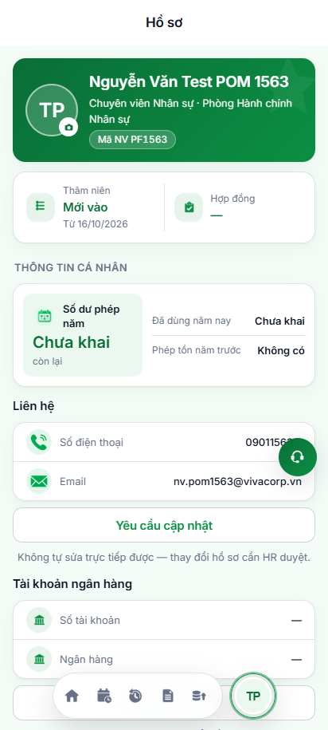
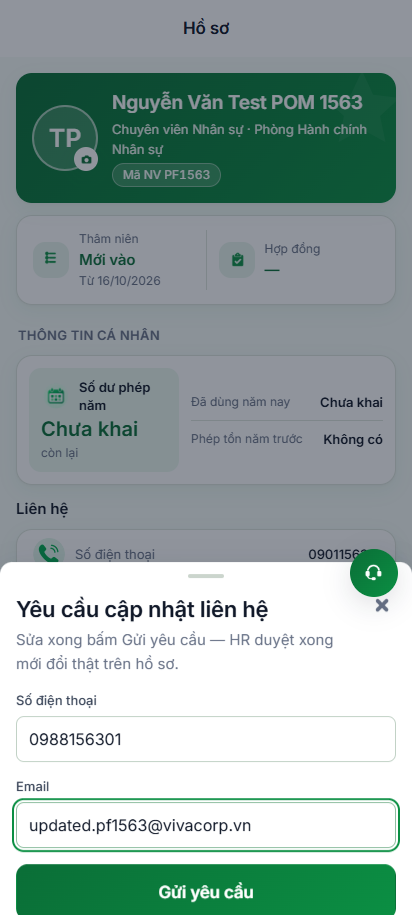
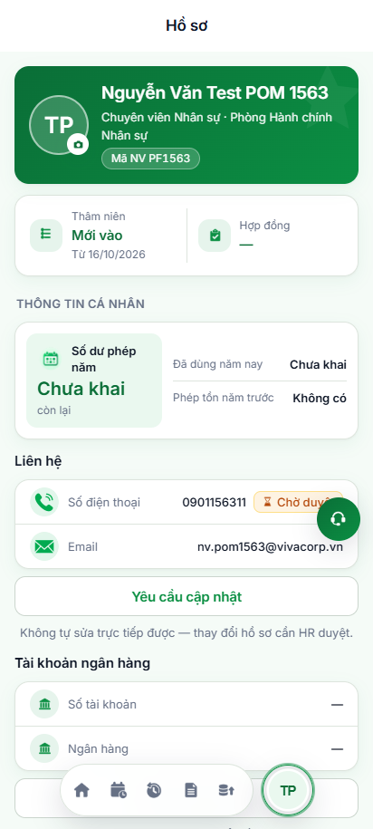
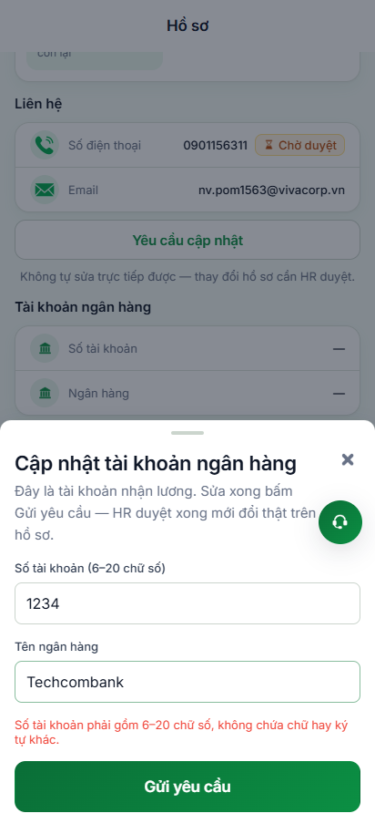
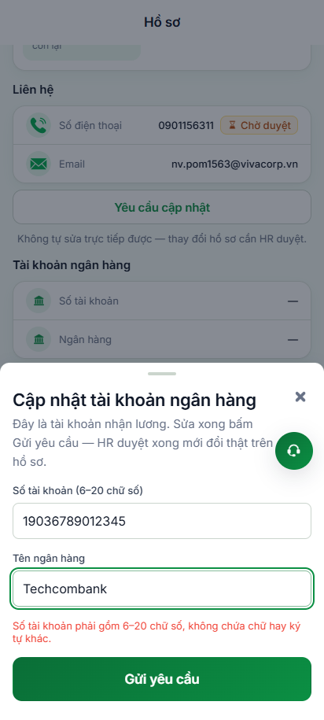
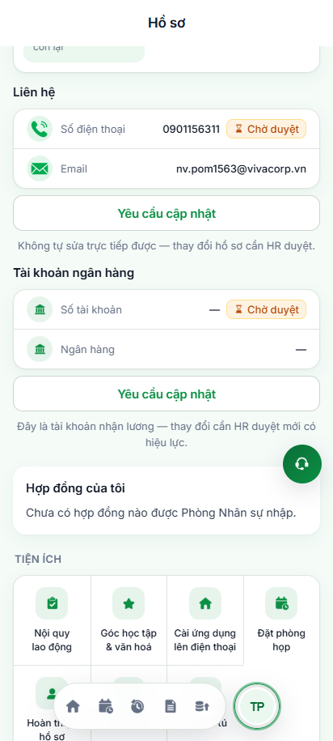
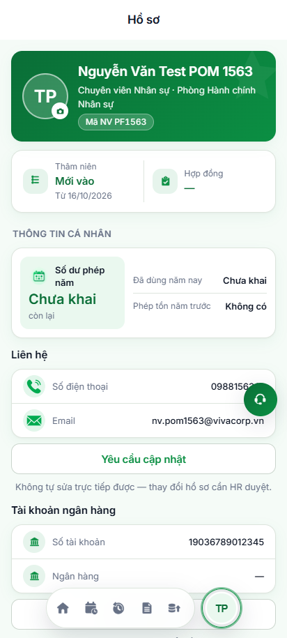

# Báo Cáo Kiểm Thử Chuẩn Hóa POM (Page Object Model) & Assertions (expect)

> **Môi trường thử nghiệm:** Staging (`https://workdemo.vivacorp.vn`)  
> **Kiến trúc:** Page Object Model (POM) + Playwright Test Runner (`@playwright/test`)  
> **Thời gian thực thi:** 16/10/2026  
> **Kết quả chung:** **PASS 100% (6/6 Specs thành công trong 13.9s)**

---

## 1. Cấu Trúc Kiến Trúc Page Object Model (POM)

Mã nguồn kiểm thử tự động hóa được bóc tách và phân lớp chuẩn công nghiệp, tách biệt hoàn toàn giữa **Bộ định vị UI (Locators)**, **Hành vi nghiệp vụ (Action Methods)** và **Tập lệnh kiểm thử (Specs & Assertions)**:

```
04-src/
├── playwright.config.mjs               # Cấu hình Playwright Test Runner (Chrome Mobile 412x915)
├── tests/
│   ├── pages/
│   │   ├── BasePage.mjs                # Lớp cơ sở: chụp ảnh, auto-waiting (không dùng waitForTimeout)
│   │   ├── LoginPage.mjs               # POM Trang Đăng nhập (/dang-nhap)
│   │   ├── ProfilePage.mjs             # POM Trang Hồ sơ (/ho-so)
│   │   └── components/
│   │       ├── UpdateContactSheet.mjs  # POM Sheet Cập nhật liên hệ (VBO-HS-06) - getByRole('textbox')
│   │       └── UpdateBankSheet.mjs     # POM Sheet Cập nhật tài khoản ngân hàng (VBO-HS-15) - getByRole('textbox')
│   ├── helpers/
│   │   └── profileApiHelper.mjs        # API Helper: Admin token (Cache & Backoff), cấp user, duyệt đơn RPC
│   └── specs/
│       └── profile-update.spec.mjs     # Test Suite chính thức chạy bằng npx playwright test
└── scripts/
    └── automation-profile-update.mjs   # Standalone runner xuất báo cáo ảnh và log chi tiết
```

---

## 2. Bảng Phân Tích Lớp Đối Tượng (Page Objects & Locators)

### 2.1. `LoginPage` ([LoginPage.mjs](file:///c:/intern/vivaoffice/04-src/tests/pages/LoginPage.mjs))
- **Locators:**
  - `employeeCodeInput`: Ô nhập "Mã nhân viên"
  - `passwordInput`: Ô nhập "Mật khẩu"
  - `loginButton`: Nút "Đăng nhập"
  - `continueButton`: Nút "Tiếp tục" (máy lạ)
- **Phương thức nghiệp vụ:** `navigate()`, `fillEmployeeCode()`, `fillPassword()`, `clickLogin()`, `login(code, pass)`
- **Assertions (`expect`):** `await expect(this.page).toHaveURL(/.*\/trang-chu/)`

### 2.2. `ProfilePage` ([ProfilePage.mjs](file:///c:/intern/vivaoffice/04-src/tests/pages/ProfilePage.mjs))
- **Locators:**
  - `header`: Khối tiêu đề Hồ sơ (`[data-section="VBO-HS-01"]`)
  - `contactCard`: Khối thông tin liên hệ (`[data-section="VBO-HS-04"]`)
  - `bankCard`: Khối tài khoản nhận lương (`[data-section="VBO-HS-14"]`)
  - `contactPendingBadge` & `bankPendingBadge`: Huy hiệu màu cam "Chờ duyệt"
- **Thành phần con (Sub-components):**
  - `this.contactSheet = new UpdateContactSheet(page)`
  - `this.bankSheet = new UpdateBankSheet(page)`
- **Assertions (`expect`):**
  - `expectLoaded()`: Kiểm tra toàn bộ các thẻ hiển thị đủ
  - `expectPhoneDisplayed(phone)`: Kiểm tra SĐT hiển thị trên giao diện
  - `expectBankAccountDisplayed(acc)`: Kiểm tra Số TK hiển thị trên giao diện
  - `expectContactPendingBadgeVisible()`: Kiểm tra nhãn "Chờ duyệt" xuất hiện
  - `expectNoPendingBadges()`: Kiểm tra toàn bộ nhãn "Chờ duyệt" biến mất sau khi duyệt

### 2.3. `UpdateContactSheet` ([UpdateContactSheet.mjs](file:///c:/intern/vivaoffice/04-src/tests/pages/components/UpdateContactSheet.mjs))
- **Locators:** `dialog`, `phoneInput` (`getByRole('textbox', { name: /số điện thoại/i })`), `emailInput` (`getByRole('textbox', { name: /email/i })`), `submitButton`
- **Phương thức nghiệp vụ:** `fillPhone()`, `fillEmail()`, `submit()`, `submitContactUpdate()`
- **Assertions (`expect`):** `expectOpen()`, `expectClosed()`

### 2.4. `UpdateBankSheet` ([UpdateBankSheet.mjs](file:///c:/intern/vivaoffice/04-src/tests/pages/components/UpdateBankSheet.mjs))
- **Locators:** `dialog`, `accountInput` (`getByRole('textbox', { name: /số tài khoản/i })`), `bankNameInput` (`getByRole('textbox', { name: /tên ngân hàng/i })`), `submitButton`, `accountError`
- **Phương thức nghiệp vụ:** `fillAccount()`, `fillBankName()`, `submit()`, `submitBankUpdate()`
- **Assertions (`expect`):** `expectOpen()`, `expectClosed()`, `expectAccountValidationError()`

---

## 3. Danh Sách Test Specs & Các Câu Lệnh `expect` Cụ Thể

| Mã Test Spec | Tên kịch bản | Thao tác qua POM | Câu lệnh `expect` xác minh | Kết quả |
| :--- | :--- | :--- | :--- | :---: |
| **TC-01** | Đăng nhập & Mở Hồ sơ | `loginPage.login(code, pass)`<br>`profilePage.navigate()` | `expect(page).toHaveURL(/.*\/trang-chu/)`<br>`expect(contactCard).toBeVisible()`<br>`expect(phoneText).toBeVisible()` | **PASS** ✅<br>*(5.5s)* |
| **TC-02** | Yêu cầu đổi SĐT & Email | `profilePage.openContactUpdate()`<br>`contactSheet.submitContactUpdate(phone, email)` | `expect(contactSheet.dialog).toBeHidden()`<br>`expect(contactPendingBadge).toBeVisible()` | **PASS** ✅<br>*(867ms)* |
| **TC-03** | Validation Số TK sai | `profilePage.openBankUpdate()`<br>`bankSheet.fillAccount('1234')`<br>`bankSheet.submit()` | `expect(accountError).toBeVisible()`<br>*(Thông báo: Số tài khoản phải gồm 6–20 chữ số)* | **PASS** ✅<br>*(643ms)* |
| **TC-04** | Yêu cầu đổi Số TK hợp lệ | `bankSheet.submitBankUpdate('19036789012345', 'Techcombank')` | `expect(bankSheet.dialog).toBeHidden()`<br>`expect(bankPendingBadge).toBeVisible()` | **PASS** ✅<br>*(440ms)* |
| **TC-05** | Đối soát Database API | `getPendingProfileRequests(empId, adminToken)` | `expect(requests.length).toBeGreaterThanOrEqual(2)`<br>`expect(fields).toContain('phone')`<br>`expect(fields).toContain('bank_account')` | **PASS** ✅<br>*(148ms)* |
| **TC-06** | HR Admin duyệt & Đồng bộ | `decideProfileUpdateRequest(reqId, 'approve')`<br>`profilePage.reload()` | `expect(newPhoneText).toBeVisible()`<br>`expect(newBankText).toBeVisible()`<br>`expect(pendingBadges).toHaveCount(0)` | **PASS** ✅<br>*(2.2s)* |

---

## 4. Bằng Chứng Hình Ảnh Thực Tế

````carousel

<!-- slide -->

<!-- slide -->

<!-- slide -->

<!-- slide -->

<!-- slide -->

<!-- slide -->

````

---

## 5. Hai Lựa Chọn Chạy Kiểm Thử Đã Tích Hợp

### Lựa chọn 1: Chạy bằng Playwright Test Runner chính thức
```bash
cd c:\intern\vivaoffice\04-src
npm run test:profile-pom
# hoặc: npx playwright test tests/specs/profile/profile-update.spec.mjs
```

### Lựa chọn 2: Chạy Runner tự động kèm chụp toàn bộ ảnh minh chứng
```bash
cd c:\intern\vivaoffice\04-src
npm run test:profile-update
```

