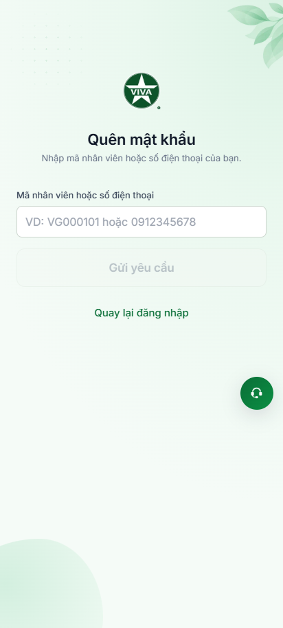
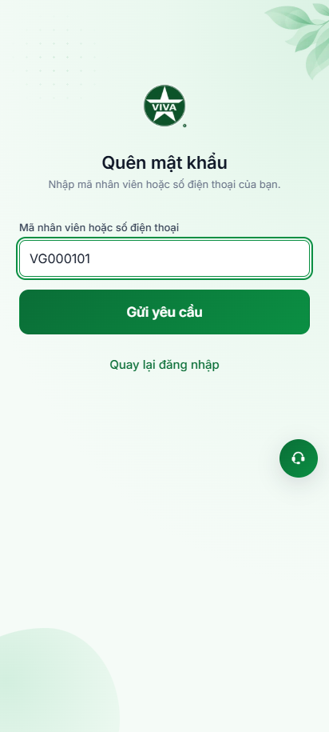
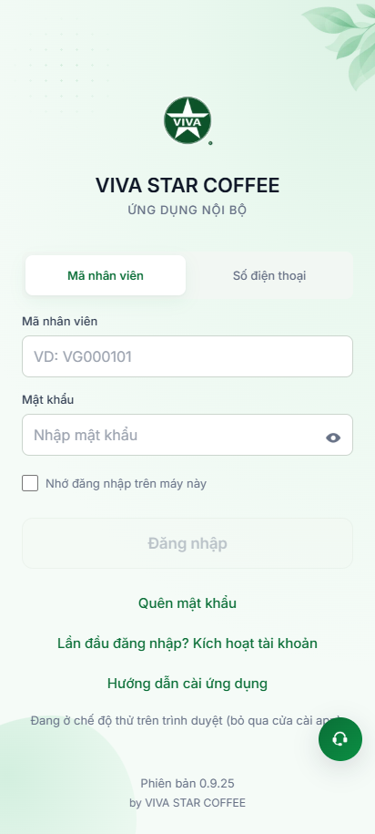
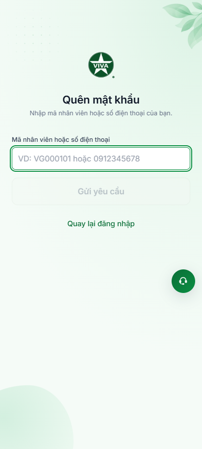

# Báo Cáo Kiểm Chứng Hành Vi Thực Tế: Phân Hệ Quên Mật Khẩu (`/quen-mat-khau`)

> **Dự án:** VivaOffice Mobile App (Staging: `https://workdemo.vivacorp.vn`)  
> **Phân hệ:** Xác thực tài khoản — **Quên Mật Khẩu** (`/quen-mat-khau`)  
> **Công cụ kiểm chứng:** Playwright MCP & Playwright Runner  
> **Kiến trúc:** Page Object Model (POM) & User-Facing Locators  
> **Thời điểm thực thi:** 22/10/2026  

---

## 1. Trình Chiếu Ảnh Minh Chứng Thực Nghiệm (Visual Evidence)

````carousel

<!-- slide -->

<!-- slide -->

<!-- slide -->

<!-- slide -->

````

---

## 2. Bảng Đối Soát Hành Vi Thực Nghiệm Chi Tiết

| STT | Bước thực hiện | Kỳ vọng nghiệp vụ | Kết quả quan sát thực tế | Trạng thái | Bằng chứng ảnh |
| :---: | :--- | :--- | :--- | :---: | :---: |
| **01** | Truy cập `/quen-mat-khau?web=thu` | Dựng Header VBO-QM-01, form VBO-QM-02, nút "Gửi yêu cầu" bị disable khi ô nhập rỗng | Đúng kỳ vọng: Tiêu đề "Quên mật khẩu", nút Gửi yêu cầu bị vô hiệu hóa | **PASS** | [01-forgot-password-initial.png](./quen-mat-khau/01-forgot-password-initial.png) |
| **02** | Nhập `vg000101` | Tự động viết hoa `VG000101`, kích hoạt nút "Gửi yêu cầu" | Đúng kỳ vọng: Chuẩn hóa tức thời theo định dạng in trên thẻ nhân viên | **PASS** | [02-forgot-password-code-uppercase.png](./quen-mat-khau/02-forgot-password-code-uppercase.png) |
| **03** | Bấm "Gửi yêu cầu" với mã không tồn tại | Luôn hiển thị câu thông báo chung an toàn `VBO-QM-03`, không để lộ tài khoản có tồn tại hay không | Đúng kỳ vọng: "Yêu cầu đã gửi tới phòng Nhân sự. Nhân sự sẽ liên hệ và cấp mật khẩu tạm cho bạn..." | **PASS** | [03-forgot-password-success-notice.png](./quen-mat-khau/03-forgot-password-success-notice.png) |
| **04** | Bấm "Quay lại đăng nhập" từ khối VBO-QM-03 | Điều hướng mượt mà về route `/dang-nhap` | Đúng kỳ vọng: URL chuyển về `/dang-nhap` sạch sẽ | **PASS** | [04-back-to-login.png](./quen-mat-khau/04-back-to-login.png) |
| **05** | Nhập toàn khoảng trắng `"     "` | Hàm chuẩn hóa xóa sạch khoảng trắng, nút Gửi yêu cầu tiếp tục bị vô hiệu hóa | Đúng kỳ vọng: Nút vẫn disabled, không gửi request rỗng | **PASS** | [05-forgot-password-spaces-disabled.png](./quen-mat-khau/05-forgot-password-spaces-disabled.png) |
