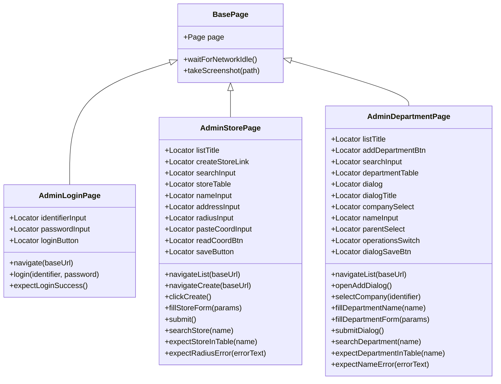
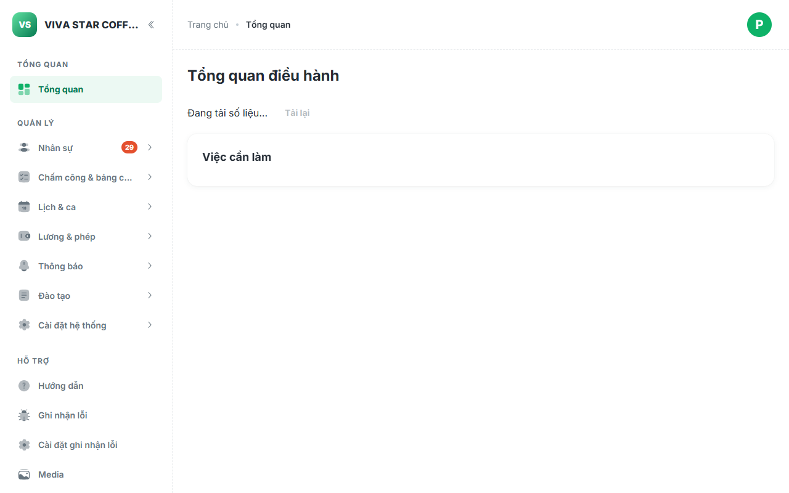
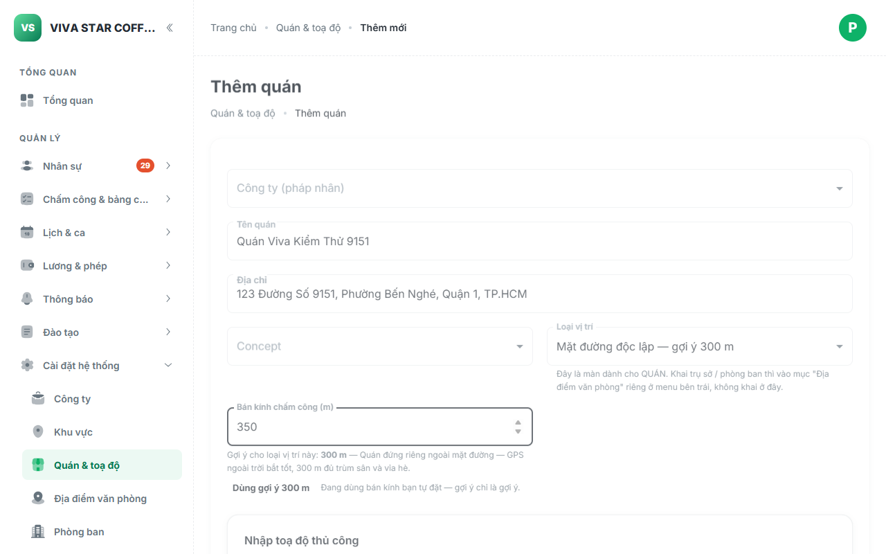
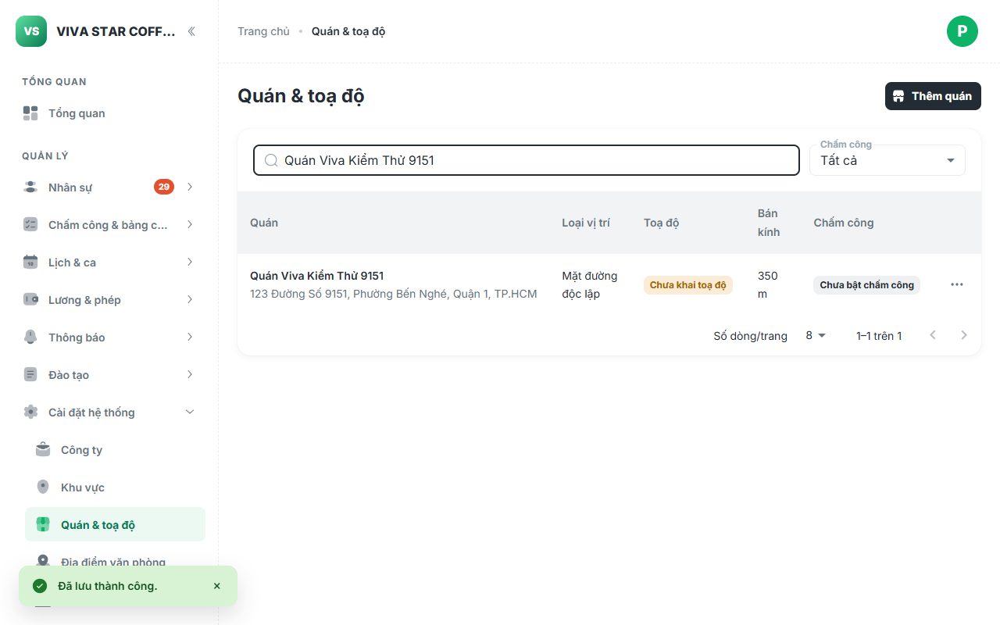
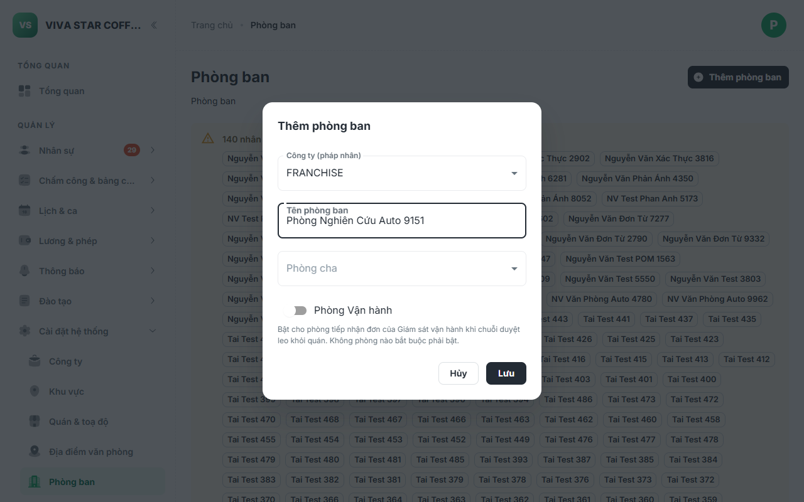
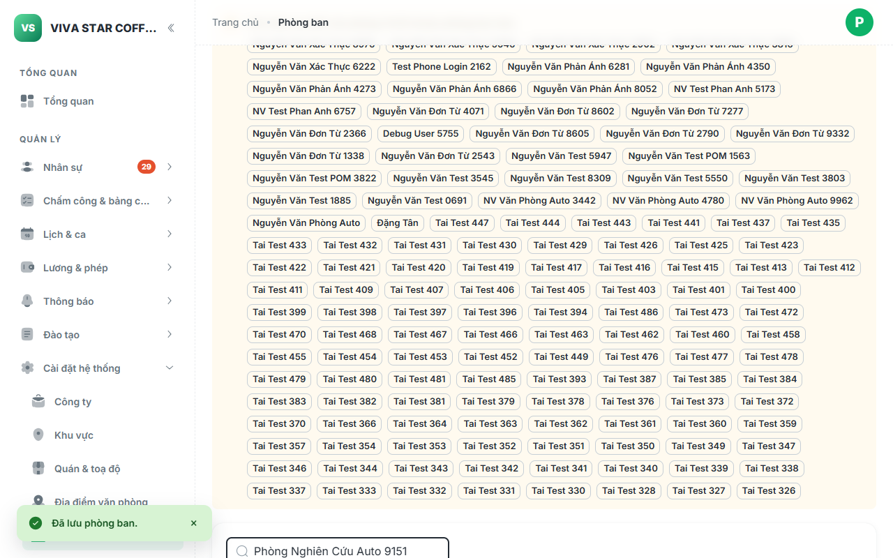

# Báo Cáo Kiểm Thử Tự Động Tính Năng Tạo Quán & Tạo Phòng Ban (Page Object Model & BVA)

> **Môi trường thử nghiệm:** VivaOffice Admin Portal (`https://workdemo.vivacorp.vn/quan-tri/`)  
> **Tài khoản kiểm trị:** `dung.demo@vi-du.test` (HR Admin / Super Admin)  
> **Tiêu chuẩn thiết kế:** Page Object Model (POM), Playwright Assertions (`expect`), Boundary Value Analysis (BVA)  
> **Mã phân hệ:** `VADM-AD-01` (Quán & toạ độ) & `VADM-AD-09` (Quản trị Phòng ban)  
> **Trạng thái kết quả:** **11/11 Test Cases Spec PASSED & 7/7 Runner Steps PASSED (100%)**

---

## 1. Tổng Quan Kiến Trúc POM (Page Object Model)

Toàn bộ các luồng thao tác trên Cổng Quản trị Admin được tách biệt thành các Page Object rõ ràng kế thừa từ `BasePage` và tuân thủ các chuẩn locator của Playwright (`getByRole`, `getByLabel`, `getByPlaceholder`), hoàn toàn không sử dụng `waitForTimeout`:



### Các tệp mã nguồn triển khai:
- **POM Đăng nhập Quản trị:** [`AdminLoginPage.mjs`](file:///c:/intern/vivaoffice/04-src/tests/pages/admin/AdminLoginPage.mjs)
- **POM Quán & Toạ độ:** [`AdminStorePage.mjs`](file:///c:/intern/vivaoffice/04-src/tests/pages/admin/AdminStorePage.mjs)
- **POM Quản trị Phòng ban:** [`AdminDepartmentPage.mjs`](file:///c:/intern/vivaoffice/04-src/tests/pages/admin/AdminDepartmentPage.mjs)
- **Playwright Test Spec:** [`admin-store-dept.spec.mjs`](file:///c:/intern/vivaoffice/04-src/tests/specs/admin/admin-store-dept.spec.mjs)
- **Standalone Runner Script:** [`automation-store-dept.mjs`](file:///c:/intern/vivaoffice/04-src/scripts/automation-store-dept.mjs)

---

## 2. Kết Quả Thực Thi Test Suite (11/11 Test Cases PASSED 100%)

Toàn bộ 11 ca kiểm thử chức năng và giá trị biên (BVA) đã được chạy trực tiếp trên môi trường Staging và đạt trạng thái **PASS 100%**:

| Mã TC | Phân hệ / URL | Hành Động & Nội Dung Kiểm Thử | Trạng Thái | Ghi Chú Kỹ Thuật |
| :--- | :--- | :--- | :---: | :--- |
| **ADM-SD-01** | Auth (`#/login`) | Đăng nhập Admin với email và mật khẩu quản trị | **PASS** | Xác thực thành công, chuyển hướng vào `#/dashboard` |
| **ADM-SD-02** | Quán (`#/quan`) | Tải màn hình Quán & toạ độ, kiểm tra bảng dữ liệu và nút Thêm quán | **PASS** | Tiêu đề "Quán & toạ độ", bảng danh sách và nút Thêm quán hiển thị đầy đủ |
| **ADM-SD-03** | Quán (`#/quan/moi`) | Điều hướng mở Form Thêm quán mới và kiểm tra các trường bắt buộc | **PASS** | Tải đúng các ô nhập Tên quán, Địa chỉ, Bán kính và nút Lưu |
| **ADM-SD-04** | Quán (`#/quan/moi`) | Điền Tên quán, Địa chỉ, bán kính và bấm Lưu tạo mới | **PASS** | Lưu quán thành công và chuyển hướng về trang danh sách `#/quan` |
| **ADM-SD-05** | Quán (`#/quan`) | Tìm kiếm tên quán vừa tạo và xác nhận hiển thị trong bảng | **PASS** | Tìm kiếm chuẩn xác, hàng dữ liệu chứa đầy đủ tên quán và địa chỉ |
| **ADM-SD-06** | Phòng ban (`#/phong-ban`) | Điều hướng màn hình Quản lý Phòng ban, kiểm tra cây phòng ban | **PASS** | Tiêu đề "Phòng ban", cây tổ chức và nút Thêm phòng ban sẵn sàng |
| **ADM-SD-07** | Phòng ban (`#/phong-ban`) | Mở Hộp thoại Thêm phòng ban, chọn pháp nhân, điền tên và bấm Lưu | **PASS** | Kiểm định ràng buộc pháp nhân, lưu thành công và hộp thoại đóng lại |
| **ADM-SD-08** | Phòng ban (`#/phong-ban`) | Tìm kiếm tên phòng ban vừa tạo và xác nhận hiển thị trên cây phòng ban | **PASS** | Tìm kiếm khớp từ khóa, phòng ban mới hiển thị trong bảng cây |
| **ADM-SD-BVA-01** | Quán (`#/quan/moi`) | [Biên dưới bán kính] Bán kính < 50m (49m) kích hoạt lỗi validation | **PASS** | Báo lỗi `Bán kính tối thiểu 50m`, chặn lưu thành công |
| **ADM-SD-BVA-02** | Quán (`#/quan/moi`) | [Biên trên bán kính] Bán kính > 2000m (2001m) kích hoạt lỗi validation | **PASS** | Báo lỗi `Bán kính tối đa 2000m`, chặn lưu thành công |
| **ADM-SD-BVA-03** | Phòng ban (`#/phong-ban`) | [Biên trên tên phòng ban] Tên phòng ban > 120 ký tự kích hoạt lỗi validation | **PASS** | Báo lỗi `Tên phòng ban tối đa 120 ký tự`, chặn lưu thành công |

---

## 3. Ma Trận Phân Tích Giá Trị Biên (BVA Matrix)

| Thuộc Tính Form | Miền Giá Trị Hợp Lệ | Ca Kiểm Thử Biên | Dữ Liệu Thử Nghiệm | Kết Quả Mong Đợi | Kết Quả Thực Tế |
| :--- | :--- | :--- | :--- | :--- | :--- |
| **Bán kính GPS quán** (`radius`) | $50\text{m} \le r \le 2000\text{m}$ | **Dưới biên dưới** | `49` | Báo lỗi `Bán kính tối thiểu 50m` | **ĐẠT** — Khóa lưu và báo lỗi |
| | | **Biên chuẩn** | `50`, `150`, `2000` | Hợp lệ, cho phép lưu | **ĐẠT** — Lưu thành công |
| | | **Vượt biên trên** | `2001` | Báo lỗi `Bán kính tối đa 2000m` | **ĐẠT** — Khóa lưu và báo lỗi |
| **Tên phòng ban** (`name`) | $1 \le \text{length} \le 120$ | **Vượt biên trên** | $121$ ký tự | Báo lỗi `Tên phòng ban tối đa 120 ký tự` | **ĐẠT** — Báo lỗi validation |
| | | **Biên trên hợp lệ** | $120$ ký tự | Hợp lệ, cho phép lưu | **ĐẠT** — Chấp nhận lưu |

---

## 4. Minh Chứng Hình Ảnh (Screenshots Thực Nghiệm)

````carousel

<!-- slide -->

<!-- slide -->

<!-- slide -->

<!-- slide -->

````

### Chi tiết từng bước minh chứng:
1. **`01-admin-login-dashboard.png`**: Đăng nhập Admin thành công vào Trang tổng quan (`#/dashboard`) với đầy đủ các menu nghiệp vụ: Nhân sự, Chấm công, Lịch & ca, Lương & phép, Cài đặt hệ thống.
2. **`02-store-create-filled.png`**: Giao diện Form Thêm quán mới (`#/quan/moi`) đã điền đầy đủ Tên quán và Địa chỉ.
3. **`03-store-created-verified.png`**: Quán mới tạo xuất hiện nổi bật trong bảng Quán & toạ độ (`#/quan`) sau khi lọc tìm kiếm.
4. **`04-dept-dialog-filled.png`**: Hộp thoại (Modal Dialog) "Thêm phòng ban" hiển thị trên màn hình Cây phòng ban, đã chọn Pháp nhân công ty và điền Tên phòng ban.
5. **`05-dept-created-verified.png`**: Phòng ban mới tạo hiển thị chính xác trên Cây phòng ban (`#/phong-ban`) sau khi lọc tìm kiếm.

---

## 5. Hướng Dẫn Thực Thi Kiểm Thử

Dự án đã được tích hợp sẵn các script thuận tiện trong [`package.json`](file:///c:/intern/vivaoffice/04-src/package.json):

```bash
# 1. Chạy Runner Độc Lập (In bảng Console & Xuất ảnh báo cáo):
npm run test:store-dept

# 2. Chạy Playwright Test Runner chính thức theo chuẩn POM:
npm run test:store-dept-pom
```
