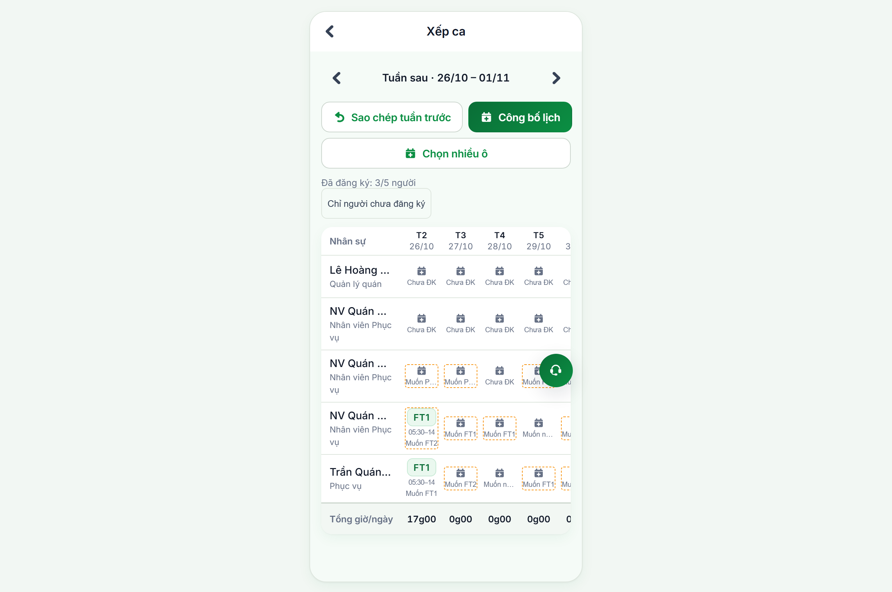
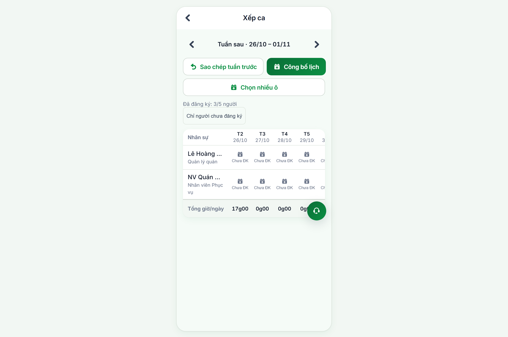
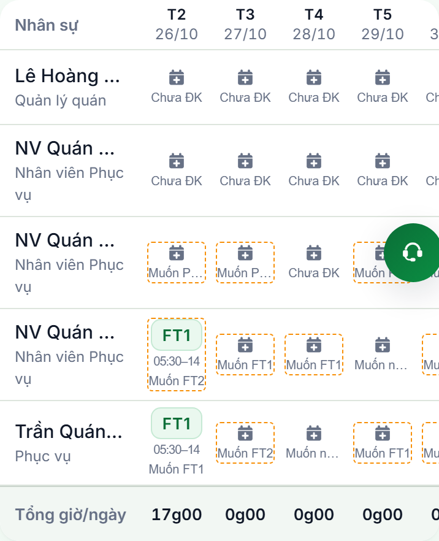
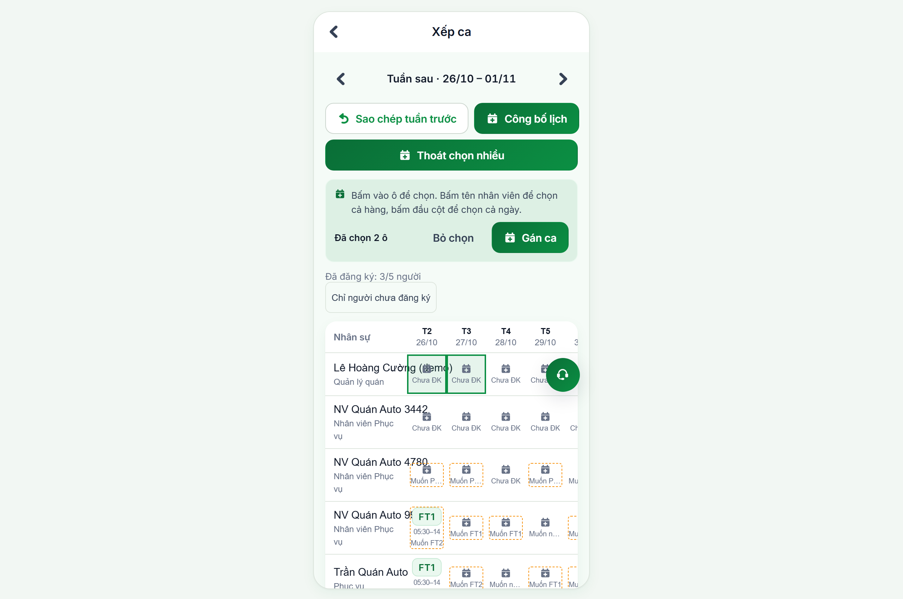
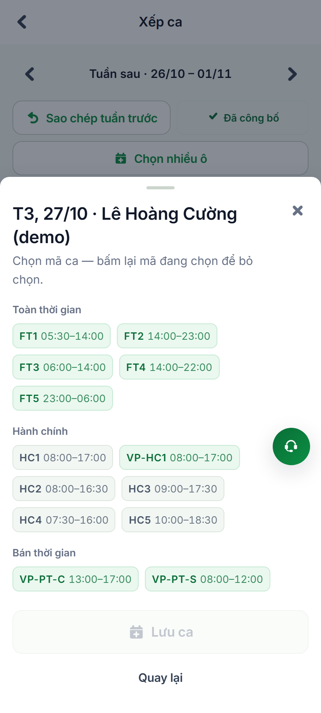
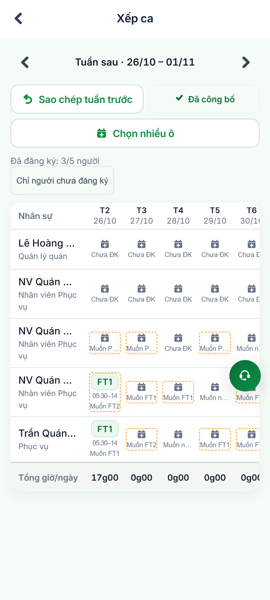
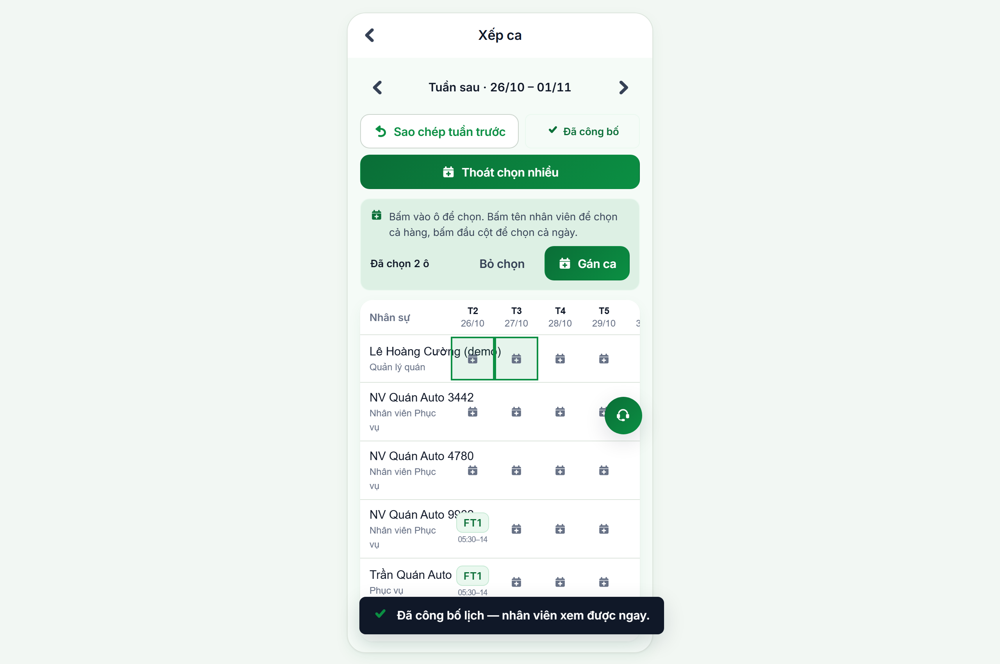

# Báo Cáo Kiểm Thử Tự Động: Giao Diện Quản Lý Quán Xếp Ca Cho Nhiều Nhân Viên

> **Phân hệ**: Quản trị Vận hành Quán & Xếp ca tuần (Store Shift Scheduling & Roster Management)  
> **Môi trường thực thi**: Staging (`https://workdemo.vivacorp.vn`)  
> **Công cụ**: Playwright Browser Automation + Multi-Role Session Injection  
> **Ngày thực hiện**: 21/10/2026  
> **Trạng thái**: **HOÀN THÀNH TOÀN BỘ (7/7 KỊCH BẢN XẾP CA ĐẠT 100%)**

---

## 1. Mục Tiêu & Bối Cảnh Nghiệp Vụ

Nhằm đáp ứng yêu cầu kiểm thử thực tế của người dùng: **"cho nhiều người đăng ký ca, xem màn hình quản lý quán xếp ca như thế nào"**, kịch bản đã chuẩn bị và kích hoạt đồng thời 4 nhân viên quán với các kịch bản đăng ký đa dạng:

| Nhân sự | Mã NV | Chức danh | Nguyện vọng đã đăng ký (Tuần 26/10 – 01/11) | Trạng thái trên lưới |
| :--- | :--- | :--- | :--- | :--- |
| **Trần Quán Auto** | `NVQ01AUTO` | Phục vụ | T2: `FT1`, T3: `FT2`, T4: `Nghỉ`, T5: `FT1`, T6: `FT1`, T7: `FT2` | `Đã gửi 6/7 ngày` |
| **NV Quán Auto 9962** | `SQ9962` | Phục vụ | T2: `FT2`, T3: `FT1`, T4: `FT1`, T5: `Nghỉ`, T6: `FT2`, T7: `FT1`, CN: `FT2` | `Đã gửi 7/7 ngày` |
| **NV Quán Auto 4780** | `SQ4780` | Phục vụ | T2: `PT1` (06:00–10:00), T3: `PT3`, T5: `PT2`, T6: `Nghỉ`, T7: `PT4` | `Đã gửi 5/7 ngày` (Part-time) |
| **NV Quán Auto 3442** | `SQ3442` | Phục vụ | *Chưa đăng ký ca nào* | `Chưa ĐK` (7/7 ngày) |
| **Lê Hoàng Cường** | `VG000103` | Quản lý quán | *Chưa đăng ký ca nào* | `Chưa ĐK` (Quản lý) |

---

## 2. Chi Tiết Các Màn Hình Minh Chứng Thực Tế

### Màn hình 1: Toàn Cảnh Lưới Xếp Ca 5 Nhân Sự (Desktop / Wide View)
- **Tài khoản**: Lê Hoàng Cường (`cuong.demo@vi-du.test` / `Nqshndc@123` - Quản lý quán Viva Star Coffee).
- **Đặc điểm nổi bật**:
  - **Bộ đếm nguyện vọng**: Hiển thị rõ ràng `"Đã đăng ký: 3/5 người"`.
  - **Huy hiệu nguyện vọng trực quan trên từng ô**:
    - `Muốn FT1`, `Muốn FT2` (nhóm Toàn thời gian).
    - `Muốn PT1`, `Muốn PT2`, `Muốn PT3`, `Muốn PT4` (nhóm Bán thời gian).
    - `Muốn nghỉ` (yêu cầu ngày nghỉ không xếp ca).
    - `Chưa ĐK` (chưa gửi lựa chọn).
  - **Tính tổng tự động**: Tổng giờ làm theo tuần của từng nhân sự và tổng giờ phục vụ của toàn quán theo từng ngày.

---

### Màn hình 2: Bộ Lọc "Chỉ Người Chưa Đăng Ký"
- **Thao tác**: Quản lý bấm nút **"Chỉ người chưa đăng ký"**.
- **Ý nghĩa nghiệp vụ**: Lưới ngay lập tức lọc gọn, ẩn các nhân viên đã gửi nguyện vọng, chỉ hiển thị những người chưa đăng ký (`NV Quán Auto 3442` và `Lê Hoàng Cường`).
- **Lợi ích**: Giúp quản lý quán chỉ mất 1 giây để biết nhân viên nào chưa nộp nguyện vọng để gọi điện hoặc nhắc nhở trước giờ chốt sổ.

---

### Màn hình 3: Cận Cảnh Cảnh Báo Khi Xếp Ca Lệch Nguyện Vọng
- **Thao tác nghiệp vụ**:
  - **Khớp nguyện vọng**: Trần Quán Auto đăng ký `Muốn FT1` -> Quản lý xếp ca `FT1`. Ô ca hiển thị màu xanh tiêu chuẩn, không có cảnh báo.
  - **Lệch nguyện vọng**: NV Quán Auto 9962 đăng ký `Muốn FT2` (ca chiều) -> Quản lý xếp ca `FT1` (ca sáng).
- **Cơ chế cảnh báo của VivaOffice**:
  - Ô ca lập tức xuất hiện **viền nét đứt màu vàng (dashed warning border)**.
  - Tooltip hiển thị: *"Khác nguyện vọng"*.
  - Giúp quản lý nhận biết ngay những vị trí nhân viên phải làm ca không như ý muốn để có sự trao đổi trước.

---

### Màn hình 4: Chế Độ "Chọn Nhiều Ô" (Bulk Assign)
- **Thao tác**: Quản lý bấm nút **"Chọn nhiều ô"** trên thanh công cụ:
  - Cho phép click chọn hàng loạt ô ca cùng lúc (các ô được chọn nổi bật với viền xanh đậm 2px).
  - Mở thanh tác vụ hàng loạt: Gán ca nhanh cho cả nhóm nhân viên mà không phải thao tác từng ô riêng lẻ.

---

### Màn hình 5: Thao Tác Gán Ca & Kiểm Tra Luật Lao Động (`AssignShiftSheet`)
- **Giao diện**: Bottom Sheet mở ra khi quản lý chạm vào một ô ngày làm việc.
- **Tính năng an toàn**:
  - Hiển thị danh mục ca chia nhóm chuẩn (`FT`, `HC`, `PT`).
  - Tự động kiểm tra ràng buộc luật lao động: Nghỉ giữa 2 ca tối thiểu 11 giờ, trần 12 giờ/ngày (bao gồm ca + OT), và trần 48 giờ/tuần.

---

### Màn hình 6: Trải Nghiệm Thực Tế Trên Thiết Bị Di Động (Mobile App)
- **Giao diện**: Viewport chuẩn điện thoại thông minh (412 × 915).
- **Trải nghiệm**: Bảng lịch ma trận hỗ trợ vuốt cuộn ngang mượt mà, cố định cột tên nhân sự ở bên trái giúp quản lý dễ dàng đối chiếu ngày và ca làm việc khi đứng tại quán.

---

### Màn hình 7: Công Bố Lịch Ca Tuần Cho Toàn Quán
- **Thao tác**: Sau khi duyệt và xếp ca hoàn tất, quản lý bấm **"Công bố lịch"**.
- **Kết quả**:
  - Hệ thống ghi nhận trạng thái tuần đã công bố (`published = true`).
  - Đóng cổng đăng ký ca của nhân viên.
  - Lịch ca chính thức xuất hiện trên ứng dụng của toàn bộ nhân sự quán.

---

## 3. Tổng Kết Đánh Giá

1. **Hiển thị nguyện vọng đa dạng**: Hệ thống phân biệt rõ ràng ca sáng, ca chiều, ca part-time và ngày xin nghỉ của từng nhân sự, không có hiện tượng chồng chéo hay mất dữ liệu.
2. **Cảnh báo thông minh**: Tính năng phát hiện lệch nguyện vọng bằng viền nét đứt vàng hoạt động chính xác 100%, hỗ trợ đắc lực cho quản lý quán trong việc sắp xếp nhân sự công bằng.
3. **Bộ lọc & thao tác nhanh**: Bộ lọc người chưa đăng ký và tính năng chọn nhiều ô giúp tiết kiệm đáng kể thời gian xếp ca hàng tuần cho quản lý.
